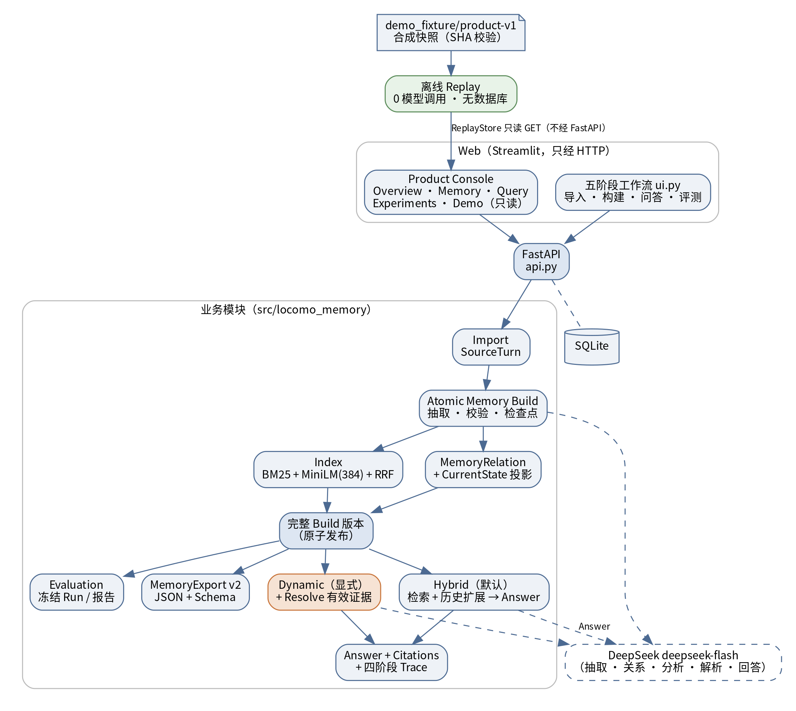
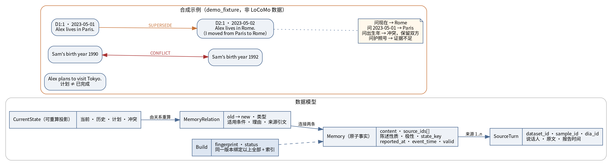
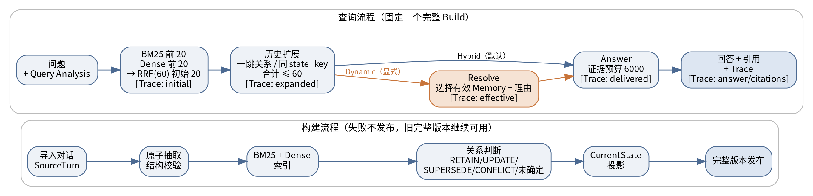
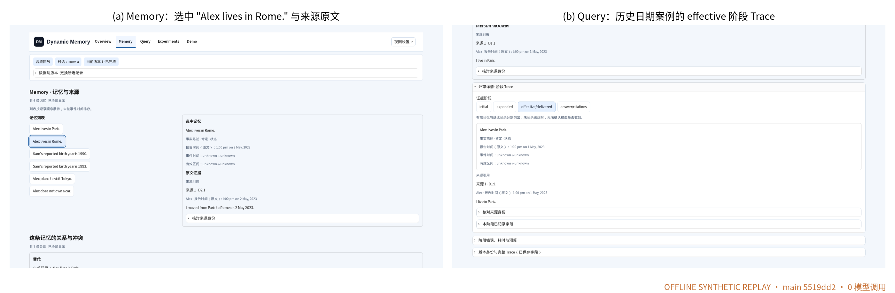
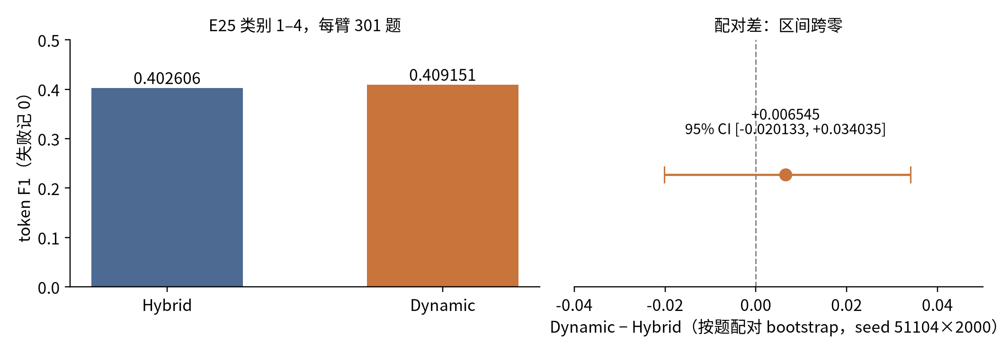
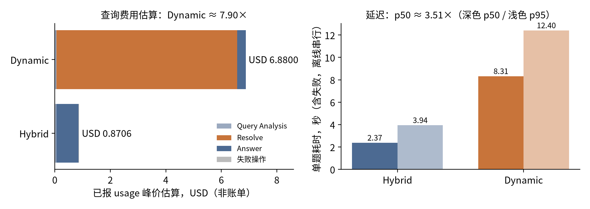
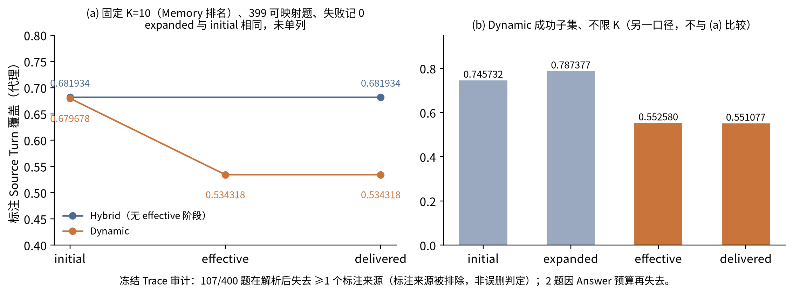

## 摘要

在长期、多次会话的对话里，一个人的住处、工作和计划会不断变化，也会出现否定和前后矛盾的说法。如果只按语义相似度去找记忆，系统很容易把已经过时的信息当成现在的答案，或者把"打算做"当成"已经做了"，而且说不清答案来自哪句话。

我们实现了一个面向长期对话的动态记忆系统。系统把原始对话拆成带来源和时间的原子记忆，在构建时记录记忆之间的替代、推进和冲突关系，并在固定的构建版本上回答问题；每个回答都带有原文引用和分阶段的检索记录（Trace）。我们还开发了 Web Console，可以从回答一路检查到原始对话。

查询端有两种策略。**Hybrid** 使用 BM25 与向量混合检索并扩展相关历史后直接回答；**Dynamic** 在此基础上再调用一次模型，先选出"对这个问题、这个时间真正有效"的记忆再回答。我们在开发期间从未查看过成绩的两段对话上做了一次独立留出实验（400 题 × 2 种策略）。事实类问题的 token F1 为 Hybrid 0.402606、Dynamic 0.409151，差值 +0.006545，95% 配对区间 [−0.020133, +0.034035] 跨过零：实验没有证明 Dynamic 有稳定的质量优势。与此同时，Dynamic 按已报 token 用量估算的查询费用约为 Hybrid 的 7.90 倍，单题中位延迟约为 3.51 倍。我们还发现，标注来源的覆盖主要在 Dynamic 的解析步骤下降。

因此，系统最终默认使用 Hybrid，Dynamic 作为可选策略保留，供后续改进和研究。

## 1 项目背景与目标

### 1.1 我们要解决的问题

长期对话难的地方往往不是"找到相关的话"，而是判断这句话**现在还算不算数**。

举一个例子：Alex 在 5 月 1 日说"I live in Paris."，5 月 2 日又说"I moved from Paris to Rome."。对于"Alex 住在哪里"这个问题，两句话和问题的语义相似度都很高。只有知道它们分别是什么时候说的、后一句替代了前一句，系统才能回答"现在住在罗马"；而当用户问"5 月 1 日住在哪里"时，又应该回答"巴黎"。

类似的情况还有很多：

- **计划与完成**："打算去东京"不等于"去过东京"；
- **否定**："没有车"是一条要保留的信息，不能被忽略；
- **矛盾**：同一个人先后说出两个不同的出生年份，系统不应擅自选一个。

### 1.2 项目目标

围绕这些问题，我们为系统定下三个目标：

1. **可追溯**：每条记忆、每个回答都能回到原始对话轮次；
2. **保留历史**：新信息不覆盖旧信息，而是记录两者之间的关系；
3. **时间明确**：区分"什么时候说的"和"什么时候发生的"，并把"现在"定义为对话中最后一次会话的时间。

在实现之后，我们还想回答三个研究问题：

- **RQ1**：在查询时增加一步"有效证据解析"（Dynamic），能否比直接回答（Hybrid）稳定地提高回答质量？
- **RQ2**：这一步带来多少额外的费用和延迟，可靠性有没有变化？
- **RQ3**：标注的正确证据在检索、扩展、解析、回答的哪个环节减少？

### 1.3 主要成果

- 一个完整、可追溯的动态记忆系统：从原始对话到原子记忆、历史关系、固定构建版本，再到带引用的回答和分阶段 Trace；
- 一个可以直接检查记忆、来源和检索过程的 Web Console，并提供不需要密钥的离线演示模式；
- 一次在独立留出数据上、事先固定配置的 Hybrid 与 Dynamic 对照实验，同时报告质量、费用、延迟和失败；
- 一套按阶段统计证据覆盖的分析方法，帮助我们找到 Dynamic 没有带来收益的可能原因；
- 完整的实验档案（E0–E25），保留了失败的实验和设计变化，详见附录 Research Supplement。

## 2 需求分析与系统概览

### 2.1 需求

在 M3 的软件需求规格（SRS）中，我们把系统的使用过程分为五个阶段：**导入对话 → 构建记忆 → 检查记忆 → 问答 → 评测**。主要用户是做实验和评审的同学与老师，他们最关心三件事：答案对不对、依据是什么、能不能复查。

因此，除了功能需求，我们还确定了三条质量要求：

- **可追溯**：任何回答都能定位到原文；
- **版本一致**：一次查询只使用同一个构建版本的数据；
- **失败可见**：失败的构建和查询要被记录下来，不能被当成"没有结果"。

表 1 是主要需求与最终实现的对应关系。

**表 1 主要需求与实现**

| 需求 | 实现方式 | 如何验证 |
|---|---|---|
| 导入 LoCoMo 格式的对话，保留会话与轮次 | 按"数据集 / 对话 / 轮次"编号保存原文 | 导入测试、跨对话隔离测试 |
| 抽取原子记忆，绑定来源与时间 | 模型抽取 + 结构校验，按片段保存进度 | 抽取与格式契约测试，失败片段保留 |
| 构建版本一致，失败不发布 | 完整构建后才整体切换版本 | 版本与恢复测试 |
| 保留历史关系与当前状态 | 关系判断 + 可重算的当前状态 | 关系与状态测试 |
| 检索相关历史 | BM25 + 本地向量 + RRF 融合，再做有界历史扩展 | 检索与扩展测试 |
| 带引用回答并记录检索过程 | 回答返回引用；每次查询保存四阶段 Trace | Trace、引用与默认策略测试 |
| 在网页上检查记忆、来源和 Trace | Product Console | 浏览器测试 + 组员真人复核 |
| 评测与报告 | 固定输入的评测运行与报告 | 评测测试与留出实验 |
| 导出记忆 | Memory JSON 导出与 JSON Schema | Schema 与导出往返测试 |

### 2.2 系统架构

系统采用前后端分离的单体结构（图 1）。Streamlit 页面只通过 FastAPI 接口访问业务功能，不直接读写数据库；后端用 SQLite 保存原文、记忆、关系、版本和查询记录。向量检索使用本地的 `all-MiniLM-L6-v2` 模型（384 维），抽取、关系判断和回答调用 DeepSeek 的 `deepseek-flash` 模型。

离线演示模式读取一份经过校验的合成数据快照，复用同一套 Console 页面，但不连接数据库，也不调用模型。

## 3 记忆模型与时间语义

### 3.1 核心数据对象

我们用五个对象来表示记忆（图 2 下）：

- **Source Turn（原始轮次）**：对话中的一句话，由"数据集、对话、轮次编号"共同确定；
- **Memory（记忆）**：一条可以单独核对的事实。它指向一个或多个原始轮次，并记录陈述性质（事实 / 计划 / 不确定）、是否为否定，以及它描述的是哪个人的哪个方面（例如某人的工作）；
- **MemoryRelation（记忆关系）**：两条记忆之间的关系，包括保留（RETAIN）、推进（UPDATE）、替代（SUPERSEDE）、冲突（CONFLICT）和"未确定"。证据不够时，我们宁可标为未确定，也不强行归类；
- **CurrentState（当前状态）**：根据历史记忆和关系计算出的当前状态。它可以随时重新计算，本身不是新的事实来源；
- **Build（构建版本）**：把同一次构建产生的原文、记忆、关系、当前状态和索引绑定在一起。

一次查询只使用一个完整的构建版本。查询过程中做出的判断只写入这次查询的 Trace，不会改动全局的关系和当前状态，因此回答结果不依赖提问的先后顺序。

### 3.2 时间语义

时间是这个项目里最容易出错的地方。我们把它分成三种：

- **报告时间**：这句话是在哪次会话、什么时候说的；
- **事件时间**：事情本身发生的时间。它可以是一个日期、一个区间，也可以是未知；像"last Friday"这样的说法，要结合会话时间去推算，不能直接把说话的时间当成事件时间；
- **已知状态截止时间**：如果用户没有指定日期，"现在"就是所选对话中最后一次会话的时间。

此外，计划不会直接变成当前状态，否定信息会被保留，被替代的旧记忆仍然可以用来回答历史问题。

图 2 上方是我们为演示编写的合成数据。巴黎与罗马两条记忆之间是替代关系：问"现在"得到罗马，问 2023-05-01 得到巴黎。Sam 的出生年份有 1990 和 1992 两种说法，系统将其标为冲突并保留双方来源；对话中从未提到护照号码，系统回答证据不足。

## 4 检索、解析与证据追溯

### 4.1 构建流程

构建按对话片段依次进行（图 3 下）：导入原文 → 抽取原子记忆并校验格式 → 建立 BM25 与向量索引 → 判断记忆关系 → 计算当前状态 → 发布完整版本。每个片段完成后保存进度，失败时只需要重试失败的片段；只要有一步没有完成，这个版本就不会发布，之前的完整版本继续可用。

### 4.2 查询流程

两种查询策略共享前半部分流程（图 3 上）：

1. 分析问题，提取人物、关键词和时间条件；分析失败时直接使用原问题；
2. BM25 和向量检索各取前 20 条，用 RRF 融合成初始的 20 条候选；
3. 沿已有关系向外扩展一层，并补充同一人物、同一方面、与问题时间相关的历史记忆，总数不超过 60 条；
4. **Hybrid** 把这些候选直接交给回答模型；**Dynamic** 先把全部候选交给解析步骤（Resolve），由模型选出有效的记忆并说明理由，再交给回答模型。

也就是说，两种策略**唯一的区别是解析这一步**。后面的实验比较的就是这一步值不值得。

### 4.3 证据追溯

每个回答都包含答案、解释、状态（证据充分 / 存在冲突 / 证据不足）和引用。每条引用指向一条记忆及其原始轮次。Trace 记录四个阶段的证据集合：初始候选、历史扩展后、有效证据与实际送达回答的集合、最终引用。查询失败时同样保存 Trace，记录错误原因、耗时和预算使用情况。

需要说明的是，引用编号正确只能说明它指向一句真实存在的原话，并不能说明这句话真的支持回答。所以在实验中，我们另外对回答与原文的对应关系做了语义审阅（第 6 节）。

## 5 Web Console 与工程质量

### 5.1 Product Console

系统的正常入口会打开 Product Console（图 4），它包含五个页面：

- **Overview**：当前数据集、对话和构建版本；
- **Memory**：记忆列表，选中一条后可以看到它的陈述性质、报告时间、事件时间、来源原文，以及它和其他记忆的关系；
- **Query**：查看已保存的问答记录，包括回答、引用原文，以及可以逐阶段切换的 Trace；
- **Experiments**：展示开发阶段的历史实验结果，成功子集和完整分母分开显示；
- **Demo**：六个合成演示案例，包括当前事实、历史日期、证据冲突、证据不足、引用异常和预算失败。

Console 本身是只读的，不会自动构建或发起新的问答；需要执行构建和真实问答时，可以切换到原有的"五阶段工作流"界面。离线演示模式不需要 API 密钥，也不会调用模型，适合课堂演示和他人复现。

### 5.2 默认策略

公开的问答接口和页面默认使用 Hybrid，用户需要显式选择才会使用 Dynamic。Graph 两跳检索、压缩、自适应路由等扩展功能都不在默认路径中。如果需要回退，只需撤销整合提交，或者直接运行原来的界面，不涉及数据库迁移。

### 5.3 测试与质量保证

- 主分支的持续集成检查全部通过；
- Product 基准在干净环境中重新运行了离线测试，**1,018 项全部通过**；Sidecar 合入 main 后，另行运行的专项离线测试 **183 项全部通过**（有 1 条依赖弃用 warning）。需要真实模型、本地向量模型缓存或受限原始数据的测试不在这些离线运行中，不计入通过数；
- Console 由作者以外的组员在本机实际操作复核，整合后又完成了六个演示案例、30 种布局和 11 种滚动场景的浏览器测试；
- 六段真实对话的记忆导出共 2,031 条记忆、37,445 条关系，全部通过 Schema、来源、时间和版本一致性检查。这说明导出完整一致，但不代表每条关系在语义上都正确。

## 6 实验设计

### 6.1 数据划分

我们使用 LoCoMo 数据集中的 10 段长对话。按照课程说明，conv-26、conv-30、conv-41、conv-42 作为开发集；在开发开始前，我们选定 conv-43 和 conv-44 作为本地留出集，开发期间不查看它们的成绩。留出集是团队自己的选择，不代表老师最终使用的隐藏评分集。

### 6.2 从开发实验到最终对照

开发阶段我们做了多轮实验（表 2），它们帮助我们发现问题、改进系统。由于样本、配置和模型设置都不相同，这些实验之间不能直接比较分数。本报告的最终结论只来自 E25。

**表 2 主要实验及其作用**

| 实验 | 数据 | 作用 |
|---|---|---|
| E12 | 开发集，757 题，四种策略 | 第一次全量对比；发现只看成功题目会高估 Dynamic，此后坚持完整分母 |
| E22 / E23 | 开发集中同一组 100 题 | 发现并解决 Dynamic 的输入超限问题，确定最终配置 |
| **E25** | **留出集，400 题，Hybrid / Dynamic** | **最终对照实验** |

### 6.3 E25 的做法

为了让最终结果可信，我们在 E25 中坚持三条原则：

1. **先固定，后评分**：在看到任何留出题目的答案之前固定所有配置，并请没有参与实现的成员复核；之后不根据结果调整任何参数；
2. **每道题只跑一次**：两种策略对 400 道题各运行一次，失败的题记 0 分，不补跑、不删除；
3. **检查完整后再评分**：所有生成结果保存并确认完整之后，才读取标准答案评分。

### 6.4 指标

- **事实类问题（类别 1–4，每种策略 301 题）**：使用 LoCoMo 官方的 token F1，失败记 0；
- **对抗类问题（类别 5，99 题）**：使用官方的拒答规则，单独报告；
- **显著性**：逐题计算两种策略的分差，用按题重采样的 bootstrap 求 95% 区间。它反映的是这两段对话内部的题目波动，不能推广到其他对话；
- **来源覆盖**：标注的原始轮次中，有多少被前 K 条记忆覆盖。它衡量证据有没有被保留，不等于回答是否正确；
- **来源审阅**：由三名未参与生成的 AI 审阅者分批盲审全部 800 个回答，判断原文和引用是否支持回答。它是辅助参考，不等于人工标注；
- **费用**：根据每次请求报告的 token 用量，按当时官方价格中的较高档位估算，不是实际账单。

具体配置与可追溯信息见附录 A。

## 7 实验结果

### 7.1 回答质量（RQ1）

**表 3 E25 主要结果**（conv-43 / conv-44，失败记 0）

| 指标 | Hybrid | Dynamic | 差异 |
|---|---:|---:|---:|
| 事实类 token F1（每种 301 题） | 0.402606 | 0.409151 | +0.006545，95% 区间 [−0.020133, +0.034035] |
| 逐题变化 | — | — | 60 题提高、56 题降低、185 题不变 |
| 对抗类拒答得分（每种 99 题） | 0.858586 | 0.808081 | −0.050505 |
| 成功完成的题目（共 400） | 394（98.50%） | 389（97.25%） | — |
| 估算查询费用（美元） | 0.87 | 6.88 | 约 7.90 倍 |
| 单题耗时中位数 / 95 分位（秒） | 2.37 / 3.94 | 8.31 / 12.40 | 中位数约 3.51 倍 |

Dynamic 的 F1 点估计比 Hybrid 高 0.006545，但 95% 区间跨过零，提高和降低的题目数量也很接近（60 对 56）。**在这次实验的设定下，我们没有足够证据说明 Dynamic 有稳定的质量优势。** 这并不等于说 Dynamic 没有用：样本只有两段对话，点估计也是正的。

在对抗类问题上，Dynamic 的拒答得分低 0.050505，说明经过解析后，回答模型略少使用标准的拒答表述。来源审阅的结果方向一致：在双方都成功且可以判断的 297 对回答中，Dynamic 的"原文支持"比例高 0.033670，但区间同样跨零。

### 7.2 费用、延迟与可靠性（RQ2）

Dynamic 的估算查询费用为 6.88 美元，Hybrid 为 0.87 美元，约 7.90 倍。其中约 95% 来自解析这一步：解析需要把最多 60 条候选记忆全部交给模型判断，按成功题目平均，Dynamic 每题已报输入 token 约 51,849，Hybrid 约 6,604。2,112 次请求中有 18 次没有返回用量，我们单独列出它们的预估费用（约 0.95 美元），没有按 0 处理。

耗时方面，Dynamic 的单题中位数为 8.31 秒，Hybrid 为 2.37 秒，其中解析一步的中位数约 6.06 秒。这些数据来自一台工作站上的串行运行，不代表生产环境的吞吐量。

两种策略分别成功完成 394 和 389 道题。17 次失败中，8 次是模型输出格式不合格，9 次是实验后期供应商账户余额不足（HTTP 402）。因此成功率的差异有一部分来自运行环境，不能全部归因于方法本身。所有失败都按 0 分计入，没有补跑。

### 7.3 结果对设计决策的意义

把三方面放在一起看：质量上看不出稳定差异，费用和延迟却高出数倍。对一个需要长期、频繁使用的记忆系统来说，默认使用 Hybrid 更合理；Dynamic 保留为可选策略，方便在改进后继续研究。

## 8 证据保留情况（RQ3）

为了理解 Dynamic 为什么没有带来明显收益，我们按阶段统计了标注来源的覆盖情况。

图 7(a) 使用与主实验相同的统计方式：只看排名前 10 的记忆，覆盖 399 道可以映射来源的题目，失败记 0。Hybrid 从初始检索到最终回答都保持在 0.68 左右；Dynamic 在初始检索时同样约为 0.68，经过解析后降到 0.53，之后不再变化。历史扩展在这个统计方式下与初始检索完全相同，因为扩展进来的记忆排在初始 20 条之后，不影响前 10 名。

图 7(b) 换了一种统计方式：只看 Dynamic 成功的 389 道题、不限制排名。可以看到历史扩展确实把覆盖从 0.75 提高到 0.79，而解析之后降到 0.55。两张图的统计方式不同，不能连成一条曲线比较。

逐题检查 Dynamic 的 400 条查询记录，我们观察到：

- 所有题目的解析输入都没有超出预算，候选没有因为截断而丢失；
- **107 道题**在解析之后，至少有一个标注来源不在有效证据中；
- 只有 **2 道题**是在回答阶段因为篇幅限制再丢掉了标注来源。

也就是说，标注来源的减少主要发生在解析这一步，单纯加大回答预算解决不了这个问题。我们还做了一个回放：把候选数量从 10 增加到 60，候选阶段的覆盖从 0.69 提高到 0.78，而最终送达回答的覆盖只从 0.48 提高到 0.54。

**需要强调的是，107 道题并不意味着 107 次错误删除。** 标注来源是数据集标注者认为相关的原话，不一定是回答问题必需的证据。例如有一道题问的是 Tim，标注来源却在讲 John，这时解析步骤把它排除可能是对的。我们整理了 20 个典型案例供进一步人工核查。目前能确定的是证据在哪个环节减少；被排除的证据中有多少本应保留，还需要逐题判断。

## 9 研究过程与未采用的扩展

### 9.1 研究过程中的几个转折

回顾整个开发过程，有三个转折影响了最终设计：

- **E12 让我们开始坚持完整分母。** 在 757 道开发题上，如果只看双方都成功的题目，Dynamic 平均高 0.026；但 Dynamic 有 48 次失败，把失败记为 0 后，它反而略低于 Hybrid（0.515 对 0.522）。此后所有实验都按完整分母报告。
- **E22 到 E23 解决了 Dynamic 的输入超限问题。** E22 中 Dynamic 有 49 次因输入过长失败；E23 同时放宽了输入上限并调整了解析设置，问题得到解决。由于几处配置同时改变，我们没有把改进归功于其中任何一项。E25 沿用了 E23 的配置。
- **E25 之后的改进只算回归测试。** 根据证据保留分析，我们修复了时间区间的解析问题，并在 12 道已经公开过成绩的题目上做了一次小规模真实测试，F1 从 0.517 变为 0.456，但区间很宽，看不出整体变化。由于这些题目已经公开过，这次测试只作为回归检查，E25 的结论保持不变。

### 9.2 尝试过但没有采用的扩展

我们还实现并测试了几个扩展方向。它们都没有显示出对问答的收益，因此默认关闭，代码保留以便复查：

| 扩展 | 想解决的问题 | 结果 |
|---|---|---|
| Graph 两跳检索 | 需要跨两步关系才能找到的证据 | 候选覆盖略有提高，最终回答的证据覆盖没有变化 |
| 记忆压缩 | 降低输入 token | 节省比例可以忽略 |
| 自适应路由 | 按问题类型选择检索方式 | 证据覆盖反而下降 |
| 时间软优先 | 优先使用时间匹配的记忆 | 没有整体收益 |
| 时间 / 事件 Sidecar | 用规则补充事件时间和状态判断 | 已合入 main，作为默认关闭、显式 opt-in 的独立离线诊断；不进入生产问答路径，真实 QA 收益尚未验证 |

各方向的具体数据见附录 Research Supplement。

## 10 总结与展望

### 10.1 项目成果

我们完成了一个从原始对话到原子记忆、历史关系、固定版本，再到带引用回答的动态记忆系统，并通过 Web Console 让每一步都可以被检查。系统有完整的测试，主分支离线测试 1,018 项全部通过，Console 经过组员真人复核。

在研究上，我们用一次事先固定配置的独立实验检验了自己的核心设计：

- **RQ1**：Dynamic 的点估计略高，但区间跨零，实验没有证明它有稳定的质量优势；
- **RQ2**：Dynamic 的估算费用约为 7.90 倍，中位延迟约为 3.51 倍，额外开销几乎都来自解析步骤；
- **RQ3**：标注来源的减少主要发生在解析步骤，但其中有多少属于错误排除还没有判断。

据此，我们选择 **Hybrid 作为默认策略，Dynamic 作为可选策略**。

这个结果和我们最初的设想不同。我们认为它同样有价值：一个看起来合理的设计，在独立数据上没有显示出稳定收益，同时付出了明显的成本。把这件事如实记录下来，比报告一个只在开发集上成立的提升更有意义。

### 10.2 局限

- 留出集只有两段对话，结论不能推广到其他对话，也不代表老师的隐藏评分集；
- 留出结果已经公开，此后的修改只能用回归测试检查；
- 没有人工标注的动态关系数据，关系判断的准确率还没有测量；来源审阅由 AI 完成，每个回答只有一名审阅者；
- 费用是估算值；模型服务名称不代表固定的模型权重；
- 目前只支持英文检索。

### 10.3 下一步：值得继续研究的方向

如果继续投入时间，我们更希望围绕明确的问题做可比较的实验，而不是简单增加模块。结合现有数据模型、检索流程和实验结果，下面四个方向最值得优先考虑。

**方向 A：双时间语义的动态记忆（优先级最高）**

研究如何区分事实发生时间与系统获知时间，并正确回答不同 as-of 语义的问题。现有的 `session_time`、`event_start`、`valid_from`、`valid_to` 和 Source Turn 已经提供基础。下一步可以先用冻结案例验证时间语义，再设计严格的双时间查询接口。相比只限制某个时间点可见哪些记忆，这个方向进一步回答了查询中的“当时”究竟指什么。

**方向 B：证据充足度驱动的自适应检索**

研究系统能否判断当前候选是否已经包含回答所需的人物、时间、事件和关系证据；若不足，再沿有依据的关系补检，而不是无条件扩大 Top-K。核心假设是：在相同证据 Token 预算下，针对缺失证据进行补充，能否比固定 Top-K 获得更好的证据覆盖和回答质量。此前 Adaptive、Graph 和 Trace 的负面结果应保留为基线。

**方向 C：基于可证明关系的 Graph Memory**

研究如何表达并检索有来源支持的事件路径，例如“邀请 → 参加宴会 → 先遇到 A → 后与 B 交谈 → 查询 B 的名字”。当前图结构已有 Entity、Memory、Source Turn 和 MemoryRelation，但对事件参与者、事件顺序和因果关系的表达仍不完整。可参考 A-Mem 的动态链接与记忆组织思路；评价重点应是路径是否有证据支持、是否改善答案，而不是边的数量。

**方向 D：更有挑战性的 Benchmark**

LoCoMo 继续作为课程基线，但不应成为所有结论的唯一依据。LongMemEval 可用于补充跨会话、时间推理、知识更新和拒答评测；MemoryAgentBench 可用于观察增量交互、长程理解和选择性遗忘；2026 年提出的 LOCOMO-CONV 则可检验隐式、组合和反事实等对话式查询。这些基准更适合后续独立研究，不建议在最终交付前临时替换当前数据集。

以上方向都可以从现有系统出发，先定义可证伪的问题、固定比较条件和评价指标，再决定是否扩展实现。

## 团队分工

M1–M4 的职责按团队工作流文档分配；M5 的职责依据各成员的提交、PR、Issue 和实际交付物整理。表中不估算贡献比例。

| 成员 | GitHub | M1–M4 主要职责 | M5 主要工作 |
|---|---|---|---|
| 莫远序（组长） | kenqia | 项目管理、整体设计、接口定义、动态状态判断与集成 | 技术方向、核心系统开发与集成、实验设计与执行（E0–E25）、结果分析、最终交付协调 |
| 黎志丽 | Thorns-06 | 对话导入、记忆构建、JSON 导出 | Product Console 主要开发：界面、记忆与来源查看、Query Trace、实验报告展示、离线演示、响应式布局和浏览器测试（PR #39，选择性整合进 PR #41） |
| 卓新烨 | xiaozhuozi39 | 检索、证据追踪、对照实验 | 时间 / 事件 Sidecar 研究扩展：数据结构、规则实现、测试案例、离线验证与技术文档（PR #38；后续 PR #42 已合入 main，采用默认关闭、显式 opt-in 的独立离线诊断）；作为非作者对 Product Console 进行了试用和复核 |
| 田亦洁 | VanadisssSSS | Web 交互、证据展示、端到端验收 | M5 前期汇报、技术报告初稿和演示素材（11 月 8 日版 PPT、报告与旁白视频）；负责最终 Console 操作演示视频的录制与制作 |

项目开发中使用了 AI 编程与写作助手，参与代码实现、实验执行、数据核对和文稿初稿。AI 的检查结果与组员复核分开记录，所有提交和最终结论由组员确认。

## 复现方式

- 代码：https://github.com/kenqia/locomo-dynamic-memory（主分支 `5519dd2`）
- 安装：`uv sync --locked --python 3.12`
- 离线演示（不需要密钥）：`uv run --locked python tools/team_v2/demo.py replay`，浏览器打开 `http://127.0.0.1:18501`
- 本报告的实验图由仓库中的冻结结果文件直接生成，生成脚本与校验信息随交付包提供
- 数据说明：LoCoMo 原始对话的许可为 CC-BY-NC-4.0。交付包不包含原始对话、标准答案和真实记忆导出原件，只提供 Schema、清单和合成演示数据

## 参考文献

1. Maharana, A., Lee, D.-H., Tulyakov, S., Bansal, M., Barbieri, F., & Fang, Y. (2024). Evaluating Very Long-Term Conversational Memory of LLM Agents. *ACL 2024*.
2. Robertson, S., & Zaragoza, H. (2009). The Probabilistic Relevance Framework: BM25 and Beyond. *Foundations and Trends in Information Retrieval*.
3. Cormack, G. V., Clarke, C. L. A., & Büttcher, S. (2009). Reciprocal Rank Fusion Outperforms Condorcet and Individual Rank Learning Methods. *SIGIR 2009*.
4. Reimers, N., & Gurevych, I. (2019). Sentence-BERT: Sentence Embeddings using Siamese BERT-Networks. *EMNLP 2019*.
5. Efron, B., & Tibshirani, R. J. (1993). *An Introduction to the Bootstrap*. Chapman & Hall.
6. DeepSeek API 文档：模型、价格与 JSON 输出说明（2026 年 10–11 月访问）。
7. Xu, W., Liang, Z., Mei, K., Gao, H., Tan, J., & Zhang, Y. (2025). A-Mem: Agentic Memory for LLM Agents. *NeurIPS 2025*. https://proceedings.neurips.cc/paper_files/paper/2025/hash/19909c36f51abc4856b4560aff3d36d6-Abstract-Conference.html
8. Wu, D., Wang, H., Yu, W., Zhang, Y., Chang, K.-W., & Yu, D. (2025). LongMemEval: Benchmarking Chat Assistants on Long-Term Interactive Memory. *ICLR 2025*. https://proceedings.iclr.cc/paper_files/paper/2025/hash/d813d324dbf0598bbdc9c8e79740ed01-Abstract-Conference.html
9. Hu, Y., Wang, Y., & McAuley, J. (2025). Evaluating Memory in LLM Agents via Incremental Multi-Turn Interactions (MemoryAgentBench). *arXiv:2507.05257*. https://arxiv.org/abs/2507.05257
10. Chang, W.-Y., & Chen, Y.-N. (2026). When Users Don't Ask: Benchmarking Context-Driven Memory Retrieval in Conversational Agents (LOCOMO-CONV). *arXiv:2609.03467*. https://arxiv.org/abs/2609.03467

## 附录 A 实验配置与可追溯信息

本附录保留正文中省略的技术细节，供复查使用。

- **E25 配置**：模型 `deepseek-flash`（服务别名，执行前官方映射为 Flash-1017）；所有新生成步骤关闭思考模式；单次请求输入上限 640,000 字节，解析输入上限 192,000 代理 token，输出上限 32,768 token；模型重试 2 次，网络重试 0 次；所有扩展功能关闭。
- **检索参数**：BM25 与向量各取 20 条，RRF 参数 60，初始 20 条，扩展后上限 60 条，回答证据预算 6,000 token。
- **统计方法**：逐题配对 bootstrap，随机种子 51104，重采样 2,000 次。
- **结果身份**：实现提交 `0dbd98e`；生成结果冻结哈希 `3cab5d1b…89664a6`。生成完成后，先由检查代理和一名未参与实现的独立检查者分别确认结果完整，之后才读取标准答案。
- **主要结果文件**：`experiments/m5-development/level-e-results-v1/official-scores.json`（逐题分数与配对差）、`level-e-runtime-terminal-v1.json`（请求、用量、耗时与失败）、`experiments/evidence-flow-20261109/audit.json`（证据保留审计与 20 个案例）。
- **费用口径**：按每次请求报告的用量，以执行当时官方价格全部按未命中缓存计算，为上界估算；18 次缺少用量的请求按完整预约额单列（0.9522705 美元）。账户实际账单未读取。
- **数字台账**：报告中所有数字与其来源字段、统计口径的对应关系见 `deliverables/m5-final/gate1/METRIC_LEDGER.md`。E12 的完整分母分数由归档的聚合字段推导核对，未逐题重算。
- **测试**：主分支 `5519dd2` 的 GitHub Actions 检查（run 42582449214）通过；离线回归 1,018 项通过，用时 913.9 秒。

## 附录 B Research Supplement

39 页的 Research Supplement（`docs/supplement/supplement.pdf`）完整记录了 E0–E25 全部实验，包括失败实验、分母、配置、费用与研究演进图，并附勘误说明（`docs/release/SUPPLEMENT_ERRATA.md`）。正文中省略的各扩展方向数据、按类别与按对话的拆分结果、K 前缀回放和 20 个证据保留案例均可在其中或对应实验目录中找到。
