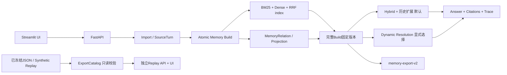

# 系统架构与数据边界

默认系统沿用单体后端：Streamlit → FastAPI → SQLite/本地MiniLM/可选DeepSeek。研究工具不自动接入应用。

构建写入片段检查点；失败不发布。查询固定一个完整Build，不混新旧索引/关系/投影。Source ID由dataset/sample/dia组成，Memory多来源可追溯。时间分别保留session报告日、原始表达、推导事件区间；计划不是完成事实，历史不因替代被删除。

Hybrid：查询分析→BM25+Dense各20→RRF60→初始20→原一跳/同状态历史扩展总上限60→Answer预算6000。Dynamic额外执行完整输入校验/有效解析；查询中补判只入Trace，不改全局CurrentState。具体参数以Settings/Trace快照为准。

Bonus为既有独立模块：m5_graph提供有界来源图和显式两跳；m5_compression全字段可逆分组；m5_adaptive提供路由/时间软优先。这些研究模块均不被默认QA adapter调用。

只读ExportCatalog消费同一MemoryExport契约，校验SHA、Build/对话、Memory/Source/关系/Projection/Index、时间锚定和typed roundtrip。独立factory没有Database/lifespan恢复或模型对象。正常API挂载/replay显式固定Synthetic，不受外部受控Catalog环境变量影响。

API/数据模型见docs/app和memory-export-schema.json。生产默认变更/回滚见DEFAULTS_AND_ROLLBACK。受控导出不包含检索向量或完整原对话，足以只读浏览，不能声称它独立恢复全部Dense索引；重新建索引需合法完整来源与缓存模型，另行操作。
