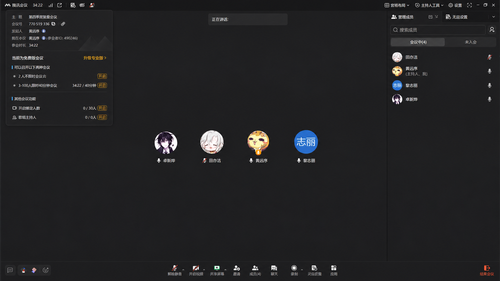

# 2026 年 11 月 3 日晚团队会议记录

团队：在阴雨天游泳，Team ID 3。项目：动态对话记忆管理。

| 项目 | 记录 |
| --- | --- |
| 会议时间 | 北京时间 2026-11-03 晚；日期与时段依据本次归档说明 |
| 形式 | 腾讯会议 |
| 参会成员 | 莫远序、黎志丽、卓新烨、田亦洁；截图显示四人入会 |
| 召开依据 | 按团队会议约定召开，依据团队本次说明登记 |
| 截图时已进行时长 | 34 分 22 秒；不是整场会议的最终时长 |
| 归档日期 | 2026-11-09 |

## 原始截图

原图按团队提供的附件原样保存。会议日期与晚间时段来自归档时的确认，截图本身未显示日期。参会成员姓名沿用仓库既有团队登记，截图中的显示名可能不同。

本次收到的材料为参会截图，未附讨论摘要。具体起止时间、讨论内容、决定和行动项尚未登记。
