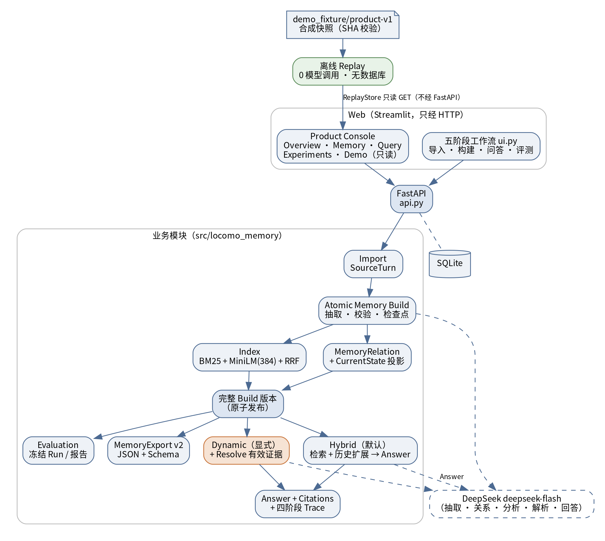
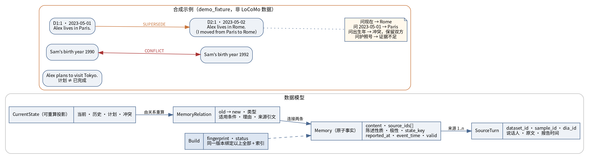
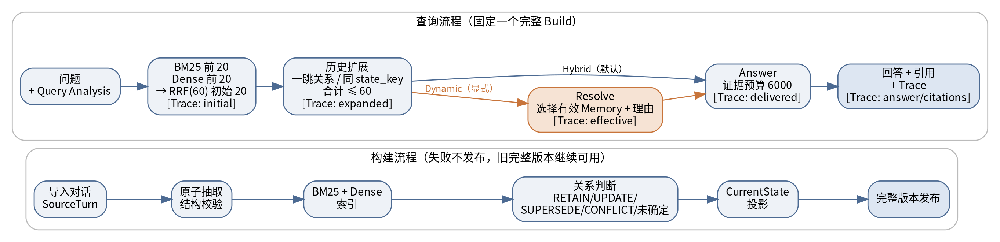
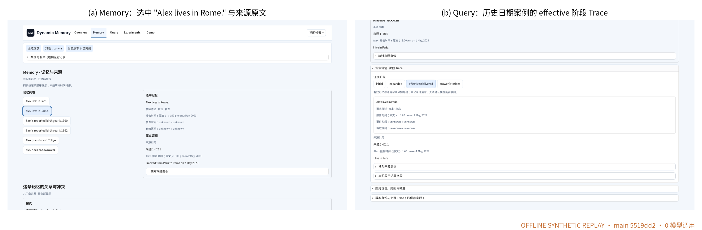
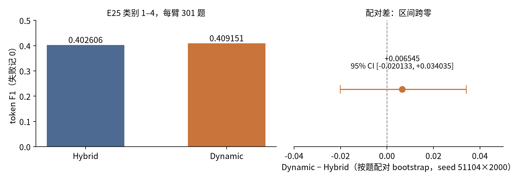
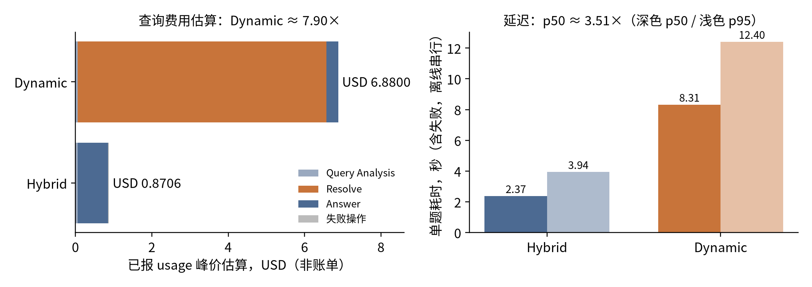
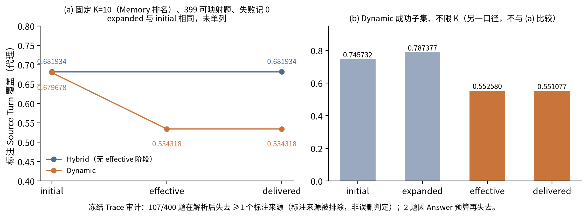

<!-- 数字均来自 deliverables/m5-final/gate1/METRIC_LEDGER.md；方括号 [M..] 为台账 ID，排版时可隐藏。 -->

## 摘要

长期、多会话对话中，同一人物的居住地、工作、计划和自述会随时间变化，也会出现否定和互相矛盾的陈述。仅按语义相似度检索记忆，容易把已过时的事实用于当前问题，或把计划当成已经发生的事件，回答也难以回指原文。本项目实现了一套动态记忆管理与证据问答系统：把原始对话拆成带来源轮次（Source Turn）和时间语义的原子记忆（Memory），在构建期保留记忆之间的替代、推进与冲突关系（MemoryRelation），以固定的完整构建版本（Build）回答问题，并返回引用和分阶段 Trace。查询端提供两种策略：Hybrid（BM25 + Dense + RRF 检索、有界历史扩展后直接回答）与 Dynamic（在 Hybrid 候选上增加一次有效证据解析）。

我们在预先锁定配置、生成结果冻结后才读取标准答案的独立留出实验 E25（conv-43/44，400 题 × 2 策略）中比较两种策略。事实类问题（类别 1–4，每臂 301 题，失败记 0）的 token F1 为 Hybrid 0.402606、Dynamic 0.409151，配对差 +0.006545，按题配对 bootstrap 95% 区间 [−0.020133, +0.034035] 跨零 [M01–M02]。本实验未能提供充分证据证明 Dynamic 相对 Hybrid 具有稳定的回答质量优势。同时，Dynamic 的已报 usage 峰价估算费用约为 Hybrid 的 7.90 倍，单题中位延迟约 3.51 倍 [M07, M09]；冻结 Trace 显示，标注来源覆盖的主要下降发生在解析步骤 [M21, M23]。据此，系统公共入口默认采用 Hybrid，Dynamic 作为显式选项保留。

## 1 引言

### 1.1 问题

长期对话的困难不在于"找到相关内容"，而在于判断相关内容**此时是否仍然有效**。例如一个人先说"我住在巴黎"，几周后说"我从巴黎搬到了罗马"。对问题"他住在哪"，两条记录在语义上都高度相关；只有结合陈述时间和两条记录之间的替代关系，才能回答"现在住在罗马"，同时在问到某个更早日期时仍回答"巴黎"。类似的情况还有计划与完成（"打算去东京"不等于"去过东京"）、否定（"没有车"）以及无法消解的矛盾自述。

由此产生三个设计要求：第一，记忆必须保留来源轮次，回答才能回查原文；第二，新信息不能直接覆盖旧信息，历史要保留，并显式记录两者关系；第三，"现在"需要定义为所选对话最后一次会话的已知状态，而不是现实中的当下。

### 1.2 研究问题

- **RQ1 回答质量**：在独立留出对话上，Dynamic 有效证据解析是否比 Hybrid 检索稳定地提高长期对话问答质量？
- **RQ2 效率与可靠性**：Dynamic 带来多少 token 费用、延迟和技术成功率的变化？
- **RQ3 证据保留**：标注证据在检索、扩展、解析和交付的哪个阶段被遗漏或排除？

### 1.3 贡献

1. **可追溯的动态记忆系统（已实现并验收）**：从 Source Turn 到原子 Memory、MemoryRelation、CurrentState 投影、固定完整 Build，再到带引用回答和四阶段 Trace；包括 Product Console 和无需密钥的离线回放。
2. **预先锁定的独立留出对照（实验验证）**：400 题 × 2 策略，完整分母、失败保留，在同一实验中同时报告质量、费用、延迟和可靠性。
3. **阶段化证据损失审计（研究方法与诊断）**：把标注来源覆盖按阶段分列，用冻结 Trace 定位覆盖下降的阶段。哪些被排除的证据属于错误排除，尚未完成语义验证。
4. **研究可信度工程（过程资产）**：E0–E25 实验档案、生成冻结哈希、非作者终态审计、数值独立重算与勘误保留。

此外，Graph 两跳检索、可逆压缩、自适应路由、时间软优先和时间/事件 Sidecar 已完成探索性实现与评估，目前没有得到问答收益证据（第 9 节）。它们作为**探索性研究与负面结果**报告，与上述四项不属于同一成熟度。

## 2 需求与系统概览

### 2.1 需求到实现

项目的软件需求规格（SRS，`docs/requirements/software-requirements-specification.md`）围绕"导入—构建—检查—问答—评测"五个阶段定义功能需求，并把可追溯性、版本一致性和失败可见性列为质量属性。表 1 给出主要需求与最终实现、验证证据的对应关系。

**表 1 主要需求、实现与验证**

| 需求 | 实现（`src/locomo_memory/`） | 验证 |
|---|---|---|
| 导入 LoCoMo 格式对话，保留会话与轮次身份 | `imports.py`、`schemas.py`；`/imports` | `test_imports`；跨对话隔离 |
| 抽取原子 Memory，绑定来源与时间 | `builds.py`、`memory_schemas.py` | 抽取 / 契约测试；失败片段保留 |
| 构建版本一致、失败不发布 | `versions.py`、`build_progress` | 版本 / 恢复测试 |
| 保留历史关系与当前状态 | `relations.py`、`projection.py` | 关系 / 投影测试 |
| 检索相关历史 | `retrieval.py`（BM25 + MiniLM + RRF）、`expansion.py` | 检索 / 扩展测试 |
| 问答带引用与 Trace | `queries.py`、`release_queries.py` | Trace / 引用 / 默认策略测试 |
| 可视化检查 Memory、来源与 Trace | `console_ui.py`、`evidence_ui.py` | PR #41 专项与浏览器检查；作者外真人复核 |
| 冻结评测与报告 | `evaluation*.py` | 评测 / 报告测试；E25 |
| 导出 Memory JSON | `exports.py`、`memory-export-schema.json` | Schema / 往返 / 六份真实导出 SHA |

### 2.2 架构

系统采用单体后端（图 1）：Streamlit 页面只通过 FastAPI 访问业务功能，后端使用 SQLite 保存来源、Memory、关系、版本和 Trace；Dense 检索使用本地固定版本的 `sentence-transformers/all-MiniLM-L6-v2`（384 维），生成与解析调用 DeepSeek 官方接口的 `deepseek-flash`（服务别名，不是固定权重）。离线回放使用独立的只读数据通道，读取经哈希校验的合成快照，不连接数据库，也不调用模型。

## 3 记忆模型与时间语义

### 3.1 数据对象

- **SourceTurn**：原始对话中的一轮，身份为 `(dataset_id, sample_id, dia_id)`。`dia_id` 只在对话内唯一，不作全局主键。
- **Memory**：一条可独立核查的原子事实，带一个或多个来源、陈述性质（事实 / 计划或意愿 / 不确定）、极性（肯定 / 否定）和状态维度 `state_key`（对话 + 实体 + 维度，例如 `conv-30:Gina:employment`，不含具体取值）。
- **MemoryRelation**：两条 Memory 之间有来源支持的关系，取值 RETAIN、UPDATE、SUPERSEDE、CONFLICT 或"未确定"。证据不足时允许保持未确定，不强行归类。
- **CurrentState**：由历史 Memory 和已确认关系**重算得到的投影**，不是另一份事实来源；它可能包含未消解的冲突。
- **Build**：一次构建对应的来源、Memory、关系、投影和索引的共同版本。查询固定在一个完整 Build 上，不混用新旧数据；失败或未完成的 Build 只能检查，不能问答。

查询期解析出的有效证据只写入本次 Trace，不改写全局关系或 CurrentState，因此结果不依赖提问顺序。

### 3.2 时间语义

系统区分三种时间：

- **报告时间（reported_at / session time）**：这句话在哪次会话、什么时候被说出；
- **事件时间（event_time）**：事情本身发生的时间，可以是日期、区间或未知，由原始表达加会话锚点推导，不把会话时刻直接当作事件时刻，也不把"last Friday"之类的模糊表达强制精确化；
- **已知状态截止时间**：未指定日期时，"现在"指所选对话最后一次会话的时间。

计划不直接进入当前状态；否定信息保留；SUPERSEDE 只替代当前取值，被替代的旧 Memory 仍可回答历史问题。

图 2 右侧是项目原创的合成示例：Alex 在 2023-05-01 说"I live in Paris."，次日说"I moved from Paris to Rome on 2 May 2023."。系统建立 SUPERSEDE 关系：问"现在住在哪"得到 Rome，指定 2023-05-01 得到 Paris。同一快照中，Sam 的出生年份有 1990 和 1992 两种说法，被保留为 CONFLICT；问护照号码则返回证据不足。

## 4 检索、解析与证据追溯

### 4.1 构建流程

构建按片段执行（图 3 上）：导入 → 原子抽取与结构校验 → BM25 与 Dense 索引 → 关系判断 → CurrentState 投影 → 完整版本发布。每个片段保存检查点，重试只补做失败片段；任何阶段失败，版本都不发布，旧的完整版本继续可用。

### 4.2 查询流程

查询流程（图 3 下）对两种策略共享前半段：

1. Query Analysis 提取实体、关键词和时间条件；分析失败时回退到原问题，原问题始终参与检索。
2. BM25 与 Dense 各取前 20，经 RRF（k=60）融合为初始 20 条。
3. 有界历史扩展：沿已有关系扩展一跳，并补充同一 `state_key` 下与问题时间相关的历史，初始与扩展合计不超过 60 条。
4. **Hybrid**：直接把扩展后的候选按回答预算交给 Answer。**Dynamic**：先把全部候选交给 Resolve，模型选出对该问题有效的 Memory 并说明理由，再把有效集合交给 Answer。

两种策略的唯一区别是 Resolve 这一步。这也是 RQ1–RQ3 所比较的对象。

### 4.3 证据追溯

回答返回 `answer`、`explanation`、`status`（sufficient / conflict / insufficient）和引用；每条引用指向 Memory 及其 Source Turn。Trace 分别保存四个阶段：**initial**（初始候选）、**expanded**（历史扩展后）、**effective/delivered**（Dynamic 的有效集合与实际送达回答的集合）、**answer/citations**。失败查询同样保存 Trace，记录错误、耗时和预算，不被当作"没有证据"。

引用 ID 合法只说明它指向一条真实的原文，不说明原文确实支持回答。因此第 7 节另外报告了来源语义审阅结果。

## 5 Web 应用与工程验证

### 5.1 Product Console

最终 Web 应用的正常入口（`scripts/personal-release start`）进入 Product Console（PR #41，2026-11-09 合并入 main）。Console 是只读的，通过公开 HTTP 接口读取数据，有五个页面：

- **Overview**：当前数据集、对话、构建版本及其指纹；
- **Memory**：Memory 列表（分页）、选中 Memory 的陈述性质、报告时间、事件时间和有效区间；点击来源即显示完整原文；下方列出该 Memory 的关系与冲突；
- **Query**：读取已保存的问答 Trace，显示问题、回答、状态、引用原文，以及可逐阶段切换的 Trace（initial / expanded / effective/delivered / answer/citations）和阶段错误、耗时、预算；
- **Experiments**：冻结的 E12 历史 757 题四策略报告，成功子集与完整分母分列，成本标明为历史价格估算；
- **Demo**：六个合成回放案例（当前事实、历史日期、证据冲突、证据不足、引用异常、预算失败）。

Console 不会发起构建或新问答；需要真实构建和问答时，通过顶部"五阶段工作流"开关进入原有界面。离线回放（`tools/team_v2/demo.py replay`）读取 `demo_fixture/product-v1` 中经 SHA 校验的合成快照，不需要 API、数据库或密钥，0 次模型调用。

### 5.2 默认策略与回滚

公共 `POST /queries` 在省略 `strategy` 时使用 Hybrid（`hybrid_no_resolution`），Dynamic 需显式选择；Graph 两跳、压缩 wire、自适应路由和时间软优先都不进入默认路径（`docs/release/DEFAULTS_AND_ROLLBACK.md`）。Product 整合不改动 main 的查询、配置和原界面文件；回滚方式为 revert 整合提交，或直接运行原 `ui.py`，不涉及数据库迁移。

### 5.3 工程验证

- main `5519dd2` 的 GitHub Actions "Checks"（run 42582449214）结果为 success [M50]。
- 我们在独立工作树中重新运行了公开离线回归：1,018 项通过、0 失败、0 错误，退出码 0，用时 913.9 秒 [M51]。该回归排除需要真实模型（live_model）、本地 Embedding 缓存（local_embedding）和受控原始数据（controlled_data）的测试，被排除的测试不计为通过。
- Product 作者外的成员 xiaozhuozi39 对绑定 `0401155` 的版本完成了逐项真人复核；整合后的 Chromium 六案例、30 个布局场景和 11 个滚轮场景检查通过，记录见 `docs/release/PRODUCT_FREEZE.md` [M52]。
- 六份真实 MemoryExport（共 2,031 条 Memory、37,445 条关系）通过 Schema、来源、时间、投影、索引和 SHA 校验 [M53]。这说明导出完整、一致，不说明关系语义正确。

## 6 实验方法

### 6.1 数据与划分

数据为 LoCoMo 的 10 段长对话（上游许可 CC-BY-NC-4.0）。按课程说明，conv-26、conv-30、conv-41、conv-42 为开发集；团队在开发开始前选定 conv-43、conv-44 为本地留出集，开发期间不查看其成绩。留出集是团队的选择，不代表教师的隐藏评分集。

### 6.2 实验层次

**表 2 实验层次与角色**（不同层次的样本、配置和模型血缘不同，分数不可横向排行）

| 实验 | 样本 | 策略 | 在本报告中的角色 |
|---|---|---|---|
| E12 | 开发 4 段，757 题 | Full Text / Vector / Hybrid / Dynamic | 研究演进：首次全量基线，发现 Dynamic 成功子集略高但失败多、费用高 |
| E22 | 同一开发 100 题（80 普通 + 20 诊断） | Hybrid / Dynamic | 研究演进：暴露 Dynamic 输入上限失败 |
| E23 | 同上 100 题 | Hybrid / Dynamic | 研究演进：同时调整三项配置后 Dynamic 不再大量失败 |
| **E25** | **留出 conv-43/44，400 题** | **Hybrid / Dynamic** | **唯一主实验结果** |
| 11-09 回归 | E25 中 12 道已曝光题 | 新旧代码对照 | 已曝光数据上的回归，不是新的留出结果 |

### 6.3 E25 流程

E25 按固定门禁执行（`docs/m5-development/LEVEL_E_GATE.md`）：

1. 在读取任何留出问题的类别、答案或证据之前，锁定配置（`deepseek-flash`；所有新生成 thinking disabled；输入上限 640,000 UTF-8 字节、resolve 192,000 代理 token、输出 32,768 token；模型重试 2 次、传输重试 0 次；Bonus 全部关闭），并由非作者复核配置锁。
2. 两种策略对 400 题各运行一次，共 800 项；失败不补跑、不删除。生成结果冻结，冻结 SHA 为 `3cab5d1b…89664a6`。
3. 根审计与非作者独立终态审计确认冻结完整后，才读取 Gold 评分。之后没有根据结果调整任何参数。

### 6.4 指标

- **类别 1–4**：上游官方规则的 token F1；**完整分母**（每臂 301 题），技术失败记 0。仅成功子集的分数单独列出，不能替代完整分母。
- **类别 5**（99 题对抗问题）：字面拒答规则，单独报告，不能解释为事实正确率。
- **配对比较**：逐题差 Dynamic − Hybrid，按题 bootstrap（seed 51104，2,000 次）求 95% 区间。它只描述这两段对话内的题目抽样不确定性，不支持对话级泛化。
- **来源覆盖代理**：标注 Source Turn 中被前 K 条 Memory（按 Memory 排名）覆盖的比例，按阶段分别计算。它不是事实召回率或回答正确率。每臂 399 题可映射，1 题无法映射，保留为空，不记 0。
- **来源语义审阅**：三名未参与生成的 AI 审阅者分区盲审全部 800 项，每项一名审阅者，判断原文与实际引用是否支持回答。它不是人工或教师真值。
- **费用**：按每次请求的已报 usage 和执行当时官方价格中的 cache-miss 峰价计算的上界估算，单位 USD。它不是实际账单（账户账单未读取）；usage 未知的请求单列其保守预约额。

## 7 实验结果

### 7.1 RQ1：回答质量

**表 3 E25 主结果**（conv-43/44；失败记 0）

| 指标 | 分母 | Hybrid | Dynamic | Dynamic − Hybrid |
|---|---|---:|---:|---:|
| 类别 1–4 token F1（完整分母） | 301/臂 | 0.402606 | 0.409151 | +0.006545，95% CI [−0.020133, +0.034035] |
| 逐题变化 | 301 对 | — | — | 60 提升 / 56 退化 / 185 不变 |
| 类别 5 字面拒答 | 99/臂 | 0.858586 | 0.808081 | −0.050505，95% CI [−0.101010, 0] |
| 技术成功 | 400/臂 | 394（98.50%） | 389（97.25%） | — |
| 已报 usage 峰价估算（USD） | 全部尝试 | 0.8705958 | 6.8800119 | 7.90× |
| 单题耗时 p50 / p95（秒） | 400/臂 | 2.370 / 3.935 | 8.315 / 12.404 | p50 3.51× |

**结论**：在 E25 留出实验的设定下，Dynamic 的事实类 token F1 点估计高于 Hybrid，但按题配对 bootstrap 区间跨零。本实验未能提供充分证据证明 Dynamic 相对 Hybrid 具有稳定的回答质量优势。这一结论不等于"Dynamic 无效"：样本只有两段对话，且已提升与退化的题数接近（60 对 56），点估计为正。

对抗类问题上，Dynamic 的字面拒答分数低 0.050505，区间上端恰为 0（1 提升、6 退化），说明解析后的回答略少使用标准拒答表述；该指标只衡量拒答措辞的命中。按对话与按类别的拆分结果（如类别 2 差 +0.049119）属于未作多重比较校正的探索性观察，详见 Supplement，不据此声称任何子类提升。

来源语义审阅给出一致的方向：两臂都成功且标签明确适用的 297 对中，原文支持的配对差为 +0.033670，95% 区间 [−0.010101, +0.077525]，28 对改善、18 对退化 [M27]，区间同样跨零。该分母只包含双方成功且可判定的题目，属于条件比较。

### 7.2 RQ2：费用、延迟与可靠性

Dynamic 的已报 usage 峰价估算为 USD 6.8800119，Hybrid 为 USD 0.8705958，比例约 7.90 [M07]。这是估算比例，不是实际账单。其中 Resolve 一步为 USD 6.5111079，约占 Dynamic 的 95% [M08]：按"全部尝试的已报输入 token ÷ 成功项数"计，Dynamic 约 51,849，Hybrid 约 6,604 [M16]。共 2,112 次物理请求中有 18 次缺少 usage，其保守预约合计 USD 0.9522705，单独列出，未按零计入 [M14–M15]。

单题耗时（含失败项，离线工作站串行运行）的中位数分别为 2.370 秒和 8.315 秒，约 3.51 倍；Dynamic 中 Resolve 一步的中位耗时为 6.063 秒 [M09–M11]。这些数字不代表生产吞吐。

技术成功率为 394/400 与 389/400。17 个失败中，8 个为 `invalid_output`，9 个为供应商余额不足导致的 HTTP 402 [M06]。因此两臂成功率差异中有一部分来自运行时的账户状态，**不能全部归因于方法本身**。所有失败按 0 计入完整分母，没有补跑。

如果独立部署某一策略，还需承担共享构建费用：conv-43/44 的构建与恢复共 920 次请求，已知 usage 峰价估算 USD 6.6141915，应按每臂完整承担再除以题数计算，而不是两臂各摊一半。

## 8 证据损失分析（RQ3）

### 8.1 已观察现象

图 7(a) 使用与 E25 主结果相同的口径：固定 K=10（按 Memory 排名），399 道可映射题，失败记 0。Hybrid 的来源覆盖从 initial 到 delivered 保持在 0.681934（K=20 时由 0.730436 降到 0.719367，来自回答预算）；Dynamic 从 initial 0.679678 降到 effective 0.534318，delivered 与 effective 相同 [M20–M22]。在这一口径下，expanded 与 initial 的数值完全相同 [M20b]：历史扩展加入的 Memory 排在初始 20 条之后，不改变前 K 条的覆盖。

扩展的作用只能在另一口径中看到。图 7(b) 为 Dynamic 成功子集（389 题）、不限 K 的覆盖：initial 0.745732 → expanded 0.787377 → effective 0.552580 → delivered 0.551077 [M25]。两个面板的分母、K 和失败处理都不同，不能连成一条曲线比较。

对 400 条 Dynamic 冻结 Trace 的只读审计 [M23–M24] 显示：

- 400 题的解析输入全部在预算内，没有因输入截断丢掉候选；
- 107 题在解析后失去了至少一个标注 Source Turn；
- 只有 2 题在回答预算阶段进一步失去标注来源（12 题发生过回答预算截断，其余 10 题的同一来源由其他 Memory 送达）。

因此，在冻结结果中，标注来源覆盖的主要下降发生在 **Resolver input → Effective** 这一步。单纯增大回答预算无法解释这一下降。另外，固定已记录决策的 K 前缀回放表明，增加候选覆盖并不能带来同等程度的交付覆盖：K 从 10 增到 60，候选来源覆盖 0.694 → 0.785，而交付覆盖只从 0.475 增到 0.536（详见 Supplement）。

### 8.2 尚未完成的原因判断

107 题是"标注来源被解析步骤排除"的题数，**不是错误删除的题数**。标注来源是 QA 标注者给出的相关轮次，不等于回答该问题必需且唯一正确的证据。审计保存了 20 个分层选取的完整案例，作者 AI 给出了逐案初判，但独立的人工语义核查尚未完成。初判中已经出现排除可能合理的例子，见表 4。

**表 4 证据损失案例（摘自 20 案审计包，作者 AI 初判，未经人工核查）**

| 问题 ID | 观察 | 待核对的边界 |
|---|---|---|
| conv-43:qa:135 | 标注来源谈的是 John，问题问的是 Tim | 排除可能正确 |
| conv-43:qa:20 | 去过 Chicago 的来源被排除 | "去过 Chicago"不等于"去 Chicago 之前的城市" |
| conv-43:qa:14 | Memory 只写"写作进展"，原文提到 fantasy novel；覆盖下降但答案仍包含小说 | 覆盖下降不一定使回答变差 |
| conv-43:qa:67 | 旅行愿望来源在回答预算阶段丢失 | 2 个预算损失案例之一 |
| conv-43:qa:65 | 运行失败项，有候选、有效和拟交付记录 | 失败项不能当成功回答 |

所以 RQ3 的结论是：我们能定位覆盖下降发生的阶段，但还不能说明下降中有多少是错误排除。

## 9 研究演进、探索性研究与默认策略

### 9.1 研究演进

E0–E25 的完整档案见 Supplement 与 `EXPERIMENT_ARCHIVE_INDEX.md`。与本报告结论直接相关的转折有三个：

1. **E12（757 题，开发集）**：Dynamic 在双方都成功的 705 对上平均高 0.026074，但它有 48 次失败；按完整分母（失败记 0）的 aggregate-derived 交叉核对，四策略为 Full Text 0.464869、Vector 0.519714、Hybrid 0.521886（unknown 记 0 的下界）、Dynamic 0.515133 [M30–M32]。成功子集上的优势在完整分母下没有保留，这促使后续实验坚持完整分母。
2. **E22 → E23（同一开发 100 题）**：E22 中 Dynamic 有 49 次输入上限失败；E23 同时放宽输入上限、resolve token 上限并关闭解析 thinking 后，Dynamic 不再大量失败。由于三项配置同时变化，不能把差异归因于任何单一因素 [M34–M35]。E25 沿用了 E23 的配置并在执行前锁定。
3. **E25 之后（11-09）**：基于证据损失审计修复了时间区间解析（21 个固定边界由 11/21 变为 21/21，属于工程解析回归 [M37]），并在 12 道已曝光的时间题上做了真实模型回归：普通 10 题 F1 从 0.517381 降为 0.456314，区间 [−0.313876, +0.233333] [M36]。这是已曝光数据上的小样本回归，不是新的留出结果，没有显示整体收益；E25 成绩不变。

### 9.2 探索性研究与负面结果

这些工作已经实现并做过评估，但没有得到问答收益证据。它们默认关闭，作为负面或无结论结果报告（数值见 Supplement）：

- **Graph 两跳检索**：在 757 题离线回放中略微提高候选阶段的来源覆盖，最终交付覆盖不变。只读 Graph 浏览保留在原工作流与独立 Replay 中，需显式打开。
- **可逆压缩分组**：对完整回答请求的代理 token 节省可以忽略，没有账单或解码质量证据。
- **自适应路由**：在离线回放中降低了交付来源覆盖，被拒绝用作默认。
- **时间软优先**：没有总体代理收益；系统原有的时间与版本能力不受影响。
- **时间/事件 Sidecar**（PR #38，未合并 main）：在两个真实开发构建上，规则判断全部为 unknown，固定 68 个参考单元中信息性正确为 0。研究本身建议不接入真实构建或问答路径，只保留默认关闭的离线诊断。
- **Hindsight、Cross-Encoder 重排、PropMem**：保留在研究档案中，未进入应用。

### 9.3 默认策略

最终采用 Hybrid 默认、Dynamic 显式可选，理由是：（1）E25 中两者的回答质量差异不可分辨；（2）Dynamic 的估算费用高约 7.9 倍，中位延迟高约 3.5 倍；（3）Dynamic 的解析步骤是标注来源覆盖下降的主要位置，这一问题尚未解决；（4）Hybrid 失败更少，且可随时回退。保留 Dynamic 是为了后续研究：如果解析步骤的证据保留得到改善，并在新的、未曝光的数据上重新验证，再讨论是否改变默认。

## 10 局限、结论与未来工作

### 10.1 局限

- 留出集只有两段对话；按题 bootstrap 不支持对话级泛化，也不代表教师的隐藏评分集。
- E25 已经曝光，此后的修复与重跑只能称为回归。
- 没有人工或教师的动态标签。来源审阅每项只有一名 AI 审阅者；关系四标签的准确率没有测量（已有的 60 单位诊断不覆盖 SUPERSEDE 和 CONFLICT）。原子事实召回、有效选择准确率均未测量。
- 费用是估算，账户账单未读取；`deepseek-flash` 是服务别名，不能保证固定的底层权重。
- E12、E22、E23、E25 的样本和配置不同，彼此不做因果比较。
- 只支持英文检索。

### 10.2 结论

针对三个研究问题：（RQ1）在 E25 设定下，Dynamic 的点估计高于 Hybrid，但区间跨零，本实验未能提供充分证据证明其具有稳定的回答质量优势；（RQ2）Dynamic 的估算费用约为 7.90 倍、中位延迟约 3.51 倍，其中约 95% 的估算费用来自解析步骤；技术成功率略低，但部分失败来自供应商余额错误；（RQ3）标注来源覆盖的主要下降发生在解析步骤，被排除的来源中有多少属于错误排除尚未验证。

工程上，项目交付了一套从原文、原子记忆、历史关系、固定版本到带引用回答和分阶段 Trace 的可追溯系统，并在 Web Console 中可以直接检查。研究上，我们更重要的收获是如实记录了一个"看起来合理的设计在独立数据上没有显示出稳定收益"的结果，以及它的代价和可能原因。

### 10.3 未来工作

1. 对 20 案证据损失包完成人工语义核查，区分合理排除与错误排除；
2. 建立带人工核查的动态标签，测量关系与有效选择的准确率；
3. 改进解析步骤的证据保留后，在新的、未曝光对话上重新评估；
4. 扩大留出对话数量，支持对话级的不确定性估计。

## 复现与发布信息

- 代码版本：main `5519dd2`（最终冻结时以 tag 指向的 SHA 为准）；GitHub：https://github.com/kenqia/locomo-dynamic-memory
- 安装与离线演示：`uv sync --locked --python 3.12`；`uv run --locked python tools/team_v2/demo.py replay`（无需密钥）
- E25 冻结工件：`experiments/m5-development/level-e-results-v1/official-scores.json`、`level-e-runtime-terminal-v1.json`；证据损失审计：`experiments/evidence-flow-20261109/audit.json`
- 本报告图 5–7 由 `deliverables/m5-final/figures/make_figures.py` 从上述文件只读生成，输入与输出 SHA 见 `figure-provenance.json`
- 数据政策：公开包不含 LoCoMo 原始对话、QA 标准答案和六份真实 Memory 导出原件，只提供 Schema、清单与哈希（`docs/release/DATA_POLICY.md`）
- 附录：A 勘误（`docs/release/SUPPLEMENT_ERRATA.md`）；B 实验档案 E0–E25；C 39 页 Research Supplement（`docs/supplement/supplement.pdf`）

## 团队分工与 AI 协作

> **【待团队确认】** 以下为依据 `docs/requirements/team-workflow.md`（已提交）、`process/m5/member-review-20261107/` 与 `process/snapshots/2026-11-0{7,8,9}-member-quality-review.md`（**本地证据，尚未提交**）以及 PR/Issue 记录整理的**职责草稿**，不是贡献比例。最终表述须由全体成员确认；不依据提交数推算个人贡献。

| 成员（GitHub） | M1–M4 职责（团队工作流） | M5 可核验的工作 |
|---|---|---|
| 莫远序（kenqia，组长） | 管理、整体设计、接口、动态状态判断与集成 | 核心系统与 M5 研究实验（E0–E25）、Release 整合、PR #40/#41 合并；11-09 回归的人工核查（`experiments/live-boundary-20261109/HUMAN_REVIEW.md`） |
| 【待确认 GitHub 账号对应】 | 对话导入、记忆构建、JSON 导出（黎志丽） | 【待确认】 |
| 【待确认】 | 检索、证据追踪、对照实验（卓新烨） | 【待确认】 |
| 【待确认】 | Web 交互、证据展示、端到端验收（田亦洁） | 【待确认】 |
| Thorns-06 | — | Product Console（Issue #26–#29，PR #39，整合入 PR #41） |
| xiaozhuozi39 | — | 时间/事件 Sidecar（Issue #30–#33，PR #38，研究候选）；Product 真人复核 |
| VanadisssSSS | — | 11-08 版汇报与技术报告初稿（本报告与汇报以其为基础重写）；M5 演示视频（Issue #36，录制中） |

AI 协作：实现、实验执行、数值审计和本报告初稿均有 AI 代理参与；AI 审阅与非作者成员复核分开记录，AI 结论不替代成员复核。所有数字可回溯到冻结工件，并由 `METRIC_LEDGER.md` 绑定。

## 参考文献

1. Maharana, A., Lee, D.-H., Tulyakov, S., Bansal, M., Barbieri, F., & Fang, Y. (2024). Evaluating Very Long-Term Conversational Memory of LLM Agents. *ACL 2024*.（LoCoMo 数据集与评测规则）
2. Robertson, S., & Zaragoza, H. (2009). The Probabilistic Relevance Framework: BM25 and Beyond. *Foundations and Trends in Information Retrieval*.
3. Cormack, G. V., Clarke, C. L. A., & Büttcher, S. (2009). Reciprocal Rank Fusion Outperforms Condorcet and Individual Rank Learning Methods. *SIGIR 2009*.
4. Reimers, N., & Gurevych, I. (2019). Sentence-BERT: Sentence Embeddings using Siamese BERT-Networks. *EMNLP 2019*；模型 `sentence-transformers/all-MiniLM-L6-v2`，revision `c9745ed1d9f207416be6d2e6f8de32d1f16199bf`。
5. DeepSeek API 文档：模型与价格、JSON 输出、思考模式（访问于 2026-10-19 与 E25 执行前）。
6. Efron, B., & Tibshirani, R. J. (1993). *An Introduction to the Bootstrap*. Chapman & Hall.
