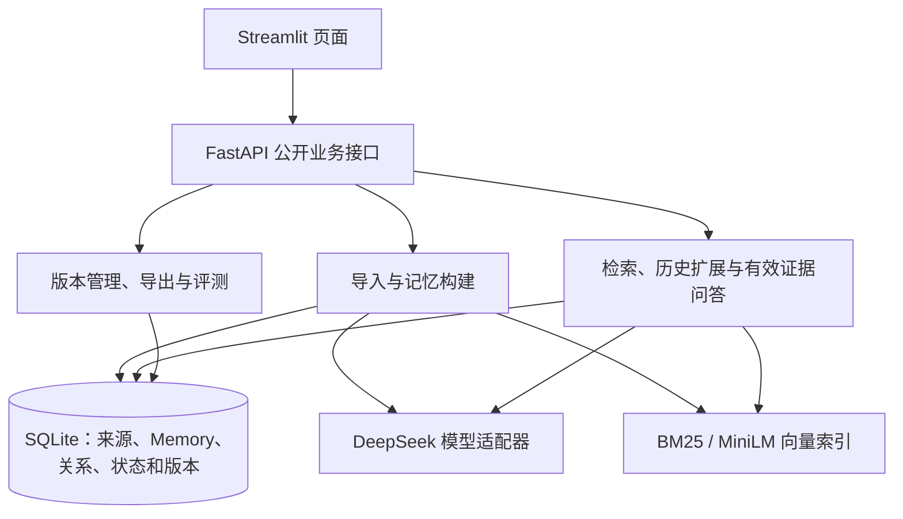

# 动态对话记忆管理：M4 中期报告

Milestone 4 · Design, Coding and Testing

队名：在阴雨天游泳　Team ID：3　日期：2026-10-21

成员：莫远序、黎志丽、卓新烨、田亦洁

版本：v0.1，待成员复核。实现基准：`main@3d9d37c`（2026-10-19）；另列本地已缓存实验分支截至 2026-10-20 的进展。本稿引用已有验证记录，编写时未重新执行应用测试。

## 1 阶段目标与当前进展

本项目面向长期、多会话对话中的事实变化，开发支持结构化记忆构建、动态状态维护和有效证据问答的本地 Web 应用。核心问题是：检索得到的历史信息虽然与问题相关，却可能不适用于问题所指的时间与状态。例如，用户先住在 Paris，后来明确搬到 Rome，询问当前住所与搬家前住所应采用不同证据，同时保留两段历史。

M4 围绕 F01–F06 跑通导入、记忆构建、状态维护、混合检索、有效证据选择与 Web 展示，并形成设计及初步测试依据。当前主分支已实现该核心链路，另接入完整版本 JSON 导出和四策略评测入口。受控模型条件下的接口与浏览器流程已有通过记录；真实模型的完整对话构建和效果评测仍在推进，尚不能认定课程指标达标。[1][2]

| 功能 | 当前实现与可检查结果 |
| --- | --- |
| F01 对话导入 | 导入 LoCoMo，保存数据版本、许可证及校验信息；按对话、会话和轮次浏览原文 |
| F02 记忆构建 | 抽取原子 Memory，保留时间、陈述性质和来源；展示片段进度，显式重试失败项 |
| F03 历史与状态维护 | 持久化记忆关系，保留旧证据，生成可重算的 Current State |
| F04 查询分析与混合检索 | 原始问题参与 BM25 与 Dense 检索，通过 RRF 融合排名并检查候选 |
| F05 有效证据选择 | 扩展相关历史，结合人物、状态维度和时间解析证据，区分证据充分、冲突和不足 |
| F06 回答与 Web 展示 | 展示答案、原文引用、初始与扩展候选、有效集合及 Trace |

上述功能状态表示实现及已有验证覆盖，不等同于全部真实数据质量验证或 M4 正式验收。

## 2 系统架构与数据设计

系统采用本地单体后端，Streamlit 页面通过 HTTP 调用 FastAPI，业务模块统一访问 SQLite 与检索索引。生成模型由独立适配器调用 DeepSeek 官方接口；Dense 检索使用本地 `all-MiniLM-L6-v2` 和 NumPy。该方案适合课程数据规模，便于部署和追溯，首版未引入图数据库、独立向量数据库或外部任务队列。[2]

主要模块为：导入与来源管理（`imports.py`）、构建与模型适配（`builds.py`、`model.py`）、检索（`retrieval.py`、`embeddings.py`）、关系与状态（`relations.py`、`projection.py`）、历史扩展与问答（`expansion.py`、`queries.py`），以及版本、导出和评测模块。页面负责交互和展示，不直接读写 SQLite。

| 数据对象 | 核心信息与作用 |
| --- | --- |
| SourceTurn | 数据集、对话、会话、轮次、说话人、时间和原文，作为证据来源 |
| Memory | 内容、实体、事件／状态类型、事实／计划等性质、正负性质、状态维度、时间与来源列表 |
| MemoryRelation | 新旧 Memory 端点、关系标签、理由、支持证据与适用条件 |
| Current State | 从历史及关系重算的当前状态投影，允许包含未消解冲突 |
| BuildVersion | 构建状态、来源与配置指纹、模型及 Prompt/schema 身份，关联同一版本产物 |
| QueryTrace | 固定版本、时间条件、候选与扩展集合、证据选择理由、回答引用及调用记录 |

一条 Memory 表达一项可独立判断的陈述，可以引用多个原始轮次；同一轮也可以支持多条 Memory。`state_key` 由对话、实体和状态维度组成，状态值单独保存，避免转职后把同一就业历史拆散。不同对话的同名人物保持隔离。同一维度允许多个事实并存，不能仅因同键就认定冲突。

原始会话时间、原始时间表达和推导的事件日期分别保存，未知时间保持未知。官方 `conversation` 是构建输入；QA 答案、证据标注及官方辅助摘要独立保存，不进入记忆抽取和线上问答输入。[2][3]

仓库保留上游固定版本的 10 段对话、5,882 个轮次和 1,986 条 QA，并记录原件校验值。来源检查发现 9 个 evidence 元素无法直接匹配单一轮次；组合引用和异常引用均保留原值，评测时单独说明解析及不可计分情况。数据入库与来源校验不等于全量模型评测完成。[3]

## 3 核心流程与实现机制

### 3.1 记忆构建、动态关系与版本发布

构建流程为：导入并校验来源 → 按片段抽取 Memory → 校验结构、来源和时间 → 建立索引 → 比较相关历史并保存关系 → 重算 Current State → 检查并发布完整版本。`POST /builds` 创建任务，片段和阶段结果持久化；`POST /builds/{build_id}/publish` 在各项检查通过后整体发布。

关系使用 RETAIN、UPDATE、SUPERSEDE、CONFLICT 和 undetermined：分别表示有证据支持的继续适用、过程推进、状态替代、未消解矛盾和关系未确定。事件与旧状态保留历史意义；计划不能直接替代已发生事实，时间较新也不足以证明替代。关系校验检查端点范围、双方来源和适用条件，Current State 由已保存历史与关系计算。[2]

当前实现同一时刻最多运行一个构建任务，使用 WSL Ubuntu 的文件锁防止多个后端争用同一数据库。默认模型调用每次最多额外重试两次；失败与中断保留状态，用户显式恢复时复用成功产物。配置或构建契约变化后，旧的不完整版本拒绝恢复，需创建新版本。新版本失败时保留旧完整版本；首次构建未完成时开放检查，不提供完整记忆库问答。[4]

### 3.2 混合检索与有效证据问答

查询流程为：固定完整版本 → 问题分析 → BM25 与 Dense 检索 → RRF 融合 → 相关历史扩展 → 有效证据解析 → 回答与引用。原始英文问题始终参与检索，分析失败时回退原问题。当前默认两路各取前 20 条，融合保留前 20 条，再沿已有关系扩展一跳，并补充同一实体与状态维度的历史；去重后总候选上限为 60 条。这些值集中配置，达到预算时记录截断，不保证证据完整。

有效证据解析结合问题的人物、状态维度和时间选择适用 Memory。明确日期优先；未指定日期时，“现在”以该对话最后一次会话为已知截止时间。查询补充判断只写入本次 Trace，不修改全局关系或 Current State。证据不足时明确返回不足，模型执行失败另行保存错误，避免混淆两种结果。[5]

生成模型默认采用 `deepseek-flash`、关闭思考、JSON 对象输出，再由 Pydantic 和领域规则校验；JSON 可解析不代表语义正确。MiniLM 固定 revision，输出 384 维向量，编码前检查长度并拒绝超长输入。首版使用英文提问和英文证据，页面标签可用中文。

### 3.3 页面、导出与评测

页面支持来源定位、进度检查、失败重试、候选与关系查看、当前及历史问答、Trace 展开和完整版本下载。`POST /queries` 发起问答，`GET /queries/{trace_id}` 读取已保存记录；`GET /builds/{build_id}/export` 下载所选完整版本的 `memory-export-v1` JSON，包含 Memory、多来源、关系和状态信息。

评测入口比较 Full Text、Vector、关闭状态解析的 Hybrid 和完整 Dynamic 四种策略，分别记录 QA 计分、来源覆盖、错误及调用用量。主分支 Full Text 仍受共享最终证据预算限制，超出时记录截断，不能作为完整全文质量结论；实验分支正在改为完整对话基线。动态准确率需要独立关系或有效记忆标注，当前不以系统自己的判断作为真值。[6]

## 4 初步测试与真实实验进展

### 4.1 已有主线验证

主要自动化边界为 FastAPI 公开业务接口，使用真实 SQLite、BM25、相似度计算、RRF、历史关系和版本机制，仅控制外部生成模型及 Embedding 输出。另以真实 Chromium 检查页面流程，并单独运行真实本地 MiniLM 检查。下表结果均来自 2026-10-19 已保存记录，编写本稿时没有重新运行。[7][8]

| 验证范围 | 已记录结果 | 可支持的结论 |
| --- | --- | --- |
| 最新默认自动测试 | 112 passed、4 skipped | 接口与受控场景回归通过；跳过项为真实 DeepSeek 和三项真实 MiniLM 检查 |
| 独立真实 MiniLM 检查 | 合并前后已有 3 passed 记录 | 固定缓存模型加载、编码、超长拒绝及旧版本编码器选择可用；与默认测试分开执行 |
| Chromium 全流程 | 退出码 0，页面异常与控制台错误均为 0 | 合成来源下的导入、重试、检索、关系、问答、下载及评测流程可操作 |
| 下载及失败诊断 | JSON schema 校验通过；诊断脚本 3 tests OK | 所选版本导出有效，浏览器故障可保留截图、页面文本和 Trace |

浏览器案例使用独立合成来源：Alex 于 2023-05-01 住 Paris，2023-05-02 明确搬到 Rome；Sam 的出生年记录互相矛盾。受控模型提供结构化响应，实际检索、历史扩展、持久化和页面仍执行生产逻辑。已有结果如下：[8]

| 场景 | 观察结果 |
| --- | --- |
| 当前住所与历史住所 | 当前回答 Rome，指定 2023-05-01 时回答 Paris，并展示对应来源 |
| 出生年份矛盾 | 保留 1990 与 1992 的双方证据，展示冲突，不强行择一 |
| 查询原文没有的护照号码 | 返回证据不足，不生成有效 Memory 或虚构引用 |
| 模型失败、恢复和版本一致性 | 故意制造抽取失败后显式重试成功；查询未改写全局状态；下载与所选版本一致 |

历史问答页面及展开的 Trace 见[已有截图](../../experiments/screenshots/issue-4-final-history-trace.png)。这些案例证明工程流程按预期协作，不代表真实模型在官方数据上的准确率。已配置 GitHub Actions 检查入口，但本稿未核查远端运行结果。

### 4.2 未合入主线的真实实验

本地缓存的 `origin/codex/issue-15-integration@7893f04` 保存了截至 2026-10-20 的实验记录，本稿未联网刷新或恢复该实验。该分支已约定开发对话为 `conv-26`、`conv-30`、`conv-41`、`conv-42`，本地留出对话为 `conv-43`、`conv-44`；教师隐藏评分集另行保密。这是实验分支协议，尚未合入本报告的主线实现基准。[9]

真实 `conv-26` 构建经一次显式恢复后完成 21/21 个抽取片段，得到 295 条 Memory，真实 MiniLM 索引通过。关系阶段停止时为 89 项成功、29 项失败、1 项中断及 173 项待执行，未发布完整版本。后续独立回放定位了状态维度前提和重复证据 ID 问题；补充提示词后两个多候选批次通过校验，但结果均为关系未确定，且没有恢复原完整关系构建，不能据此认定全部失败已解决或语义质量改善。[9]

该分支最新受控回归记录为 202 passed、4 deselected，与主线的 112 passed 属于不同版本及执行范围。五题真实 QA 预检和 757 题开发集全量评测尚未完成，目前没有可报告的完整真实 QA F1、证据 Recall@K 或动态状态准确率。

## 5 问题、后续安排与阶段判断

当前主要问题有三项：真实模型关系输出仍可能违反领域约束，阻止完整版本发布；缺少独立动态标注，无法评价关系及有效集合的语义正确性；完整真实对照结果尚未形成，不能判断动态方案相比基线的收益。历史扩展还受抽取完整性和候选预算限制，不能补回根本没有抽取的事实。

后续优先保留失败基线和用量记录，验证最小修复后再显式开展完整关系构建；通过真实五题预检后推进开发集四策略评测，分别报告成功率、可计分范围、证据覆盖、耗时及用量。在独立标注和系统冻结后开展留出对话评测，避免根据测试成绩反复调参。图谱、多跳等扩展继续排在核心质量验证之后。

本阶段已形成可运行原型、明确的数据与版本机制，以及可追溯的接口和浏览器验证证据。中期展示可以据此说明系统设计、演示核心链路并展示失败处理，同时明确真实模型完整构建与质量评测尚未完成。报告定稿前需由各模块负责人核对描述、非作者成员复核，并复测拟展示版本。当前文稿尚未导出 PDF、核验页数或正式提交；定稿检查及证据索引另见[编写记录](../../process/m4/draft-evidence.md)。

参考与证据：

- [1] [M2 功能路线与团队安排](../requirements/vision-and-scope.md#8-功能路线与团队安排)。
- [2] [M3/M4 架构决策](../adr/0001-memory-architecture.md)与[Issue #4 规格副本](../specs/issue-4-m3-m4-dynamic-memory.md)。
- [3] [官方数据、版本及来源说明](../../data/raw/locomo/README.md)。
- [4] [构建说明](../app/building.md)与[恢复、版本和导出说明](../app/versions.md)。
- [5] [检索说明](../app/retrieval.md)、[关系说明](../app/relations.md)与[问答说明](../app/querying.md)。
- [6] [主线评测策略与计分边界](../app/evaluation.md)。
- [7] [主线默认测试与诊断验证](../../experiments/retro-validation-guardrails.md)及[实现总记录](../../experiments/issue-4-implementation.md)。
- [8] [浏览器集成验证](../../experiments/issue-12-integration-validation.md)、[最终浏览器摘要](../../experiments/issue-4-final-browser-result.json)与[后续浏览器摘要](../../experiments/retro-browser-result.json)。
- [9] 实验分支固定提交的来源路径和读取方法见[证据索引](../../process/m4/draft-evidence.md#实验分支来源)。
