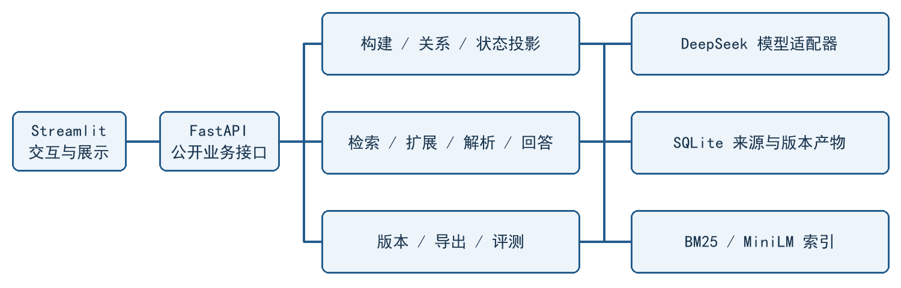

# 动态对话记忆管理：M4 中期报告

Milestone 4 · 需求规格、系统设计、实现与初步测试

队名：在阴雨天游泳　Team ID：3　日期：2026-10-22

成员：莫远序、黎志丽、卓新烨、田亦洁

版本：v0.2，待成员复核；实现基准：main@ffb2657（2026-10-21）。

## 1 需求规格与阶段范围

本项目开发基于 LoCoMo 长期对话的动态记忆 Web 应用。系统从原始对话提取结构化 Memory，检索与问题相关的历史，再结合时间及状态关系选择有效证据并回答。例如，先住 Paris、后搬到 Rome 的人，当前与搬家前的住所问题应使用不同来源，旧事实仍可追溯。

依据助教说明，本阶段呈现需求规格、系统设计、已实现功能与初步测试。M3/M4 规格见 Issue #4 的仓库副本；后续评测及质量调整由 ADR 和执行记录补充，历史规格保留原文。[1][2]

| 需求 | 核心行为 | 可检查的验收依据 |
| --- | --- | --- |
| F01 对话导入 | 保留人物、会话、轮次、时间与原文 | 按对话和 dia_id 精确定位来源；异常输入整次拒绝 |
| F02 记忆构建 | 抽取独立陈述并关联一个或多个来源 | 检查内容、时间、事件／状态、事实／计划及否定信息 |
| F03 历史与状态 | 保留旧记忆，维护关系与当前状态 | 展示保留、推进、替代、冲突或未确定关系及双方证据 |
| F04 混合检索 | 分析问题，融合关键词和向量排名 | 检查初始排序、历史扩展、来源及实际预算 |
| F05 有效证据 | 根据人物、状态维度和时间选择记忆 | 当前与历史问题采用对应证据；冲突和证据不足分别说明 |
| F06 回答与 Web | 展示答案、来源、历史关系及 Trace | 完成导入到问答的核心操作，能够读取保存结果和导出 JSON |

共同约束：QA 标准答案不进入构建或线上问答；查询固定一个完整版本，不修改全局状态；模型失败、未完成构建与证据不足分别记录；配置和来源可追溯，凭据不进入报告、Trace 或导出。首版采用英文提问与英文证据，中文界面，部署范围为本地单用户应用。[1][2]

仓库保存官方 10 段对话、5,882 轮与 1,986 条 QA。当前完成核心应用和一轮 conv-26 开发集展示；开发对话为 conv-26/30/41/42，本地留出为 conv-43/44，教师隐藏评分集另行保密。本轮结果不代表全开发集或独立测试结果。[2][3]

<!-- pagebreak -->

## 2 系统架构与数据设计

应用采用 Streamlit → FastAPI → 业务模块 → SQLite／检索索引的调用路径。页面只负责交互和展示，持久化、校验及状态变更由后端统一处理。SQLite 适合课程数据规模，生成模型和 Embedding 通过适配层接入，无须独立图数据库或向量数据库。[2]

图 1 系统架构。DeepSeek 用于抽取、关系判断、查询分析、证据解析及回答；MiniLM 在本地生成向量，BM25 和 RRF 提供词法召回及排名融合。

| 对象 | 关键内容与约束 |
| --- | --- |
| SourceTurn | 数据集、对话、会话、轮次、说话人、时间、原文；证据身份包含对话范围 |
| Memory | 原子内容、实体、状态维度与值、时间、性质、来源列表和构建版本 |
| MemoryRelation | 新旧端点、关系标签、理由、来源和适用条件；端点与证据须通过校验 |
| Current State | 从历史及关系重算的当前状态投影，可保留未消解冲突 |
| BuildVersion | 来源、配置、Prompt/schema、模型与索引身份，区分部分产物和完整版本 |
| QueryTrace | 固定版本、时间条件、初始／扩展／有效集合、选择理由、引用和调用记录 |

一条 Memory 表达一项可独立判断的陈述，同一轮可支持多条记忆，一条记忆也可引用多轮。state_key 由对话、实体和状态维度组成，状态值另存；同键不自动意味着互斥。不同对话的同名人物隔离，事实、计划和不确定陈述区分。

原始会话时间、原始时间表达与推导日期分别保存，未知时间不强行精确化。“现在”以所选对话最后一次会话为已知截止时间；明确历史日期优先，未来计划不作为已发生事实。仅 conversation 作为构建来源，QA 和官方辅助摘要独立保存。[1][2]

<!-- pagebreak -->

## 3 已实现的核心功能与运行方式

### 3.1 可复用的记忆构建

导入与来源检查 → 分片抽取 → 来源和结构校验 → 建立索引 → 历史关系判断 → 状态投影 → 完整版本发布。构建阶段保存片段和关系任务的成功、失败及中断结果，显式重试复用成功产物。新版本检查通过后才整体切换；失败保留旧完整版本，首次未完成构建只允许检查。[4]

关系区分 RETAIN、UPDATE、SUPERSEDE、CONFLICT 和 undetermined。历史事件与旧状态保留，计划不直接替代事实，时间较新也不能单独证明替代。当前展示复用已发布 conv-26 完整 Build，含 272 条 Memory 和 4,902 条关系；本轮未重新抽取或修改该 Build。[3][5]

### 3.2 查询、补查与可解释回答

固定完整版本 → 问题分析 → BM25／Dense 检索 → RRF 融合 → 有界历史扩展 → 有效证据解析 → 回答与来源。原始问题始终参与检索，默认两路各取 20 条、初始保留 20 条，扩展一跳后总候选上限 60。超预算时记录省略及截断，不声称证据完整。

在线页面提供 Dynamic 与 Dynamic + 原文兜底。后者在证据缺口时至多进行一次有界原文补查并联合解析，原文来自固定 Build 的来源，不产生新 Memory。必要冲突端点和既有支持受到保护；结构化解析失败可走既有原文备用路径，Trace 记录实际执行策略。查询补判不写回全局关系或状态。[4]

当前默认 deepseek-flash，输出上限 8192 tokens，关系阶段 high 思考、证据解析 low，其余阶段关闭思考；实验配置保存在 plan.json，不以当前默认值覆盖历史快照。MiniLM 固定 revision、384 维，检查长度并拒绝静默截断。

### 3.3 可运行证据与复现入口

既有 Chromium 检查已覆盖导入、故意失败与重试、发布、当前／历史／冲突／不足问答及 JSON 下载。真实结果通过生产页面和只读 API 回放保存 Trace，五项操作均通过，页面与控制台错误为零；回放不代表新发起模型请求。[5]

运行环境为 WSL Ubuntu、Python 3.12 和 uv。锁定安装后，分别启动 FastAPI 与 Streamlit；真实构建另需本地 MiniLM 缓存和受保护凭据。接口包括 POST /builds、POST /queries、GET /queries/{trace_id} 和完整版本导出，详细命令见运行指南。[4]

<!-- pagebreak -->

## 4 初步测试与真实展示结果

合并前已有全量非 live 回归 405 passed、4 skipped，并保存编译和浏览器验证记录。本轮展示执行前相关测试 24 passed；受控浏览器检查退出 0。真实 MiniLM 独立检查已有 3 passed 记录。以上均为仓库既有执行结果，本次文档修订未重跑业务或付费实验。[5][6]

展示实验固定 conv-26、同一完整 Build，预先分层选取五个类别各 4 题；20 题分别运行五策略，共 100 个逻辑项，全部得到合法结果。F1 按既有官方类别分支计算，仅汇总类别 1–4 的 16 题；类别 5 的 4 题单列拒答匹配，运行成功不等于语义正确。[5]

| 策略 | 可回答题 F1 | 成功项 | 类别 5 拒答匹配 |
| --- | --- | --- | --- |
| Full Text（完整原始对话） | 0.3490 | 20/20 | 4/4 |
| Vector RAG | 0.4911 | 20/20 | 4/4 |
| Hybrid（无有效证据解析） | 0.5124 | 20/20 | 4/4 |
| Dynamic | 0.5100 | 20/20 | 4/4 |
| Dynamic + 原文兜底 | 0.3997 | 20/20 | 4/4 |

Full Text 输入完整对话，检索策略使用各自证据预算，输入量并不相同。Dynamic 有 2 题实际触发结构化失败后的原文备用，因此不能作为禁用备用路径的纯消融。本组 Hybrid 与 Dynamic 接近，原文兜底未总体胜出，单对话单轮不能证明稳定优劣。

另完成 40 题证据检索检查：K 计初始 Memory 排名数，覆盖计映射后去重的 gold Source Turn，逐题算覆盖再平均。

| K | 初始 RRF | Dense 通道诊断 | BM25 通道诊断 |
| --- | --- | --- | --- |
| 5 | 64.17% | 62.92% | 57.08% |
| 10 | 72.92% | 74.17% | 63.33% |
| 20 | 77.92% | 79.17% | 66.67% |

10 个真实动态查询均成功；开发助手审阅为 9 条回答正确、1 条部分支持，存储关系另有 2 处语义异议。该审阅不是独立动态真值，不作为课程准确率。20 条回答来源审阅均引用合法，但仍有推断及部分支持；引用合法不能代替语义正确。[5]

<!-- pagebreak -->

## 5 结果分析、未完成项与后续安排

### 5.1 已观察到的收益与不足

QA148 的原文补查从 D18:5 找到家人对 Grand Canyon 的反应，补足原先不足的证据，展示补查的实际作用；但回答较参考长，词面 F1 仅 0.1429。QA51 仍遗漏 sunrise，QA144 答事故结局而非儿子的应对，QA68 的 Seven years 与 Since 2016 表述接近但词面分数为 0。误差同时涉及召回、证据覆盖、回答切题与计分口径，不能一概归因于检索。[5]

当前真实 Build 没有 SUPERSEDE／CONFLICT，合成冲突场景只能验证处理流程，不能评价这两类真实关系质量。动态案例还有将“未报告完成收养”表达为“确定未完成”的问题；两处关系语义异议也表明合法结构和成功请求不足以证明状态判断正确。

### 5.2 阶段范围与待完成工作

本轮完成的是限定范围的开发集展示及证据审阅。原 Issue #15 已被后续增量迭代取代，757 题、四策略 3,028 项全量实验取消，Issue #20 原固定预检延期。本轮 100 项展示不替代原全量验收，也不恢复已取消计划；本地留出对话和教师隐藏评分集尚无本轮结果。[2][7]

后续优先修正枚举遗漏、时间表达与回答切题问题，结合来源逐例分析；取得独立核查的动态标注后再评价关系及有效记忆，保留未评类别。扩大实验需重新固定范围、配置和预算，开发与留出数据隔离。图谱、多跳等扩展继续排在核心质量验证之后。

中期已有可运行的核心系统、真实问答对照、来源检索和页面验证证据。展示时应演示从原始来源到记忆、有效证据及回答的链路，并如实解释失败与不足。本文为待复核稿，成员非作者复核、展示环境复测和正式提交仍按 Team Workflow 执行。

### 5.3 依据与结果索引

[1] [M3/M4 需求规格副本](../specs/issue-4-m3-m4-dynamic-memory.md)。

[2] [ADR 0001 架构](../adr/0001-memory-architecture.md)、[ADR 0002 最新评测范围](../adr/0002-real-model-baseline-protocol.md)。

[3] [原始数据](../../data/raw/locomo/README.md)、[展示固定计划](../../experiments/current-showcase/plan.json)。

[4] [运行指南](../app/running.md)、[构建与版本](../app/building.md)、[有效证据问答](../app/querying.md)。

[5] [展示分析与真实页面截图](../../experiments/current-showcase/results/analysis.md)、[逐题指标](../../experiments/current-showcase/results/report.md)、[最终审计](../../experiments/current-showcase/results/final-audit.json)。

[6] [合并前验证](../../process/prs/issue-15-integration.md)、[早期 MiniLM 检查](../../experiments/issue-4-implementation.md)。

[7] [原全量范围结案](../../experiments/issue-15-closure/README.md)；文档变更与页数校验另见[本轮记录](../../process/m4/draft-evidence.md)。
