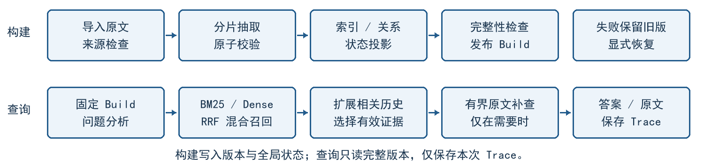

# 动态对话记忆管理：M4 中期报告

Milestone 4 · 需求规格、系统设计、实现与初步测试

队名：在阴雨天游泳　Team ID：3　日期：2026-10-23

成员：莫远序、黎志丽、卓新烨、田亦洁

版本：v0.6，待成员复核；实现基准：main@ffb2657。

## 1 需求规格

本项目开发基于 LoCoMo 长期对话的动态记忆 Web 应用。系统从原始对话提取结构化 Memory，检索与问题相关的历史，再结合时间及状态关系选择有效证据并回答。本阶段主要呈现需求规格、系统设计、已实现功能与初步测试。〔1〕 〔2〕

| 用户任务 | 核心需求与可观察结果 | 验收方法 | 当前实现与验证状态 |
| --- | --- | --- | --- |
| 开发者导入、构建或恢复记忆 | 原子记忆保留人物、时间、性质和来源；失败可重试，完整后发布 | 输入合法／非法数据；模拟中断，检查来源、重复产物与版本切换 | 已实现；工程和浏览器已有验证，真实 conv-26 Build 已发布；抽取语义未逐条独立核验 |
| 复核者检查历史与状态 | 旧记忆保留，关系有端点、理由与证据，当前状态可重算 | 对照原文检查阶段推进、替代、冲突和未知；交叉查询当前与历史 | 已实现；合成边界已检，10 个真实案例已有作者审阅，未独立复核 |
| 评测者查询当前或过去 | 混合召回、扩展历史、选择有效证据，返回答案及解释 | 检查初始／扩展／有效集合、截止时间、回答和引用 | 已实现；20 题五策略和 40 题检索已运行；留出集与独立动态准确率未评 |
| 用户补查证据不足的问题 | 有界原文补查；冲突与不足分别说明，不改写记忆库 | 检查补查来源、预算、支持保留、失败回退及 Trace | 已实现；QA148 观察到补查收益，预算回退有记录；总体质量收益未证实 |
| 用户查看证据并导出 JSON | Web 展示答案、历史、Trace 与原文；导出同一完整版本 | 展开引用、切换已有结果并下载，检查版本一致及无新生成 | 已实现；工程、浏览器及真实结果回放已有验证；展示环境本轮尚未复测 |
| 评测者复现并比较策略 | 固定样本、版本与配置，记录分数、失败和用量 | 重算逐题 F1／Recall，核对请求及实际执行策略、重试与 token | 已实现；conv-26 展示完成；跨对话评测与留出集测试尚未完成 |

仅原始 conversation 进入构建，QA 与辅助标注隔离。开发对话为 conv-26/30/41/42，本地留出为 conv-43/44；当前展示仅使用 conv-26。〔2〕 〔3〕

<!-- pagebreak -->

## 2 系统设计

应用采用 Streamlit → FastAPI → 业务模块 → SQLite／检索索引的调用路径。页面只负责交互和展示，持久化、校验及状态变更由后端统一处理。SQLite 适合课程数据规模，生成模型和 Embedding 通过适配层接入，无须独立图数据库或向量数据库。〔2〕

图 1 模块架构。DeepSeek 完成抽取、关系判断、查询分析、证据解析与回答；MiniLM 生成本地向量，BM25 与 RRF 实现混合召回。

图 2 两条路径共享完整 Build。构建检查通过才发布并整体切换；失败保留旧完整版本。查询固定同一版本，原始问题始终参与召回，分析失败退回原问题。原文补查只读且有界，不能产生新 Memory。〔4〕

一条 Memory 表达一项可独立核查的陈述，分别保存内容、人物、状态维度、时间、性质及来源。同轮可产生多条记忆，多轮也可共同支持一条；事实、计划、否定与不确定陈述分开。state_key 标识对话、实体和维度，状态值另存，同键不自动互斥。

使用 MemoryRelation 保存端点、标签、理由和原文证据，区分 RETAIN、UPDATE、SUPERSEDE、CONFLICT 与未确定。保留旧记忆，才能回答过去时点的问题、追溯演化并复核判断；新证据替代当前取值，也不抹除旧事实的历史意义。时间较新不能单独证明替代。

有效证据：召回只说明相关；解析还要按问题的人物、维度和时间选择适用记忆。旧、新记录可能同时有效，也可能因计划尚未发生或时间不符被排除。“现在”指对话最后会话的已知截止时间，未知日期不强行精确化。

查询不修改全局状态：历史提问和本次补判是问题范围内的选择，不代表现实发生更新。结论只保存于 QueryTrace；全局关系与可重算 Current State 由构建／显式重建维护，避免答案依赖提问顺序。〔2〕 〔4〕

<!-- pagebreak -->

## 3 已实现功能：一次真实职业探索问答

案例 state-01，conv-26，Dynamic；问题：“As of the end of the conversation, what is known about Caroline's career exploration?”（截至对话结束，Caroline 的职业探索有何进展？）

| 历史阶段 | 抽取记忆及性质 | 可定位原文 |
| --- | --- | --- |
| D1:9，2023-05-08 | 计划了解职业选项；plan；Memory ab5f9130… | “Gonna continue my edu and check out career options” |
| D7:7，2023-07-12 | 已开始探索咨询与心理健康职业；fact；Memory 376676a7… | “I started looking into counseling and mental health career options” |

关系判断：同一职业探索过程从计划推进到实际行动，记录 UPDATE（关系 581985a7…），而非把旧计划判为错误或删除。有效证据：旧、新端点均进入本次有效集合；工作坊是已发生事件，继续教育仍是计划，不推断已取得职业资格。

答案节选：“Caroline is exploring a career in counseling and mental health …”；回答还说明其兴趣、工作坊及继续教育计划，引用包含 D1:9、D7:7 等原文。历史、关系、有效集合和完整答案均可通过[本案例机器记录](../../experiments/current-showcase/results/dynamic-review.json)复核，完整原文与解析见[证据包](../../experiments/current-showcase/results/dynamic-packets.json)。

图 3 职业探索问答页面局部：保存 Trace 的只读回放，显示证据支持状态和答案；[完整截图](../../experiments/current-showcase/web-recorded/history-and-effective-memory.png)。

Trace：fb0b30cf8e254441be9d4830319b1634。演示视频：未录制，文件名与案例时间段待补。运行入口为 FastAPI＋Streamlit（WSL、Python 3.12、uv），启动命令见〔4〕。

<!-- pagebreak -->

## 4 初步测试与真实展示结果

展示验证：2026-10-21，conv-26 开发对话，完整 Build 5c7699dd…（272 条 Memory、4,902 条关系），配置和指纹见 plan.json。生成模型为 deepseek-flash，MiniLM revision 与各阶段设置固定，复用同一 Build。〔3〕 〔5〕

工程验证：已有非 live 回归 405 passed、4 skipped，覆盖导入、恢复、版本、检索、查询和导出；展示前相关测试 24 passed，真实 MiniLM 检查 3 passed。受控浏览器覆盖当前／历史／冲突／不足及评测页面，退出 0；真实 Trace 回放 5 项通过，页面和控制台错误为 0。〔5〕 〔6〕

问答样本按五个类别各预选 4 题，同题运行五策略，共 100 项，各策略均成功 20/20。F1 按既有官方类别分支计算，仅汇总类别 1–4 的 16 题；类别 5 的 4 题在表后单列。

| 策略 | 类别 1–4 F1 | 输入 tokens／20 题 | 输出 tokens／20 题 |
| --- | --- | --- | --- |
| Full Text（完整原始对话） | 0.3490 | 1,270,393 | 2,558 |
| Vector RAG | 0.4911 | 159,789 | 3,567 |
| Hybrid（无有效证据解析） | 0.5124 | 168,978 | 3,473 |
| Dynamic | 0.5100 | 1,477,136 | 112,169 |
| Dynamic + 原文兜底 | 0.3997 | 341,097 | 75,900 |

类别 5 单列：4 题，各策略按既有拒答规则匹配均为 4/4，不并入 F1。token 为各策略 20 题全部查询尝试的提供方用量，含失败、重试和各阶段，不含复用 Build 的构建。Full Text 输入完整对话，RAG 采用各自证据预算。

Dynamic 有 2 题实际触发结构化失败后的原文备用路径，结果按请求策略汇总，并保留实际执行策略；该组不是关闭备用路径的纯动态消融。

另完成 40 题证据检索检查：K 计初始 Memory 排名数，覆盖计映射后去重的 gold Source Turn，逐题算覆盖再平均。

| K | 初始 RRF | Dense 通道诊断 | BM25 通道诊断 |
| --- | --- | --- | --- |
| 5 | 64.17% | 62.92% | 57.08% |
| 10 | 72.92% | 74.17% | 63.33% |
| 20 | 77.92% | 79.17% | 66.67% |

结果分析：Hybrid F1 为 0.5124，Dynamic 为 0.5100；同组查询总 token 分别为 172,451 和 1,589,305，Dynamic 约为 Hybrid 的 9.2 倍。本轮未观察到 Dynamic 的整体优势，需要进一步核查状态变化问题上的收益和额外开销。原文兜底也未总体胜出。

当前真实 Build 尚无 SUPERSEDE／CONFLICT，两类真实关系质量未评；合成冲突仅验证处理流程。10 个动态案例作者审阅为 9 条正确、1 条部分支持，存储关系另有 2 处语义异议，未独立复核。单对话单轮展示不能代表跨对话或留出集表现。〔5〕 〔7〕

<!-- pagebreak -->

## 5 问题、后续安排与证据索引

### 5.1 两个需要处理的真实案例

QA51：枚举画作时遗漏 sunrise，部分分组超出明确文本。已确认答案覆盖不全；遗漏发生在抽取、召回、有效证据选择还是生成，尚待定位。下一步对照 gold 原文、初始／扩展／有效集合及答案，确定缺失阶段后修正，并用固定题复核。〔5〕

state-02：回答把“现有对话未报告完成收养”表达为“确定尚未完成”。已确认结论强于证据，具体引入阶段待查。下一步对照 Trace 定位越界处，校正证据不足与否定事实的表达边界，并加入有／无明确完成证据的成对检查。〔7〕

### 5.2 尚未完成的评价与下一步

| 未完成项 | 下一步与证据 |
| --- | --- |
| 留出集测试 | 尚未完成；冻结实现、题单和预算后，在 conv-43/44 测试并单列结果，不用留出成绩调参 |
| 跨对话评测 | 尚未完成；先在 conv-30/41/42 固定少量同类状态问题，按对话比较回答、证据覆盖与 token |
| 独立动态质量评价 | 未独立复核；需取得独立核查的关系与有效证据判断，再评价状态变化子集；优先保留并核查现有异议 |

下一阶段先完成现有失败案例定位，再按固定范围逐步推进上述评价。中期报告呈现当前成果与初步结果。

### 5.3 依据与结果索引

〔1〕 [M3 需求规格说明书 v0.3](../requirements/software-requirements-specification.md)（2026-10-22，待团队复核）；[Issue #4 实现规格历史副本](../specs/issue-4-m3-m4-dynamic-memory.md)供参考。

〔2〕 [ADR 0001 架构](../adr/0001-memory-architecture.md)、[ADR 0002 最新评测范围](../adr/0002-real-model-baseline-protocol.md)。

〔3〕 [原始数据](../../data/raw/locomo/README.md)、[展示固定计划](../../experiments/current-showcase/plan.json)。

〔4〕 [运行指南](../app/running.md)、[构建与版本](../app/building.md)、[有效证据问答](../app/querying.md)。

〔5〕 [展示分析与真实页面截图](../../experiments/current-showcase/results/analysis.md)、[逐题指标](../../experiments/current-showcase/results/report.md)、[最终审计](../../experiments/current-showcase/results/final-audit.json)。

〔6〕 [合并前验证](../../process/prs/issue-15-integration.md)、[早期 MiniLM 检查](../../experiments/issue-4-implementation.md)。

〔7〕 [动态案例及已有异议](../../experiments/current-showcase/results/dynamic-review.md)、[关系与有效证据记录](../../experiments/current-showcase/results/dynamic-review.json)。
