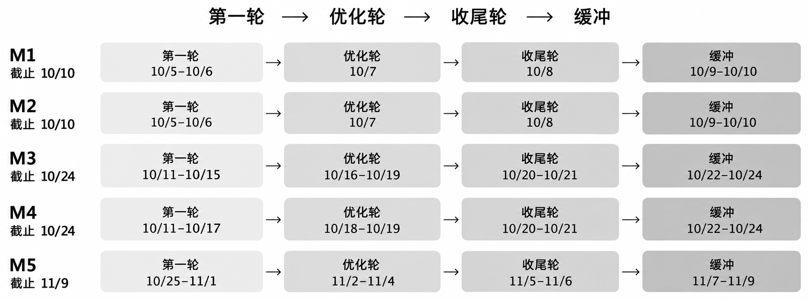

# M1 Team Workflow

队名：在阴雨天游泳　Team ID：3　项目：动态对话记忆管理

组长：莫远序　成员：黎志丽、卓新烨、田亦洁　日期：2026-10-05

本文件规定团队职责、沟通、任务管理、版本控制及 M1–M5 行动计划。

## 1 团队目标与职责

团队开发基于 LoCoMo 长期对话的 Web 应用，完成结构化记忆构建、相关记忆检索、动态状态判断、来源证据展示和 JSON 导出，并用回答 F1、证据 Recall@K、状态判断准确率及对照实验检验结果。M1 负责确定团队流程及全项目行动计划，后续技术细节分别在需求和设计阶段落实。

表 1 模块职责与交付边界

| 成员 | 主责 | 主要交付物 |
| --- | --- | --- |
| 莫远序 | 管理、整体设计、接口、动态状态判断与集成 | 任务安排、模块契约、状态判断模块、集成记录 |
| 黎志丽 | 对话导入、记忆构建、JSON 导出 | 数据处理与记忆模块、来源映射、导出样例 |
| 卓新烨 | 检索、证据追踪、对照实验 | 检索模块、轮次映射、对照运行与分析 |
| 田亦洁 | Web 交互、证据展示、端到端验收 | 可用界面、完整操作流程、端到端验证记录 |

投入包含开发、文档、会议、复核和返工；重叠里程碑共享该预算。各人负责自己模块的实现、测试、文档和汇报素材。集成缺陷按来源交回对应模块，不集中由组长补修；分配调整由组长结合依赖和实际投入决定。

表 2 近期材料与管理职责

| 工作 | 主责 | 复核 |
| --- | --- | --- |
| M1 Team Workflow | 莫远序 | 黎志丽 |
| M2 Vision & Scope 与功能路线 | 卓新烨 | 莫远序 |
| Proposal 汇报整理与主讲 | 田亦洁 | 莫远序 |
| 过程材料整理与文件检查 | 黎志丽 | 田亦洁 |
| 课程疑问跟进与最终提交 | 莫远序 | 黎志丽 |

## 2 沟通与例会

微信用于日常沟通，普通消息在 24 小时内回应，阻塞在发现当天报告。每周二北京时间 20:00 举行 20–30 分钟线上例会，由莫远序召集；首次计划为 10 月 6 日。记录人按黎志丽、卓新烨、田亦洁轮换，组长复核行动项。先简述进展，再检查产物、依赖、阻塞和下一批任务。

决定及行动项写入会议纪要，明确负责人和完成时间。真实纪要及经检查的截图存入 process/meetings/，使用其中的 meeting-template.md。阻塞先由相关成员协助，24 小时仍无解决路径时，由组长决定拆分、改派或调整计划。

## 3 任务管理与验收

里程碑约束阶段目标和期限，tickets 可随需求、缺陷和优化持续增加。任何成员均可提出任务，由组长决定是否接受、所属里程碑、优先级及迭代归属。新增工作计入原投入预算；若影响当前交付，需明确替换、推迟或取消的工作。

统一工作链路为 grill-with-docs → to-spec → to-tickets → implement → code-review。新需求先采访、形成 spec，再确认拆分及阻塞依赖。已有 spec 下的缺陷或遗漏直接关联原 spec；范围、接口、数据格式、依赖或验收变化时先更新相关定义。

GitHub Issues 保存 spec、ticket 正文及讨论。成功发布的 spec 和 ticket 正文分别原样复制到 docs/specs/、process/tickets/。每个 ticket 单独保存，并可追溯至原 Issue 和所属 spec。每项任务须明确可独立检查的交付结果、主责、非作者复核人、期限、依赖及验收标准。

表 3 任务流转与完成依据

| 状态 | 进入依据 | 下一步 |
| --- | --- | --- |
| 待评估 | 成员提出需求、缺陷或优化 | 组长判断范围、优先级和归属 |
| 待开始 | 定义、负责人及验收明确 | 等依赖满足后领取 |
| 进行中 | 已领取且依赖满足 | 实现、文档和自测，及时报告阻塞 |
| 待复核 | 待审版本已提交，附自测证据 | AI 审查及非作者复核；问题退回修改 |
| 完成 | 验收通过，合并及必要验证完成 | 关闭交付任务，保留证据与链接 |
| 取消 | 组长决定不实施并记录原因 | 保留记录，不计为交付完成 |

阻塞单独记录原因、所需协助和解除条件，保留原流转状态。依赖全部满足后才开工；多人只并行处理边界明确、不会争改同一核心接口的任务。ready-for-agent 是适合交给 Agent 的准备标签，不代表正在开发或已完成。

验收标准采用可检查的勾选项。作者提供产物和验证证据，非作者逐条核对后勾选；代码任务检查功能、异常及必要测试，文档任务检查内容完整性、来源和一致性。未通过的项先修复。

Notion 是任务实时状态的唯一准本，维护任务编号、里程碑、迭代、主责、复核人、期限、状态、阻塞及 Issue/PR 链接。莫远序维护结构和优先级，成员在领取、送审、交付或阻塞时更新，例会前补齐进展。Notion 不重复维护 spec、ticket 正文。

AI 在获授权的任务操作中同步更新已关联的 Notion 记录。缺少关联、权限或更新失败时，报告未同步项，由负责人补录；不宣称同步成功。此方式按需执行，不持续后台运行。阶段快照注明导出时间和交付版本，保存到 process/snapshots/，用于过程留档。

## 4 版本控制与协作开发

私有仓库为 kenqia/locomo-dynamic-memory，仅授权成员可修改。邀请全部成员后检查读取、创建分支和参与 PR 的权限；成员使用自己的账号提交，从首份文档草稿开始保存版本历史。main 保存经复核的产物，每项 ticket 使用一个短期分支，分支名应能识别任务。

作者在任务分支实现与自测，提交待审版本后发起 PR，并写明关联 ticket、具体改动、验证命令或检查方法、实际结果及剩余问题。code-review 使用明确的基准版本比较已提交的 HEAD，检查项目规范与原 spec；未提交改动应先纳入待审版本，避免漏审。修复后提交新版本并重新检查。

普通改动经至少一位非作者复核后，由作者合并。项目范围、技术栈、公共接口、数据格式、验收标准及阶段交付版本由莫远序最终批准。存在分歧时记录理由，由组长裁决；测试失败或验收不满足的交付先修复。AI 审查不能替代非作者成员复核。

提交格式为“类型: 具体改动”，类型使用 docs、feat、fix、test、chore，例如“docs: 补充有效记忆验收场景”。PR 关联任务编号，提交描述实际变化。阶段定稿用 milestone-1-v1 等 tag 标识，修订递增版本；交付文件与实际 tag、commit 保持对应。

团队先执行上述操作约定，新增强制设置另行确认。发生接口变更时先更新相关 spec、通知受影响成员，再继续开发；保留旧版本和变更原因，必要时通过修复或 revert 恢复已确认行为。

## 5 AI 使用与资料管理

四位成员统一使用仓库内置 skills，实际路径为 .agents/skills/。grill-with-docs 用于澄清需求并记录已确定术语和决定；to-spec 形成规格；to-tickets 将规格拆成可独立验收的任务并声明依赖；implement 按已确认任务实现、自测和提交，过程中调用 code-review。各环节完成后复用已有结论，不为小修订重复整套采访。

作者必须理解 AI 产物，能够解释模块输入输出、来源映射、状态关系和验证结果。新术语记入 CONTEXT.md；团队流程决定保存在 docs/decisions/，架构与领域取舍按既有规则写入 docs/adr/，具体设计存入 docs/design/。任务定义、设计和过程记录通过链接关联。

不提交真实 API key、token、cookie、真实 .env、私密聊天或含凭据的日志；配置示例仅使用无真实值的 .env.example。截图检查共享范围，去除无关通知和私人信息。课程 QA 标准答案只用于评价，不混入可检索记忆，也不用于独立测试集调参。

发布 Issues、推送、修改权限或正式提交须在明确授权范围内执行。

## 6 M1 至 M5 迭代与行动计划

每个里程碑安排三轮：第一轮形成可检查产物，第二轮优化提升，第三轮验收收尾，之后另留缓冲。日期均为 2026 年。优化优先处理已有问题与产物质量，新增功能必须重新评估范围与预算；缓冲用于修复、环境和提交检查。

图 1 各阶段时间流程

组长在例会中核对总量并调整优先级。某个功能的需求与验收先确定，再开展对应实现，不等待全部需求文档统一结束。

表 4 各阶段行动项与交付检查

| 阶段及组织方式 | 三轮主要行动 | 阶段交付检查 |
| --- | --- | --- |
| M1 莫远序主责，黎志丽复核 | 首轮补齐分工、工具和流程；中轮检查可执行性、任务依赖与材料；末轮复核正文、PDF 和过程文件 | Team Workflow 覆盖课程要求，PDF ≤5 页；真实会议、访问与版本记录可追溯 |
| M2 卓新烨负责正文，田亦洁负责汇报，莫远序复核 | 首轮明确问题、范围、路线和评测计划；中轮核对可行性及边界；末轮完善汇报、试讲和答疑 | Vision & Scope、Feature Roadmap 与汇报一致；文档 ≤5 页，汇报 PDF ≤10 页 |
| M3 莫远序组织，各模块负责人编写 | 首轮细化功能、数据、异常与验收；中轮交叉审查遗漏和依赖；末轮核对规格与接口并整理提交 | 需求规格覆盖核心链路，有可检查的验收场景，变更与依赖明确 |
| M4 莫远序集成，各模块负责人交付，田亦洁组织端到端检查 | 首轮跑通导入、记忆、检索、状态判断和界面；中轮修复集成与测试问题；末轮复测、整理设计和中期演示 | 可运行核心链路，设计与实现对应，有初步测试和真实未完成项说明 |
| M5 莫远序统筹，卓新烨组织对照实验，全部成员收尾 | 首轮完善系统、JSON 与实验；中轮分析指标和失败案例；末轮复现验收、整理报告及最终演示 | 完整代码、Memory JSON、需求与设计文档、测试及对照分析、项目总结齐全 |

跨阶段复核安排由组长在分配 tickets 时确定，每项任务必须有非作者复核人。阶段结束时主责提交产物和证据，复核人检查；未通过的必做项进入缓冲，不能用扩展功能替代。具体任务可随阶段进展增补，实时状态以 Notion 为准。

## 7 近期执行与过程留档

表 5 M1 和 M2 近期行动安排

| 时间 | 行动项 | 主责与复核 |
| --- | --- | --- |
| 10/5–10/6 | 完成流程正文；检查成员仓库和 Notion 访问；准备启动会；起草提案与汇报 | 莫远序组织；各材料按表 2 分工 |
| 10/6 20:00 | 举行首次线上例会，讲清职责与规则，检查任务认领和阻塞，保存真实纪要及截图 | 莫远序主持；黎志丽记录 |
| 10/7 | 优化 M1 可执行性；核对提案范围、评测计划、工作量及相互依赖 | 各主责修改；指定非作者复核 |
| 10/8 | 收尾验收，检查文档与 PDF；完成试讲、文件一致性与命名检查 | 黎志丽整理；田亦洁复核文件；莫远序最终检查 |
| 10/9–10/10 | 修复遗漏和访问问题；整理真实过程 ZIP；按课程要求正式提交并留存回执 | 莫远序提交；黎志丽复核 |

会议纪要记录实际时间、参会人员、主持和记录人、决定、行动项、责任人及期限。会议截图与纪要对应；任务快照注明导出时间，交付版本记录具体 commit 或 tag。模板、未来计划和真实过程材料分开保存，不补造会议、贡献或完成状态。
