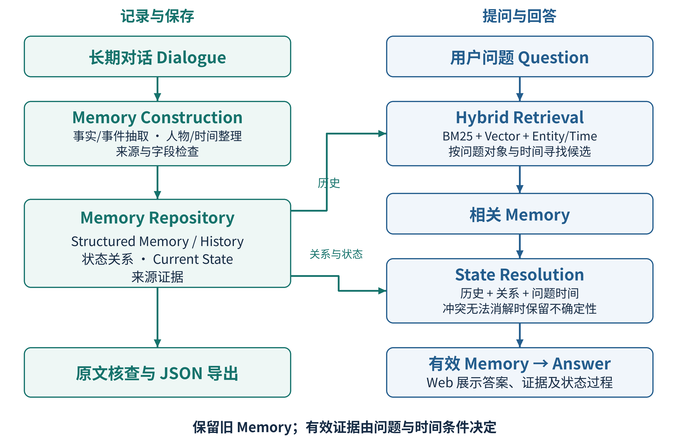
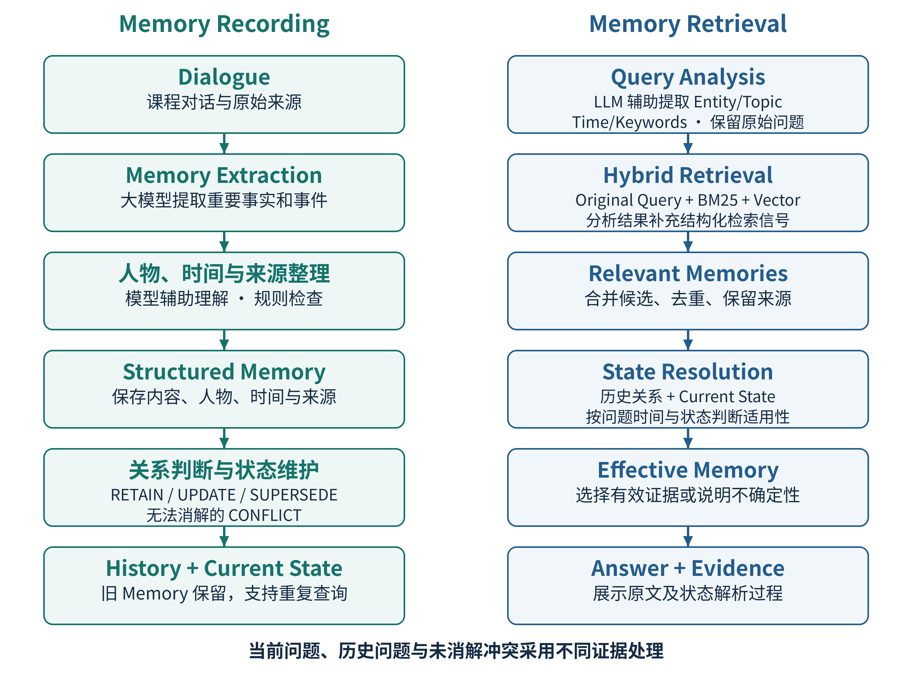

# 动态对话记忆管理项目提案

Milestone 2 · Vision and Scope & Feature Roadmap

队名：在阴雨天游泳　Team ID：3　日期：2026-10-06

成员：莫远序、黎志丽、卓新烨、田亦洁

## 1 问题与项目愿景

跨会话助手需要记住用户事实，也需要处理事实的变化。LangChain 官方文档采用可更新的 JSON 档案或记忆集合，并指出更新可能丢失信息或过度覆盖 [1]。Zep 官方示例中，Kendra 因 Adidas 鞋损坏转而喜欢 Puma，系统尝试将旧偏好标为失效并保存新事实 [2]。这是已有产品的文档示例，不是本组的用户调查。

本项目聚焦一个可检验的问题：检索到相关历史后，怎样判断它是否适用于问题所指的时间？我们计划开发基于课程 LoCoMo 数据的 Web 应用，提取带人物、时间和来源的结构化 Memory，保留历史与状态关系，维护 Current State；提问时结合关键词、语义和结构化条件找候选，再选择有效证据。用户可以查看原始轮次及状态判断过程。

我们的价值是把记录、检索和状态选择连成可核查的课程系统。宏观方法参考已有实践，效果由后续对照实验检验。
## 2 使用者与主要功能

主要使用者为项目开发与评测人员，以及检查系统的教师和助教。基本操作为导入对话、构建并浏览记忆、输入问题、核查回答及证据、导出 JSON。一次构建的 Memory 可保存并供多次提问复用。

| 功能 | 可检查的完成依据 |
| --- | --- |
| F01 对话导入 | 读取课程指定对话，保留人物、会话、轮次和时间来源 |
| F02 记忆构建 | 重要事实和事件形成结构化 Memory，能够定位原始证据 |
| F03 历史与状态维护 | 保留旧 Memory，记录状态关系，维护 Current State 并保存复用 |
| F04 混合检索 | 结合 BM25、Vector 与 Entity/Time 条件，返回可追溯候选 |
| F05 有效记忆选择 | 按问题时间选择证据，展示未消解冲突与证据不足 |
| F06 回答与 Web 展示 | 展示回答、相关历史、采用证据和状态解析过程 |
| F07 JSON 导出 | 导出可与界面及来源记录对应的结构化 Memory |
| F08 测试与对照 | 记录课程指标、对照配置和失败案例，支持复现 |

## 3 首版范围

首版覆盖上述链路。图谱、多跳、合并压缩、复杂冲突消解与自适应检索为候选扩展，不承诺公众账户、外部搜索或图片理解。M2 确定宏观方法及路线，数据库、接口与 Prompt 留待 M3；尚无运行及效果结论。

<!-- pagebreak -->

## 4 总体架构与职责

方案由 Memory Construction、Memory Repository、Hybrid Retrieval、State Resolution 和 Answer / Evidence 展示构成。记录流程维护可复用的历史，查询流程根据问题选择有效证据。两条流程通过同一记忆仓库衔接。

图 1 简化总体架构。箭头表示数据与证据流向，图中各块是宏观职责，不限定内部代码结构。

| 宏观部分 | 职责与产出 |
| --- | --- |
| Memory Construction | 抽取事实和事件，整理人物与时间，校验来源，产出结构化 Memory |
| Memory Repository | 保存历史、来源及关系，维护 Current State，供检索与核查复用 |
| Hybrid Retrieval | 理解问题的对象与时间，合并关键词、向量及结构化条件找到的候选 |
| State Resolution | 结合历史、关系及问题时间，选择有效 Memory 或说明不确定性 |
| Answer 与证据展示 | 根据有效证据回答，在 Web 中展示原文、历史及选择过程 |

Current State 是依据历史及状态关系整理的当前状态摘要，可能包含未消解冲突。它帮助理解当前问题，但不能替代历史记录，也不能成为所有问题的固定答案来源。一次查询的选择不永久覆盖全局历史。

全组已确认此宏观路线。采用大模型辅助抽取与语义理解，规则负责可核查的字段、来源和明确时间；具体技术栈不在 M2 锁定。图谱扩展不属于核心架构实施前提。

<!-- pagebreak -->

## 5 记忆记录与检索流程

记录流程先提取 Memory 并保存来源，再与相关历史比较，维护关系和 Current State。查询流程先找相关 Memory，再按问题与时间条件判断哪些证据有效。状态变化不意味着历史事实被删除。

图 2 Memory Recording / Retrieval。检索后的状态解析区分“与问题有关”与“适用于问题时间”。

| 验收场景 | 预期行为与检查方法 |
| --- | --- |
| 当前状态 | “先住 A，后来搬到 B”；问现在住哪里，采用搬家后证据，旧来源仍可查看 |
| 历史状态 | 对相同历史问搬家前住哪里，采用旧证据，不套用 Current State |
| 未消解冲突 | 两条同一时间条件下的状态证据互相矛盾，展示双方来源和不确定性 |
| 证据不足与导出 | 无充分证据时说明不足；导出的 Memory 能定位原始轮次并与界面对应 |

RETAIN 表示继续保留可用记忆；UPDATE / SUPERSEDE 描述推进或替代关系；CONFLICT 表示证据尚不足以消解矛盾。UPDATE 与 SUPERSEDE 的精确标签边界按课程标注和评测口径核实。时间更新本身不足以证明一条记录应被替代。

<!-- pagebreak -->

## 6 现实方案与方法选择

调研一手文档后，我们保留已确认的结构化 Memory 与 Hybrid Retrieval 路线。现成系统提供了实现依据，也暴露出需要验证的限制。

| 已有实践 | 对首版方案的启示与限制 |
| --- | --- |
| LangChain 的 JSON 档案与记忆集合 [1] | 结构化记忆可跨会话保存；官方提示过度新增、过度更新及上下文丢失风险，抽取结果必须保留来源 |
| Zep / Graphiti 的时间事实 [2] | 事实可有有效时间并随新信息失效，支持历史查询；时间字段不能证明事实为真，图谱本身增加工作量 |
| Elasticsearch 的混合检索 [3] | 官方支持 BM25 与向量结果融合，证明此检索组合已有实现；相关排名仍不等于状态有效性 |

首版采用结构化历史与 Current State，检索后依据问题时间选证据。单纯时间优先难以回答历史问题，单一向量检索保留为对照；图谱与多跳列为扩展。上表是机制参考，不承诺采用这些产品，也不声称本组方案优于它们。

大模型辅助抽取和语义理解，规则核查字段、来源及可明确换算的时间。无法确定的人物、时间与冲突保留不确定性。混合候选先合并去重，再判断状态；Entity/Time 策略在开发集验证，避免过早删掉变化前的证据。融合算法、数据库与 Prompt 留待 M3。

## 7 数据与评测计划

LoCoMo 由 LLM 生成对话后经人工核验编辑，论文明确承认它不能完全反映真实交流 [4]。课程指定 6 段对话，4 开发、2 独立测试，划分以课程通知为准。测试集不用于调参，QA 答案只供评价。

LongMemEval 将知识更新、时间推理与无法回答时拒答列为评价能力 [5]。因此，本项目除课程指标外，记录当前、历史、冲突和证据不足案例；案例检查不等于新增标准基准，也不能外推成真实用户效果。

| 检查项 | 计划与计算边界 |
| --- | --- |
| 回答质量 | 回答 F1，按课程脚本及答案规范化口径计算 |
| 证据覆盖 | Recall@K，核对 Memory 到原始轮次映射及 K 值 |
| 状态判断 | 核对课程关系、有效记忆标注、评价单位与准确率口径 |
| 完整性与成本 | 检查核心链路及异常，记录模型调用、耗时与 token 用量 |

对照使用 Full Text 和不做状态判断的 Vector RAG；另关闭本项目状态判断，检查其单独影响。尽量固定模型、生成配置与证据预算，记录输入截断及额外调用。当前不预设提升比例，实验结论限于指定数据与设置。

<!-- pagebreak -->

## 8 功能路线与团队安排

各阶段安排首轮、优化、验收与缓冲。M3/M4 重叠，共享团队投入，按已明确的需求逐步实施；下表为计划。

| 阶段与时间 | 功能与主要产物 | 三轮与缓冲 |
| --- | --- | --- |
| M2 提案，10/5–10/10 | 明确问题、范围、宏观方法、流程、评测计划与路线 | 首轮 10/5–6；优化 10/7；验收 10/8；缓冲 10/9–10 |
| M3 需求，10/11–10/24 | 功能、数据、异常、接口边界及可检查验收场景 | 首轮 10/11–15；优化 10/16–19；验收 10/20–21；缓冲 10/22–24 |
| M4 中期，10/11–10/24 | 实现导入、Memory、检索、状态选择和 Web 核心链路，提供真实初步测试 | 首轮 10/11–17；优化 10/18–19；验收 10/20–21；缓冲 10/22–24 |
| M5 最终，10/25–11/9 | 完整系统、JSON、对照实验、失败分析及可复现交付 | 首轮 10/25–11/1；优化 11/2–4；验收 11/5–6；缓冲 11/7–9 |

日期均为 2026 年。课件截止时间为 M1/M2 10 月 10 日 24:00、M3/M4 10 月 24 日 24:00、M5 11 月 9 日 24:00，实际展示场次与提交口径另按课程通知核对。

| 成员 | 模块职责 |
| --- | --- |
| 莫远序 | 管理、整体设计、动态状态判断与集成 |
| 黎志丽 | 对话导入、记忆构建与 JSON 导出 |
| 卓新烨 | 检索、证据追踪与对照实验 |
| 田亦洁 | Web 交互、证据展示与端到端验收 |

M2 正文由卓新烨负责、莫远序复核；过程材料由黎志丽整理、田亦洁检查。Notion 维护实时任务，GitHub 保存版本与阶段材料，微信沟通并每周短会；材料制作不代替成员复核。

## 9 风险与待落实事项

抽取与时间判断可能出错，保留原文核查；检索可能漏掉旧证据，用开发集检查召回；状态策略可停用，历史继续保留。公开文档支持可行性，尚无本组用户访谈与系统效果数据。

模型平台、model ID、参数与预算，以及课程数据和评测口径待核实。按共同样例分阶段集成，扩展不挤占必做链路。

## 10 参考依据

课程课件第 4、9–13 页及 M1 Team Workflow 确定交付、评测与分工。以下一手资料访问于 2026-10-06；完整调研与采用理由存入过程包。

[1] LangChain. [Memory overview](https://docs.langchain.com/oss/python/concepts/memory).

[2] Zep. [Facts](https://help.getzep.com/facts)；Graphiti. [Overview](https://help.getzep.com/graphiti/getting-started/overview).

[3] Elastic. [Ranking and reranking](https://www.elastic.co/docs/solutions/search/ranking).

[4] Maharana et al. [Evaluating Very Long-Term Conversational Memory of LLM Agents](https://aclanthology.org/2024.acl-long.747/). ACL 2024.

[5] Wu et al. [LongMemEval](https://arxiv.org/abs/2410.10813). ICLR 2025.
