# 摘要

本文记录我在 LoCoMo 长对话记忆任务上，从系统首次跑通到完成冻结留出评测这 18 天里的工程与实验探索。系统把原始对话抽取成带来源的原子 Memory；构建期判断 Memory 之间的状态关系（保留、推进、替代、冲突），查询期再按问题指定的人物、状态和时间选出有效证据。研究问题是：这套动态记忆机制（下称 Dynamic）能否在答案质量上稳定优于不做状态解析的混合检索基线（下称 Hybrid），代价又是多少。

全文按时间顺序记录 26 个实验单元（E0–E25）。每个单元可能合并了多轮真实调用，均说明动机、设置、结果、失败诊断，以及它引出的下一个实验。主要结果如下。

- 在两段预先固定、开发期间没有读取答案的留出对话（conv-43、conv-44，共 400 题）上，我只运行了一次冻结评测。类别 1–4 的完整分母 F1 为 Hybrid 0.4026、Dynamic 0.4092，配对差 +0.0065，95% 题目 bootstrap 区间为 [−0.020, +0.034]，跨零。800 项非作者 AI 来源盲审中，Dynamic 在 297 个可判定配对上原文支持改善 28 对、退化 18 对，区间同样跨零。
- 在同一批留出题上，Dynamic 的查询费用约为 Hybrid 的 7.9 倍（按已报 usage 和峰时单价折算），单题 p50 延迟约为 3.5 倍。
- 在开发集上，Dynamic 的表现首先取决于运行可靠性。输入预算不足时，Dynamic 有 49/100 项失败，完整分母 F1 比 Hybrid 低 0.17；放宽输入预算后全部成功，F1 高 0.044，但区间仍跨零。
- 失败归因显示，可以确认的语义损失主要发生在抽取阶段：8 个双审一致的错误拒答中，5 例是抽取遗漏。在留出集上，Dynamic 的有效证据解析使标注来源覆盖下降 0.08–0.19。

因此本文的主结论是一个零结果：现有证据不支持"Dynamic 稳定优于 Hybrid"。我认为这份材料的价值主要在过程本身：每个实验怎样从上一个实验的失败中提出；结论怎样在完整失败分母、预先冻结、费用硬上限和非作者复核这些约束下得出；以及哪些候选最终被采用、保留为可选、搁置或淘汰。

# 1 引言

## 1.1 任务与研究问题

LoCoMo 的每段对话跨越几十个会话、几百轮交流。问题分为五类：多跳（类别 1）、时间（类别 2）、开放域（类别 3）、单跳（类别 4），以及答案不在对话中、应当拒答的对抗题（类别 5）。课程把 conv-26、conv-30、conv-41、conv-42 定为开发集，共 757 题。教师的最终评分集不公开。项目开始时，我把 conv-43、conv-44 预先定为本地留出集（共 400 题），规定在系统冻结前不查看这两段对话的模型成绩和标准答案。

长对话里的事实会变化：人搬家、换工作、计划取消。只按语义相似度检索，可能把过期的旧事实交给回答模型。Dynamic 的设想是：在构建期记录事实之间的演化关系，在查询期按问题所指的时间和状态挑出仍然适用的证据。本文围绕三个问题展开：

- **RQ1 质量**：在完整分母下（运行失败记零），Dynamic 的答案质量是否稳定优于 Hybrid？
- **RQ2 可靠性与成本**：Dynamic 多出的有效证据解析步骤，带来多少额外失败、费用和延迟？
- **RQ3 损失位置**：答案错误或遗漏时，证据是在抽取、检索、解析还是回答阶段丢失的？

## 1.2 主要结论

1. **RQ1**：在开发集固定 100 题和留出集 400 题上，都没有观察到区间不跨零的稳定增益。唯一一次区间不含零的结果是负向的（E22，−0.17），原因是输入限制导致的运行失败，而不是语义判断变差。
2. **RQ2**：Dynamic 的查询费用是 Hybrid 的 4.1 到 10.3 倍。可靠性曾是 Dynamic 的主要短板：在三个实验阶段中，它因完整解析输入超出预算而失败 5 到 49 项。放宽预算后，这类失败消失，成本随之上升。
3. **RQ3**：已确认的事实丢失主要来自抽取；Dynamic 的有效证据解析会删去部分标注来源，但被删来源是否真的不适用，没有独立测量。在开发数据的关系参考样本中，SUPERSEDE 和 CONFLICT 的出现次数为零，conv-44 构建出的 6,973 条关系中有 6,769 条是"未确定"。Dynamic 针对的"状态替代"现象，在这批数据里可能本来就很少。
4. **过程**：大量候选改进在局部样本上有效，在同题对照或更大分母下消失。被保留下来的主要是工程约束：显式失败分母、来源绑定、输入预算保护和可恢复的构建。

## 1.3 范围与阅读说明

本文覆盖 2026-10-19 系统首次跑通到 2026-11-05 留出评测结束。课程 M1–M4 的报告与交付材料、11 月的展示冲刺不在范围内；10-19 的系统构造（E0）只作为背景简写。

全文的数字口径如下：

- **H / D**：分别指 Hybrid（`hybrid_no_resolution`）和 Dynamic。
- **完整分母**：运行失败、超时和预算拒绝都留在分母里并记零；unknown 项给出上下界。"仅成功项"的分数会单独标出，只作参考，因为它按运行结果筛选，带有选择偏差。
- **已曝光开发题**：开发集上的结果都来自已经被反复诊断过的对话，不能当作泛化证据。只有 E25 是在留出集上的一次性评测。
- **语义审阅**：除特别说明外，答案与来源的语义判断都由未参与该实验实现的 AI 审阅者完成，不是人工或教师真值。
- **费用**：分三种口径。"预约"是发送前按最坏情况扣减的额度；"已报峰价"是按 provider 返回的 usage 和官方峰时 cache-miss 单价折算的金额；实际账户账单我没有读取。三者不能互换。
- **跨实验比较**：不同实验的样本、Prompt 版本和 thinking 设置不同，表格里的分数不能跨实验直接相减。

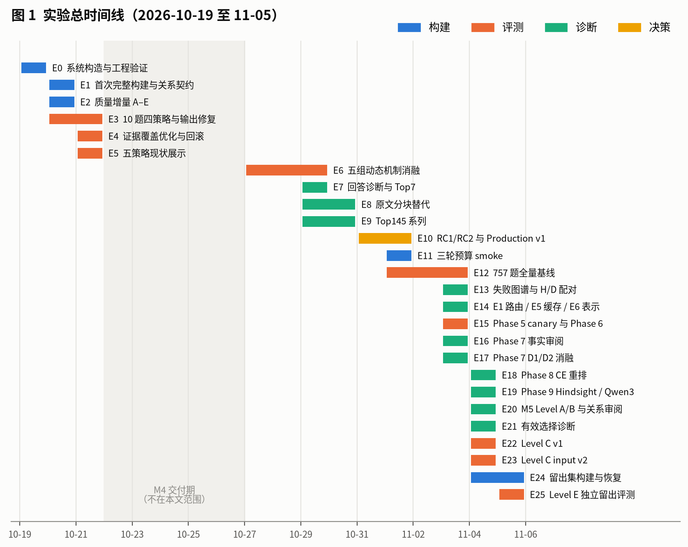{width=100%}

# 2 系统与评测口径

## 2.1 流水线

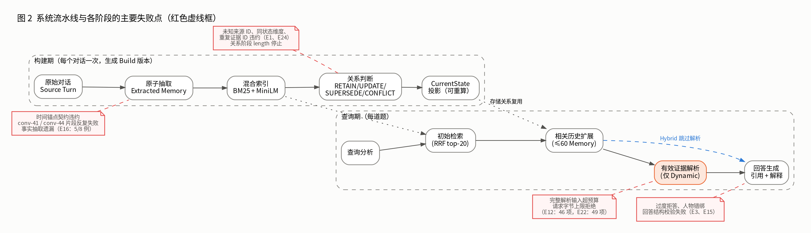{width=100%}

图 2 是系统的完整流水线。构建期对每段对话运行一次，产出一个 Build 版本：

1. **原子抽取**：把原始对话按片段送入模型，抽取出一条条原子事实（Memory）。每条 Memory 带内容、陈述性质（事实、计划或不确定）、时间表达及其原文锚点，以及一个或多个来源轮次（Source Turn）。校验器拒绝没有来源、引用不存在的轮次、或时间表达不在锚点原文中的输出。
2. **混合索引**：BM25 加固定版本的 MiniLM 本地向量，用 RRF 融合。
3. **关系判断**：对同一人物、同一状态维度（state_key）的 Memory 对，由模型判断 RETAIN（继续适用）、UPDATE（同一过程的阶段推进）、SUPERSEDE（新值替代旧值）、CONFLICT（无法消解的矛盾），或"未确定"。每条关系都要求有逐字原文证据。
4. **CurrentState 投影**：根据历史 Memory 和已确认关系重算的当前状态摘要。它是可重算的投影，不是另一份事实来源。

查询期对每道题运行：

1. **查询分析**：识别问题涉及的人物、状态和时间。
2. **初始检索**：取 RRF 排序前 20 条 Memory。
3. **相关历史扩展**：沿存储的关系和同状态维度补充历史 Memory，最多 60 条。
4. **有效证据解析**（只有 Dynamic 执行）：模型阅读扩展后的完整候选，判断哪些 Memory 在本题所指的时间和状态下仍然有效，必要时补判构建期没有确定的关系。这一步需要把全部候选一次送入模型，所以输入很长，是后文多次"完整解析输入超预算"失败的来源。
5. **回答生成**：回答模型基于交付的证据作答，必须给出引用和解释；证据不足时应拒答。

Hybrid 在第 3 步之后直接进入回答。早期实验还比较过 Full Text（把完整对话直接送给回答模型）、Vector（只用向量检索）和原文兜底（`dynamic_raw_fallback`，Dynamic 证据不足时再检索原文窗口）。

## 2.2 术语

| 术语 | 含义 |
| --- | --- |
| Source Turn | 原始对话中可定位的一轮，由对话 ID 和轮次 ID 共同确定 |
| Memory | 从原始对话抽取、带内容、时间和来源的原子事实 |
| MemoryRelation | 有来源证据支持的 Memory 之间的关系：RETAIN、UPDATE、SUPERSEDE、CONFLICT 或未确定 |
| CurrentState | 由历史 Memory 和已确认关系重算的当前状态，可以包含未消解的冲突 |
| 有效记忆 | 在问题所指的时间与状态下可以用于回答的 Memory，不一定是最新的一条 |
| Build | 一次构建对应的来源、Memory、关系、投影和索引的共同版本；配置是 Build 身份的一部分 |
| Run | 一次评测运行，固定题单、策略、Prompt 和配置，结果逐项持久化 |
| 证据损失 | 原始对话支持的应答事实在抽取、选择、交付或回答阶段丢失 |

## 2.3 指标

| 指标 | 定义 | 主要局限 |
| --- | --- | --- |
| 官方类别 F1 | 类别 1–4 使用上游规则的 token F1 | 字面重合，不等于事实正确 |
| 类别 5 字面拒答 | 回答是否按规则字面拒答 | 不是事实正确率，单独报告 |
| 完整分母 F1 | 全部计划项的均值，失败记零 | 混合了可靠性与质量 |
| 来源 Recall 代理 | 前 K 条 Memory 关联的唯一 Source Turn 对标注来源的覆盖 | 来源命中不代表事实被抽对 |
| 来源盲审 | 非作者 AI 通读原文后，逐项判断原文支持、引用支持、拒答是否合理，以及人物、事件、时间错误和列表遗漏 | 每项通常只有一名审阅者，不是人工真值 |
| 配对差与区间 | 同题 D−H，按题 bootstrap（固定 seed）得到 95% 区间 | 只描述所选对话内的题目不确定性 |

## 2.4 模型与配置

全部真实调用使用 DeepSeek 官方接口的 `deepseek-flash` 别名，temperature 0，JSON 输出。实验期间官方价格页把该别名映射为 DeepSeek-V4.1-Flash-1017，但响应只返回可变别名，所以我无法证明服务端权重在整个实验期间没有变化。早期 Build 中关系判断使用 high thinking、有效证据解析使用 low，其余阶段关闭 thinking；M5 冻结评测（E23–E25）的所有新生成操作都关闭 thinking，历史 Build 的配置原样保留。Embedding 使用固定 revision 的 MiniLM，在 CPU 上运行。

# 3 人与 AI 代理的分工

这是一份个人视角的材料，需要先说明"我做了什么"。我作为研究者负责：提出每一轮的研究问题，确定实验协议和比较条件，批准每个付费阶段的调用次数和金额上限，决定何时停止、回滚、恢复或采用。实现代码、执行实验、整理结果和初步审阅，由 AI 编码代理在我的授权下完成。各轮的设计讨论先以访谈形式进行，确认后才写成 ADR、spec 或实验协议，再进入实现。

语义复核按身份分开记录：作者代理的自查、未参与实现的非作者 AI 审阅、格式与哈希核验，各自单独标注。E6 中有两批答案（6 份与 4 份）由同组成员 B 按盲审方式提交，按原记录收到的提交如实标注，本文没有另行核实其身份或过程。本文没有把 AI 完成的实现或运行写成我亲手完成的实验，也没有把任何 AI 审阅称为人工真值。

# 4 实验记录

每个实验单元按同一结构记录：**动机**（上一步暴露了什么）→ **设置** → **结果** → **失败与诊断** → **决定与下一步**。为节省篇幅，简单单元把若干项合并成一段。

## 4.1 阶段一：系统跑通与首轮真实实验（10-19 至 10-21）

### E0 系统构造与工程验证（10-19，背景）

10-19 这一天完成了系统的首个可运行版本：导入、抽取、检索、关系、问答、版本恢复，以及浏览器端验收。这一阶段只验证工程契约，模型调用全部是受控夹具，不产生任何质量结论。

| 模块 | 验证内容 | 结果 |
| --- | --- | --- |
| 导入与来源隔离 | 10 段对话、5,882 轮只读检查；评测标注与原文隔离 | 11 项通过；未知会话、SQL 列数和时间戳元数据问题先失败后修复 |
| 原子抽取 | 空白 Memory、非法结构、来源校验、片段级提交与重启恢复 | 27 项通过、1 项跳过 |
| 混合检索 | BM25 + 固定 MiniLM + RRF；超长输入拒绝 | 39 项通过、3 项跳过，另 2 项真实本地编码检查通过 |
| 关系与发布 | 非法来源、未来或条件状态、部分发布被拒绝 | 62 项通过、3 项跳过 |
| 当前与历史问答 | 计划、冲突与证据不足的区分；英文日期解析 | 69 项通过、3 项跳过；日期解析先失败后修复 |
| 恢复、导出与并发 | 子进程中断、发布竞态、索引身份 | 各阶段失败都保留，不覆盖已成功部分 |
| 浏览器与 CI | Playwright 端到端、故障注入 | 112 项通过、4 项跳过；早期独立审查发现的安全问题已修复 |

这一阶段确立了后续实验都遵守的三条工程约束：失败必须显式保存，不能静默重试；未完成的 Build 不能被查询；评测运行逐项持久化，中断后显式恢复，unknown 不自动重发。

### E1 首次完整构建与关系契约系列（10-20）

**动机**：用冻结的原始契约对 conv-26 做第一次真实完整构建。

**首次构建**：21 个片段抽取在一次显式恢复后得到 295 条 Memory。关系阶段计划 292 个任务，结果是 89 成功、29 失败、1 中断、173 待执行。保存下来的 provider 调用有 220 次，其中一部分 usage 缺失，按未知处理。原始 29 个失败任务共 87 次尝试，其中的具体错误子类没有保存，事后无法统一推断根因。

**子实验**：我没有直接重跑整个 Build，而是固定原始候选和输入顺序，做了一系列小规模独立回放，每轮都单独批准调用上限：

| 子实验 | 调用 | 改动 | 观察 |
| --- | --- | --- | --- |
| 同状态维度前提对照 | 6（前后各 3） | 把校验器对 RETAIN/CONFLICT 已有的"同 state_key"要求写进 Prompt（relations-v2） | 单候选任务 relation:2 由失败转为通过；两个 20 候选批次仍失败，其中一个从"同维度违约"变成"联合规则违约" |
| 重复证据 ID 修复 | 4（前后各 2） | 先把联合错误码拆成"空白理由"和"重复证据 ID"两个，定位到后者；Prompt 增加去重指令（relations-v3） | relation:44、relation:90 两个批次都转为通过，覆盖 20/20；但全部 40 个判断都是"未确定" |
| v3/v4/v5 固定任务复验 | 9（每版 3） | v4 补充旧事实与新非事实的标签前提；v5 让校验器与 Prompt 共用同一个标签可用性函数，把每条旧 Memory 允许的标签直接放进输入 | v3、v4 在 relation:112 上仍报 `factual_resolution_required`；v5 三项全部通过 |
| v5 完整构建 | 累计 313 | 用 v5 新建独立 Build | 抽取和索引完成；关系阶段先后出现输出长度截断、逐字引用违约，最后在 HTTP 错误处停止。Build 置为 interrupted，不发布、不跑 QA |
| v6 / v6.1 / v6.2 语义关卡 | 25 | 在长输入和语义对照案例上设置五道关卡 | 24 次结构成功，1 次 HTTP 402；第五道关卡（案例 172）始终失败，因此阻止完整重建。早期把对照案例 148 判为"接受"的结论后来被撤回 |

**诊断**：两类问题交织在一起。一类是**契约可见性**：校验器执行的规则没有完整写进模型可见的指令里，模型无从遵守。这类问题通过补充指令或共享规则函数逐个修复。另一类是**语义正确性**：结构合法、引用逐字匹配，不代表关系判断正确。案例 172 把"完成项目"和"描述同一件作品"判成阶段推进（UPDATE），结构完全合规，语义却是错的。

**决定**：第一类修复全部保留；第二类不靠追加 Prompt 或硬编码 ID 来"修"。完整重建被语义关卡挡住，后续实验改为先在小范围定位，再决定是否扩大。

### E2 质量增量 A–E（10-20）

**动机**：E1 的语义关卡没有通过。我提出四项 P0 和一项 P1 改进，经访谈确认后分成五个相互独立的增量，每个增量都有自己的调用上限（每个不超过 16 次）。

| 增量 | 内容 | 真实请求 | 结果 |
| --- | --- | --- | --- |
| A 抽取示例 | 为抽取 Prompt 增加计划与事实、人物指代、事件阶段、否定句的正反对照 | 4 | 四个合成语句的结果另交非作者核对；不代表总体质量 |
| B 关系候选 | 优先比较同一人物、同一状态维度；修复同键旧事实被近期 24 条计划挤出 | 2 | 73/91 两个案例的回放符合预期；没有验证案例 172 |
| C 阶段证据契约 | UPDATE 必须给出合法的阶段推进证据 | 3 | 73 判为有阶段证据的 UPDATE、148 判为 RETAIN；**172 仍判为 UPDATE**，并同时给出两个 true 谓词 |
| D 有界原文兜底 | 新策略：证据不足时最多做一次 BM25 原文窗口检索和一次联合解析 | 7 | 先后暴露两个契约歧义（模型把 Memory 来源放进原文 ID、联合解析选中已被拒绝的 Memory），补充说明后探针通过 |
| E 证据精简 | `focused` 模式按词面裁剪候选，保留完整同键与关系连通组 | 6 + 4 | 输入从 4 条减到 3 条；v2 只在单人物、单问题时裁剪，3 条减到 2 条。非作者复核发现 v2 的两份答案都漏写了截止日期 |

**结果**：合计 26 次真实请求。局部契约和输入量有所改善，但没有通过整体语义验收：案例 172 仍误判 UPDATE，focused 输出存在边界遗漏。完整离线回归第一次跑出 311 通过、13 失败；修复共享校验后再跑完整回归，324 项通过。

**决定**：A–E 的工程实现保留，默认仍使用 `expanded` 证据模式。没有冻结新的完整身份，C 的真实尝试就此停止，不再继续堆 Prompt。

### E3 分阶段 thinking 与 10 题四策略，及答案输出修复（10-20 至 10-21）

**动机**：给不同阶段设定不同的 thinking 强度，并放宽关系输出上限，看能否得到第一个完整可查询的 Build。

**设置**：v1、v2 两个 Build 失败后，v3 完整构建成功。在 v3 上固定 10 道题，运行四种策略，共 40 项。

**结果**：

| 运行 | 成功 / 计划 | Dynamic | 原文兜底 | Hybrid | Full Text |
| --- | --- | --- | --- | --- | --- |
| 初轮 | 24/40 | 9/10 | 4/10 | 3/10 | 8/10 |
| 输出修复后同题复验 | 40/40 | 8 题 F1 0.334 | 8 题 F1 0.340 | — | — |

初轮有 16 项因答案结构校验失败。修复回答契约和输出提示后，同一 Build、同一题单重跑，40 项全部成功（共 98 次请求）。在 8 道可比题上，Dynamic 的 F1 从 0.154 升到 0.334，原文兜底从 0.039 升到 0.340。

**诊断**：初轮的成功数主要反映的是回答输出能否通过结构校验，而不是答案质量。复验一次改了多处，无法分离每项改动的贡献。初轮也没有"全部关闭 thinking"的对照组，不能把差异归因于 thinking 强度。

**决定**：保留修复后的回答契约。初轮不支持"原文兜底总体更优"的说法，这一点在 E5 中做了专门检验。

### E4 证据覆盖优化、回滚与旧计划取消（10-21）

**动机**：E3 复验中仍能看到关键证据没有交付给回答模型。我尝试用重排和"列表类问题枚举补查"提高证据覆盖。

**设置**：固定目标题和未见题，共 30 项 A/B，不重建 Memory。另做了查询可靠性、来源日期、列表多样性的定向修复，以及 citation 跟进回放，各自保存为独立快照。

**结果**：30 项全部运行成功，但没有看到稳定提升。QA3 的完整关键证据组仍然超出预算；QA15 的补查反而挤掉了原本的支持证据。在新问题组上，原文兜底的 F1 低于 Hybrid。

**决定**：按我的决定回滚 P0/P1 的三个提交，保留 P2 的工程修复；原始失败记录不覆盖。同一天我停止扩展原定的 757 题 × 4 策略、共 3,028 项全量计划，转为小步增量迭代。这一计划在 E12 中以新的身份重新执行。

### E5 五策略现状展示（10-21）

**动机**：回滚之后，用一组固定样本如实展示系统现状，并直接检验"原文兜底总体更优"这一假设。

**设置**：复用 conv-26 已有的完整 Build，不重新抽取、不重跑关系。题单在生成前冻结：用固定种子从每个官方类别各取 4 题，共 20 题，五种策略共 100 项。同轮另有三项检查：40 题初始检索 Recall，10 个真实动态关系场景（4 个 UPDATE、3 个 RETAIN、3 个未确定），以及对 20 条 Dynamic 和原文兜底回答的来源审阅。本轮新增 307 次调用（批准上限 420 次）。

**结果**：100 项全部运行成功。16 道可回答题的 F1：Full Text 0.349、Vector 0.491、Hybrid 0.512、Dynamic 0.510、原文兜底 0.400。初始检索 Recall@5/10/20 为 0.642 / 0.729 / 0.779。

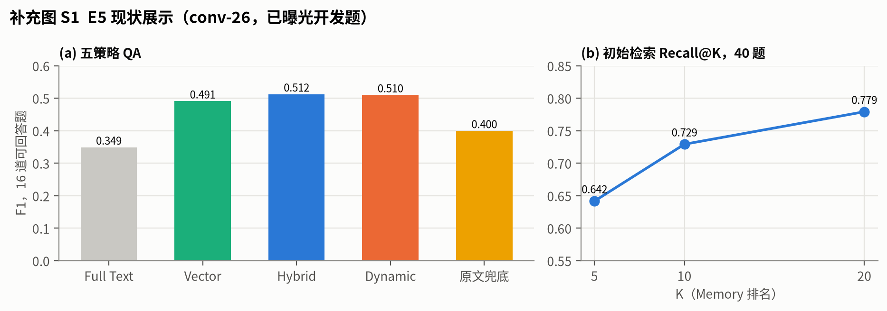{width=95%}

**诊断**：Dynamic 有 2 道题实际走了备用路径。来源审阅由当时的开发助手完成，属于作者自查。当前 Build 里没有真实的 SUPERSEDE 或 CONFLICT 关系，所以这组样本无法评估这两类关系的质量。审阅还对两条已存储关系的语义提出了异议。

**决定**：否定"原文兜底总体更优"。Hybrid 与 Dynamic 的差距只有 0.002，在 16 道题上无法区分。下一步需要回答：Dynamic 的各个机制分别贡献了什么。

## 4.2 阶段二：机制归因与局部迭代（10-27 至 11-01）

### E6 五组动态机制消融（10-27 至 10-29）

**动机**：E5 显示 Dynamic 和 Hybrid 在小样本上几乎打平。要回答 RQ1，先要知道 Dynamic 的每个机制分别贡献了什么。我通过访谈确定了一份消融协议（ADR-0003），只把可以归因到查询期的贡献作为主张。

**设置**：在 conv-30、conv-41、conv-42 上各自隔离构建，固定同一对话的 Memory、索引和初始候选。五组 A–E 分别打开或关闭历史扩展、独立有效证据解析和存储关系复用，每组运行 3 次，计划最多 1,080 项。conv-26 留作已知问题的诊断，conv-43/44 留到冻结之后。协议规定：正式运行开始后，任何对题单、策略或 Prompt 的改动都会改变比较身份，必须另存，不能覆盖。

**结果**：正式的 1,080 项没有完成。

- **关系输出上限 16K**：第 107 次调用的结果用量未知，按协议停止。
- **关系输出上限 32K**（新的 campaign）：经过多次 transport 恢复，conv-30 构建完整；conv-41 抽取 33/34 片段，失败片段反复失败。
- **时间锚点因子探针**：四组有限对照最多 12 次请求，得到 8 份可用输出、4 份不可用，48 项事实判断待审；之后的反馈探针 3 次仍然失败，没有启动完整重建。
- **conv-30 四题 A/D 对照**：8 项中 6 项成功，2 项 D 组解析失败，共 14 次请求、392,178 tokens。成员 B 的盲审给出 3 个 accept、3 个"需修改"，其中 2 项解释判断受限于审阅包缺少来源。D 组有两例把候选从 16 条压到 2 条，但这不等于降低了总成本。
- **解析契约修复与六题效果实验**：修复用了 4 次请求、214,263 tokens；随后的效果实验 4 成功、1 失败、7 未尝试，用了 10 次请求、129,252 tokens；成员 B 对其中 4 份答案的盲审为 A 组 1 accept、1 需修改，D 组 2 accept。第二个对话没有运行；失败项 mini03-A 的具体违约原因未知。

**诊断**：机制归因的前提是所有组都完整跑完。实际卡在了更上游的地方：conv-41 一个片段的时间锚点契约，和有效证据解析输出的结构契约。两份完整答案对不足以证明任何总体增益。

**决定**：停止五组消融，不从唯一完整的 conv-30 外推全部机制的收益。焦点转到一个更具体的问题：契约失败的根因能否被观测和定位。

### E7 回答诊断细化与 Top7 迭代（10-29）

**动机**：E6 的历史失败只留下了通用异常信息，无法辨别根因。

**诊断码细化**：接受条件保持不变，只把通用异常换成固定的诊断码，并用 960 组合成输入验证：58 组接受、902 组拒绝，接受结果的变化为 0。这一改动提高了可观测性，但不能事后追认历史失败（如 mini03-A）的原因。

**Top7 迭代**：我列出七个稳定的问题条目（TOP7-001 到 007），顺序固定，逐项做离线修复，再用有限的真实调用检验：

- **离线修复**：内容包括时间锚点错误分类与定向反馈、请求前输入预算检查、回答来源须证明具体事件关联、冲突证据被截断时阻止只发送一方，以及完整的交接与分母登记。完整离线回归 527 项通过；后续分层契约版本为 630 项通过。
- **真实关卡**：六项诊断中 4 项技术通过、2 项失败（9 次 HTTP、81,966 tokens）。4 份输出经冻结后揭盲的 AI 语义复核：1 通过、2 失败、1 不确定。
- **证据目录开放探索**：48 次 HTTP。短证据地址带来局部的技术改善，语义增益不足。
- **thinking 成本与原文阅读**：103 次请求结算 448,646 tokens，第 104 次请求结果未知。同一组 8 题上，resolution 使用 low thinking 时完成且语义通过 8/8；改为 direct 是 2/8，完全关闭是 3/8。
- **reader v2**：从回答输入中移除抽取用的时间地址句柄，48 次 HTTP、99,193 tokens，全部终结。已知题上，原顺序的完成率从 v1 的 4/8 升到 v2 的 8/8，完成且语义通过从 2/8 升到 6/8；QA51 的语义仍然失败。

**决定**：保留显式 reader v2 和分层契约，均为可选项（opt-in）；关闭 thinking 来降本的方案被淘汰。七个父项都没有达到整体验收。

### E8 原文分块替代结构化链路（10-29 至 10-30）

**动机**：抽取阶段反复出错。一个自然的问题是：能不能干脆不抽取，直接检索原文分块？

**设置**：10 个案例 × 3 组主比较 × 2 次重复，另加 8 项 reader 诊断和 12 项抽取，共计划 80 项，实际发出 78 次 HTTP。另有 2 项问答因上游失败没有发送，仍保留在计划分母里。三组为：结构化 Memory 链路、固定原文分块、完整全文。

| 组 | 技术交付 | 整体正确 | 干净的必需事实 |
| --- | --- | --- | --- |
| 结构化 Memory | 18/20 | 11/20 | 64/78 |
| 原文分块 | 20/20 | 12/20 | 48/78 |
| 完整全文 | 20/20 | 16/20 | 70/78 |

**诊断**：原文分块的技术交付率更高，但必需事实少了 16 个，问题出在检索阶段没有把它们取回来。分块 reader 在已交付输入上的错误拒答为 0，但这只说明 reader 本身不是瓶颈，不能掩盖端到端的检索缺口。完整全文的事实最多，但也有遗漏和过度推断，而且成本更高。

**决定**：拒绝用固定原文分块替换默认的结构化链路。近似去重等方案没有实施，所以不把它们写成失败。

### E9 Top145 系列（10-29 至 10-30）

**动机**：E7 的 Top 1、4、5 三项仍未解决，涉及单命题抽取、模态（计划或事实）、补充前文窗口，以及二阶段复核。

**设置与结果**：分四批，每批单独冻结：

| 批次 | 请求 / tokens | 关键对照 | 结论 |
| --- | --- | --- | --- |
| 单命题、模态、notes、窗口 | 96 HTTP / 276,723 | 加窗口前后：技术 6/8 对 6/8，整体 4/8 对 4/8 | 单命题保留为局部可选项；notes、思考、窗口的整体替换都不成立 |
| 复核、时间索引、新边界 | 249 HTTP / 593,616 | 窗口 + 复核在已知题上 8/8，但需 108,925 tokens；12 个新边界上复核前后 19/24 对 19/24 | 保留窄范围候选；逐断言检查、独立盘点、源内时间索引淘汰 |
| 更便宜的首次检查 | 86 HTTP / 212,852 | 首次检查替换后总计 23/32 对 23/32，token 反而多 11.2%；conv-41 新增整批拒绝 | 淘汰首次检查替换；异语境抽取示例不默认采纳 |
| 受限 patch 与选择性前文 | 56 HTTP / 242,531 | 选择性前文 + 复核与完整 ±1 窗口 + 复核都是 8/8，token 从 109,185 降到 78,242（−28.3%）；patch 技术 6/12 对 4/12，语义 2/12 对 2/12 | 选择性前文作为局部降本候选；patch 不能当作完整修复 |

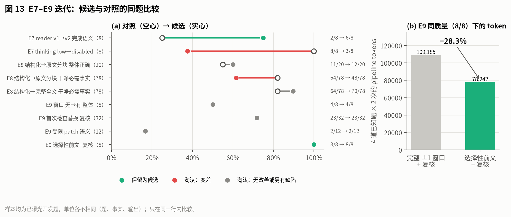{width=100%}

**诊断**：多数候选在已知题上能修好原来的失败，换到新边界或同题对照就不再成立。唯一稳定的收益是在质量不变（8/8）的前提下降低了 token，样本只有 4 道已知题，每题跑 2 次。到这一轮结束时，维护系列累计已开始的 HTTP 请求为 696 次。

**决定**：七个父项仍未整体验收。保留下来的窄改动进入下一步的安全集成。

### E10 安全集成 RC1/RC2 与 Production v1（10-31 至 11-01）

**动机**：把前几轮验证过的窄改动集成进稳定的默认路径，其余候选明确标记去向。

**设置**：先审查 26 项集成候选，RC1 和 RC2 分开保存。后续实验 INT-FOLLOWUP 使用 28 道题：12 道已曝光开发题、12 道合成题、4 道旧回归题。每题 2 次重复 × 3 组，每条 pipeline 先作答、再做一次通用复核，共 168 条 pipeline、334 次 HTTP。

**结果**：

- **已曝光开发题 24 个输出**：原版 17/24，复核后仍是 17/24；两种 guided 方案都是 24/24。
- **合成题 24 个输出**：原版 20/24，wide-guided 23/24，selective 22/24；复核前后都没有变化。
- **旧回归题 8 个输出**：三组复核前后分别为 6/8→7/8、6/8→8/8、7/8→7/8。
- **selective 的节省**：总 token 节省 15.76%，低于预设的 20% 门槛。
- **F01 四包表示**：可逆，但估算输入为 32,859–59,291，全部超过 24K 预算，因此一次真实解析请求都没有发出。

**决定**：Production v1 最终整理出 31 项规范化采用项，默认路径合入诊断码、来源预算、受限反馈和完整输入保护，并移除了"普通 Dynamic 失败后隐式用原文重跑"的行为，因为这个行为会让失败在分数里不可见。F01 不移植，F02 留作研究候选，F03 因未达门槛不采用。离线验收为 608 项测试通过、1,788 个契约组合。

## 4.3 阶段三：全量基线与失败图谱（11-01 至 11-03）

### E11 三轮预算 smoke（11-01）

**动机**：E10 得到了 Production v1。在付费跑全量之前，先用固定的 5 题 × 4 策略（20 项）检查默认预算能否跑通 conv-26。三轮共用一个累计上限：¥40、500 次物理 HTTP、并发 1；每轮都新建身份，不拼接前一轮的结果。

| 轮次 | 改动 | Build | QA | 本轮 HTTP / 峰价 |
| --- | --- | --- | --- | --- |
| ① 默认 | 输出上限 8,192 | 21/21 片段、273 Memory；关系 269 任务中 48 成功、3 失败、218 被阻塞，未发布 | 20 项执行前阻塞，没有 Run | 84 / ¥3.21 |
| ② 输出 ×4 | 输出上限 32,768，新建 Build | 275 Memory、269/269 关系，complete | 15/20：Full Text、Vector、Hybrid 各 5/5，Dynamic 0/5，全部因解析输入超过 24,000 预算 | 322 / ¥17.58 |
| ③ 解析输入 ×4 | 解析输入预算 96,000，复用②的 Build | 不变 | 20/20 执行与结构验收通过 | 40 / ¥0.67 |

第 ② 轮有 32 次输出超过了旧的 8,192 上限，最大一次 20,201 tokens；所有请求都是正常结束（`stop`），没有截断。三轮累计 446/500 次 HTTP，峰价 ¥21.46。

**诊断**：默认配置的问题不在模型能力，而在两个预算参数。关系判断的输出天然很长；有效证据解析的完整输入经常超过 24K。E12 和 E22–E23 会反复回到这个问题（图 14）。

**决定**：全量基线使用研究参数，即输出 32,768、解析输入 96,000，生产默认不变。第 ③ 轮只证明研究参数下服务可用，不代表语义验收。

### E12 四对话全量基线（11-01 至 11-03）

**动机**：在完整分母上取得 757 题 × 4 策略的真实基线，也就是 10-21 取消的那个计划，现在用新的身份重新执行。

**设置**：4 个开发对话，757 题 × 4 策略，共 3,028 项，输出 32,768、解析输入 96,000。Build 构建过程中先后发生 OOM、HTTP 402 和超时，每段恢复都单独保存，不拼接。

**结果**：3,028 项中 2,969 成功、56 失败、3 unknown。四策略完整分母 F1：Full Text 0.464869、Vector 0.519714、Hybrid 0.521886（含 1 个 unknown，上界 0.523207）、Dynamic 0.515133。Dynamic 709/757 成功，48 项失败中有 46 项是完整解析输入超过预算。

**补充与修复**：另建两个 Run，只针对原来失败和 unknown 的项。补充 Run 把解析输入提高到 192,000，59 项中 51 成功、8 失败；回答修复 Run 8/8 成功。两者都不回填原 3,028 项的分母。补充结果中仍有官方 scorer 给满分、AI 交叉审阅却指出引用失败（Citation Failure）的答案。

**决定**：原基线保持原样。Dynamic 在成功子集上的均值较高，不能用来掩盖 48 项失败。

### E13 失败图谱与 Hybrid/Dynamic 配对（11-03）

**动机**：E12 的总分接近，我需要知道两边各自在哪些题上赢。

**失败图谱**：对三个 Run 分别建立 Failure Atlas，得到 2,053 / 41 / 8 条候选记录。候选记录不等于错误数。84 项匿名 AI 初审加 18 项交叉审阅后，8 项错误拒答被两边共同指出；明确的交叉 Citation Failure 只有 1 项，其余根因多为 unknown。

**配对**：

| 指标 | 值 |
| --- | --- |
| 配对状态 | 两侧都成功 705；仅 Hybrid 成功 48；仅 Dynamic 成功 3；unknown 1 |
| 705 对上 D 相对 H | 136 胜 / 110 负 / 459 平，平均差 +0.026 |
| 胜题平均增益 / 负题平均损失 | +0.305 / −0.210 |
| 完整分母 F1 | Dynamic 0.515；Hybrid 在 [0.522, 0.523] |
| 查询费用（峰时估算） | Dynamic ¥98.93；Hybrid ¥9.60，约 10.3 倍 |

**诊断**：两边都成功时 Dynamic 略好；把它独有的 48 项失败计入后，略差。增益集中在少数题上，单题幅度大；损失分布更广。

**决定**：现有结果不支持把更贵的 Dynamic 设为默认。下一步沿两条线走：降低 Dynamic 的成本，以及减少它的输入失败。

### E14 E1 路由、E5 缓存与 E6 可逆表示，均为离线（11-03）

这里的 E1、E5、E6 是研究阶段内部的候选编号，与本文的实验编号无关。

- **E1 便宜路径路由**：目标是在能证明充分的题上走 Hybrid，只在需要时走 Dynamic。按对话做四折留一，规则不读取 gold、答案或后续分数。结果 757/757 题全部被路由到 Dynamic，便宜路径覆盖为 0，节省为 0。这是一个负结果，我没有在事后放宽门槛。
- **E5 查询编码缓存**：在切片测试中，冷启动编码 CPU 降低 64.2%，本地检索 CPU 降低 57.4%。移植到应用层后（19 题 × 3 次，模型用 Mock），冷启动 CPU 只降 7.9%，热启动的 wall time 反而增加 12.2%，没有达到 15% 的应用 CPU 门槛。provider 费用节省为 0。
- **E6-A 可逆关系表示**：完整解析输入不删证据，只换一种可逆的列式编码。757 题本地估算输入从 39,660,331 降到 26,051,688（−34.3%）。原来 46 项超限全部回到预算内，没有新增超限；129 条已有引文零丢失。这只是离线结果，真实 QA 和 provider 成本都没有评估。
- **Phase 5 执行器准备**：冻结 25 对 Control（192,000）与 E6-A（96,000）的配对输入，严格 Mock 演练 50 个 arm 全部成功，真实模型调用 0 次。

**决定**：E1 不进入付费筛选；E5 保留为可选项；E6-A 进入 E15 的真实 canary。

### E15 Phase 5 canary 与 Phase 6（11-03）

**动机**：E6-A 在离线上大幅缩短了输入，需要用真实调用确认它不损害语义。

**Phase 5 canary**：我单独授权了一次 ¥25 硬上限、8 次生成 HTTP、并发 1、不自动重试的 canary：2 道题 × Control/E6-A 两组。首次尝试因账户余额门槛设得过高而停止，原现场保留；第二次在新的授权下执行。

| 两题合计 | Control | E6-A | 变化 |
| --- | --- | --- | --- |
| 技术完成 | 2/2 | 2/2 | — |
| prompt tokens | 131,918 | 97,544 | −26.1% |
| completion tokens | 10,778 | 13,368 | +24.0% |
| 峰时费用 | ¥0.340 | ¥0.287 | −15.3% |
| 请求耗时合计 | 46.7 s | 57.7 s | +23.5% |

**Phase 6 根因与复核**：两名非作者 AI 独立复核了 4 份答案，结论一致：负对照题 conv-26 的核心遗漏和绘画参与者的错误归属是两组共有的问题，不是 E6-A 新引入的。逐阶段追溯显示，D17:25/26 的核心事实在抽取响应里就已经丢失；D8 的绘画问题是共指信息被弱化，回答所需的上下文没有交付，解析阶段把人错绑了，回答阶段沿用了这个错误。E6-A 在解析阶段曾选中另一个人（Gina）的证据，最终回答正确拒答，但这个人物判定风险必须保留。

**E7 离线来源恢复**：E7-A 让冻结开发集的候选标注来源命中增加 51/998 个题次，E7-A+B 联合增加 58 个；剔除对抗题后，非对抗题命中从 643 升到 677、再到 683（分母 820）。这只是来源重合，不是事实召回。

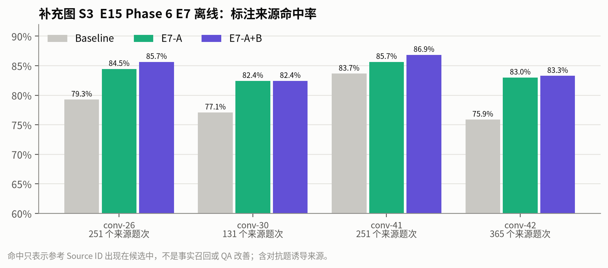{width=92%}

**决定**：E6-A 定为 `hold_for_semantic_risk`，不执行剩余 23 对。E7 默认关闭，不进入付费联合实验。根因指向抽取，下一步做一次覆盖面更大的事实审阅。

## 4.4 阶段四：证据损失定位与替代方向（11-03 至 11-04）

### E16 Phase 7 独立事实质量审阅与阶段归因（11-03）

**动机**：E15 的两道题都把问题指向抽取。需要一个更大的、事先固定的样本来确认这一点。

**设置**：用固定哈希在每个实际存在的"对话 × 类别"层中最多取 4 题，再全局补足到 80 题。先剔除 Phase 6 已知的 82 道诊断题，不按成绩筛选。对 Hybrid 和 Dynamic 的 160 份答案，两位非作者 AI 各自分页通读四段完整原文后独立审阅，隐藏方法标签、标准答案和分数。两份审阅先封存并记录 SHA，再揭盲。冻结后发现 160 份答案全部运行成功，因此这个样本不能用来估计运行可靠性。

**结果**：两位审阅者的事实切分粒度不同，不能混池计算一致性。两人都明确判定为错误拒答的，Dynamic 8/80、Hybrid 11/80。49 份存在严重错误或核心遗漏分歧的答案由主审回源复查，追加了 190 段逐字证据；复查后撤回或弱化了 4 项过强的判断，原审阅不变。

**阶段归因**：普通 80 题的共同遗漏来源链显示，21 次是初始召回疑似缺口，9 次是有效选择疑似缺口，4 次无来源关联，1 次已交付仍遗漏。单位是来源题次，这 35 次不是 35 个独立事实。另一名非作者审阅者针对 8 个双审一致的错误拒答，逐条检查了 978 条相关 Memory 和实际 Trace：

| 局部确认 | 案例数 | 说明 |
| --- | --- | --- |
| 具体事实抽取遗漏 | 5 | 晚餐菜品与事件、昵称、明确的写作动机等；来源轮次关联着 Memory，但 Memory 里没有问题需要的内容 |
| 已有事实未召回、未交付 | 2 | Memory 中有这条事实，后续没有送达回答模型 |
| 已交付仍过度拒答 | 1 | 纹身时间已交付但措辞模糊，问题并不要求精确日期 |
| Answer 预算导致丢失 | 0 | 只限这 8 例 |

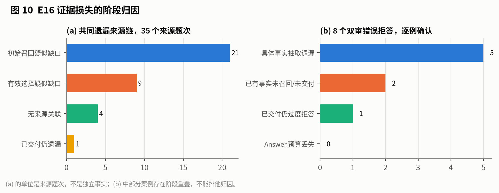{width=100%}

**决定**：部分案例同时存在召回和选择上的损失，不能排他归因。总体上哪一个阶段造成的语义错误最多，仍是未知。但在能确认的案例里，抽取遗漏最多。下一步尝试在不重建 Build 的前提下，从查询期补回原文。

### E17 Phase 7 D1 查询期原文锚点与 D2 邻接角色上下文（11-03）

**动机**：E16 确认了抽取遗漏。重新抽取需要新的 Build 身份和付费构建；这里先试一个查询期的补救办法。

**D2 邻接角色上下文**：先检查在候选旁边补充有限的邻接对话轮次。双审发现新增的原文大量只是上下文、弱相关，或者不足以回答问题，D2 没有通过价值筛选。

**D1 查询期原文锚点**：查询时构造一个临时的"原文风险目录"，不创建新 Memory，也不写旧 Build。没有关联任何 Memory 的轮次，以及有至少 3 个内容词没有出现在关联 Memory 里的轮次，被标为风险锚点；"3 个词"是固定的工程启发式，没有搜索阈值。当解析结果不足，或问题内容词没有出现在已交付的原文中时，复用已有的 BM25 原文检索，最多取 2 个中心、4 轮、700 个估算 tokens。

**离线消融**：757 题保留完整分母，其中 711 题到达回答选择阶段，46 题因上游失败跳过。

| 指标 | D1 only |
| --- | --- |
| 触发题数 | 666 |
| 新增来源题次 | 1,566 |
| 新增标注来源命中 | 106 |
| 双审遗漏来源恢复 | 3/35 |
| 新增输入 token 代理 | 191,142 |

在 8 例双审错误拒答中，D1 只完整恢复了 1 例，部分恢复 2 例。

**决定**：D1、D2 都定为 HOLD，默认关闭，没有生成新答案，也没有接入生产。这个实验和 E15 中的 E7 是两件不同的事：E7 在候选阶段补充来源，D1 在回答前补充原文锚点。

### E18 Phase 8：Hybrid + Cross-Encoder 重排（11-04）

**动机**：既然抽取侧的补救收益很低，就换到检索侧，看更强的重排能否把已有的事实更多地交付给回答模型。

**设置**：在原 Run 的 757 题上本地回放，只改变一个变量：在 Hybrid 的初始排序后加一个 Cross-Encoder 重排（C1），与冻结的 Hybrid（C0）对比。所有检索输入只用原问题和原 Memory 索引文本；gold 和标注来源只在排序完成后用于统计。新增付费请求为 0。C0 在 757/757 题上与原候选、扩展和最终交付完全一致，说明回放本身是可信的。

**结果**（753 题可评分，来源覆盖代理）：

| 阶段 | C0 | C1 | 差值 | 改善 / 退化 / 不变 |
| --- | --- | --- | --- | --- |
| 两路并集池 | 0.819387 | 0.819387 | 0 | 0 / 0 / 753 |
| 初始 20 条 | 0.782566 | 0.776442 | −0.006 | 34 / 29 / 690 |
| 扩展后 | 0.819588 | 0.799004 | −0.021 | 20 / 32 / 701 |
| 交付回答 | 0.773801 | 0.764011 | −0.010 | 37 / 33 / 683 |

交付差的 95% 区间为 [−0.028, +0.008]（10,000 次 bootstrap）。四个对话的交付均值差全部为负。按类别看，多跳/列表类 +0.060、开放域类 +0.067、时间类 −0.015。从中抽 24 道题做独立 AI 审查：候选更好 2 题、对照更好 1 题、持平 20 题、不确定 1 题。

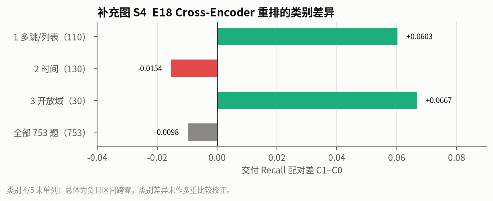{width=80%}

**决定**：未达到预设门槛，定为 HOLD。没有新的回答 F1。

### E19 Phase 9：Hindsight 后端验证与 Qwen3 0.6B 本地抽取探针（11-04）

**动机**：检查一个外部的完整长期记忆后端（Hindsight），是否能直接替代本系统的抽取与存储。

**合成验证**：固定官方 commit（MIT 许可证），在只开回环网络的独立 namespace 中运行真实 API、PostgreSQL、异步 Retain/Recall 和后台 worker，抽取由官方测试 stub 驱动。数据完全是合成的：4 个会话，11 项预设事实，覆盖人物、同人不同事件、不同人同名事件、计划取消、新旧就业、相对时间，以及跨轮的"we"。

| 契约 | 结果 |
| --- | --- |
| 异步构建 | 4 个 receipt 全部完成，无失败 |
| 事实 → chunk → 原文 | 11/11 可追溯，文本与 SHA 保持 |
| 7 个目标查询 | 7/7 召回目标事实，日期保持 |
| 历史与状态更新 | 新旧工作、计划与取消都保留，没有物理覆盖 |
| 逐事实轮次绑定 | **不支持**：原生 chunk 中两个说话者的事实共享一个 chunk |

**小模型探针**：在独立的本地 Ollama 上，用 Qwen3 0.6B 量化模型做了一次合成抽取（输入 2,663 tokens，生成 9 条 Memory）。逐条对照原文审阅发现：昵称方向颠倒、共同参与者遗漏、取消的计划遗漏、第二次比赛的 silver 名次和学习收获遗漏。时间错误中混有导出器的缺陷：跨会话输入没有内嵌各轮时间，不能归因于 Hindsight 本身。这一审阅属于作者自查。

**决定**：Hindsight 的真实数据 canary 和采用都定为 HOLD；"把原生 chunk 成员关系直接等同于逐事实来源支持"REJECT；"Qwen3 0.6B + 当前导出器"这一具体配置 REJECT。这些结论不等于淘汰 Hindsight 的所有配置。

### E20 M5 Level A/B 模块回放、PropMem 探针与关系审阅（11-04）

**动机**：在最终评测之前，系统检查剩下的几个附加模块，决定哪些进入真实实验。我把评测分为五级：A 为离线测试，B 为冻结输入回放，C 为开发集固定样本真实实验，D 为单模块真实实验，E 为一次性留出评测。

**Level B 交付回放**：757 题 × 6 组，全部复用生产的扩展与回答打包逻辑，不执行解析、Embedding 或 provider 调用。753 题可映射来源，4 题不可评分。

| 组 | 扩展后覆盖 | 交付覆盖 | 相对 D |
| --- | --- | --- | --- |
| H 冻结 Hybrid 输入 | 0.819588 | 0.773801 | 0 |
| D 冻结 Dynamic 输入 | 0.819920 | 0.773801 | 0 |
| B1 D + 两跳 Graph | 0.823098 | 0.773801 | 0 |
| B2 D + 可逆 wire 分组 | 0.819920 | 0.773801 | 0 |
| B3 D + 自适应排序 | 0.820916 | 0.744452 | −0.029 |
| B4 D + 时间优先 | 0.819920 | 0.773801 | 0 |

- **B1 Graph**：在 444 题上确实找到了新的两跳路径，扩展候选新增 7,689 个 Memory 题次，但交付覆盖没有任何增益。
- **B3 自适应排序**：5 题改善、25 题退化、723 题不变，区间 [−0.043, −0.017]，四个对话全部为负。
- **B2 压缩**：完整回答消息从 5,558,932 个代理 token 降到 5,557,306，只减少 0.029%；757 题中只有 30 题启用。

**PropMem 探针**：固定官方 commit（Apache-2.0），对其上游方法做隔离的源码与合成检查，发现四个问题：联合问题只选中一个人、名称子串误配（Joanna 匹配到 Ann）、在没有真实矛盾时按新旧时间给旧事实降权、逐事实来源受限。直接采用其配置被 REJECT；没有运行真实抽取 canary，也不外推到整个方法家族。

**关系审阅**：两名独立 AI 分别审阅不重叠的 30 + 30 个关系单位，双方端点引文逐字核对通过。参考先冻结，之后才读取历史预测：50/60 正确，Accuracy 0.833，Macro-F1 0.767。参考标签中 RETAIN 33、UPDATE 4、未确定 23，**SUPERSEDE 和 CONFLICT 都是 0**，因此这两个标签无法评估。系统对 28/60 给出"未判断"。初版审阅报告把没有执行的有效选择错写成 0%，修正版已更正，旧文件保留供审计。

**决定**：Graph、压缩、自适应和时间优先都不晋级 Level C/D，默认关闭；Graph 浏览面板保留为显式开启的展示功能。最终实验只比较 H 和 D 两组，所有附加模块关闭。

### E21 40 题 query-specific 有效证据选择诊断（11-04）

**动机**：E20 的关系审阅只回答了"一对 Memory 之间是什么关系"，没有回答"在这道题里应该用哪几条"。后者才是 Dynamic 解析阶段要做的事。

**设置**：按身份哈希从每个开发对话固定取 10 题，共 40 题，不依赖预测、运行状态或分数。两位独立 AI 各审 20 题，不看预测、存储关系、生成答案和 QA 标注；参考先冻结，之后才评分。参考结果为 30 条充分、9 条不足、1 条冲突；25 题可评分，15 题因参考本身有歧义单列。

**结果**：在 25 道可评分题上，严格有效集合完全一致 18/25（72%），集合 Macro-F1 0.854，状态判断 23/25（92%）。不一致的情况是 4 题多选、1 题少选、2 题缺失预测。各对话的严格集合一致数为：conv-26 7/9、conv-30 1/6、conv-41 6/6、conv-42 4/4。

**决定**：这是对历史预测的诊断，没有生成新模型的预测。它说明解析阶段在多数可判定题上选对了集合，在部分对话上明显偏弱；样本量不足以给出总体准确率。

## 4.5 阶段五：冻结评测（11-04 至 11-05）

### E22 Level C v1：开发集固定 200 项真实实验（11-04）

**动机**：E20 之后只剩 H 和 D 两个候选。用一个新的固定样本，在真实调用下比较这两组。

**设置**：按 SHA 顺序从四个开发对话各取 20 道普通题和 5 道诊断题，共 100 题，两组共 200 项，题单不按候选表现挑选。四份开发 Build、Prompt、配置和样本身份都绑定在冻结计划里。所有生成都冻结并通过终态审计后，才读取开发集的 gold。这一阶段的独立硬上限为 1,500 次请求 / USD 130.98，messages 字节上限 160,000，完整解析输入预算沿用 96,000；所有附加模块关闭。

**结果**：

| 分层 | 策略 | 成功 / 计划 | 完整分母 F1 | 仅成功项 F1 |
| --- | --- | --- | --- | --- |
| 普通 | Hybrid | 80/80 | 0.399883 | 0.399883 |
| 普通 | Dynamic | 41/80 | 0.228329 | 0.445521 |
| 诊断 | Hybrid | 20/20 | 0.456503 | 0.456503 |
| 诊断 | Dynamic | 10/20 | 0.293302 | 0.586604 |

普通题的 D−H 为 −0.172，区间 [−0.257, −0.093]：17 题提高、35 题退化、28 题不变。诊断题为 −0.163，区间跨零。

**失败**：49 项失败全部来自 Dynamic。其中 35 项是 `physical_request_policy_rejected`（消息超过 160,000 字节），14 项是 `complete_resolution_input_budget_exceeded`。最早的两例按保存的 Trace 离线重建，首次消息分别为 177,571 和 161,788 字节，都没有发出解析请求。我没有改上限、截断证据或补跑。

**来源盲审**：两名审阅者分别通读 conv-26/30 的 788 轮和 conv-41/42 的 1,292 轮原文，再审各自负责的 100 个匿名答案；461 条逐字引文全部核验通过。在已运行成功的答案上，来源支持为 Hybrid 64/92、Dynamic 41/49；错误人物 0/151；错误时间 Hybrid 4/94、Dynamic 0/50。

**成本**：421 次物理请求全部返回完整 usage。按已报 usage 计，Hybrid 的峰价上界为 USD 0.230、Dynamic 为 USD 0.940，比值为 4.1。保守预约合计 USD 19.31。

**诊断**：Dynamic 在共同成功的 41 道普通题上 F1 为 0.446，高于 Hybrid 的 0.368。但这个子集是按运行成功筛出来的，有选择偏差。完整分母上的负差几乎全部来自输入限制失败，失败是在本地被拦截的，模型并没有答错。

**决定**：本轮不晋级 Level D/E，也不改变生产默认。先解决完整解析输入与预算之间的兼容问题，再决定是否申请新的生成实验。

### E23 Level C input v2（11-04）

**动机**：E22 的失败全部来自两个输入上限。用同一批题，只放宽这两个上限，看 Dynamic 在运行可靠的前提下能否超过 Hybrid。

**设置**：先离线重建全部 100 项的首次解析请求：最大消息 480,456 字节、145,670 个正则 token。据此把字节上限从 160,000 调到 640,000，完整解析预算从 96,000 调到 192,000。如果只用 320,000 字节，100 项中只有 87 项能满足。所有新生成都关闭 thinking，不发送 `reasoning_effort`。新阶段的独立硬上限为 1,500 次请求 / USD 346.98。

**结果**：

| 分层 | 策略 | 成功 / 计划 | 完整分母 F1 |
| --- | --- | --- | --- |
| 普通 | Hybrid | 79/80 | 0.401172 |
| 普通 | Dynamic | 80/80 | 0.444702 |
| 诊断 | Hybrid | 20/20 | 0.434314 |
| 诊断 | Dynamic | 20/20 | 0.473472 |

普通题的 D−H 为 +0.044，区间 [−0.008, +0.095]：27 题提高、14 题退化、39 题不变。四个对话的差值都为正：+0.074、+0.039、+0.052、+0.009。诊断题为 +0.039，区间 [−0.056, +0.135]。

唯一的失败来自 Hybrid：回答阶段三次输出都没有给出证据状态字段，终态为 `invalid_output`。

**来源盲审**：在两组都运行成功且来源判断确定的 60 个普通题配对中，2 对改善、1 对退化、57 对不变，平均差 +0.017，区间跨零。引用支持在普通 61 对和诊断 14 对中的差值都是 0。

**成本**：522 次请求，usage 全部已知。按已报 usage 计，Dynamic 的峰价上界为 USD 2.353，Hybrid 为 USD 0.233，**比值为 10.1**。普通题单题 p50 延迟为 8.8 s 对 2.5 s。

**诊断**：输入失败消失后，F1 的方向翻转为正，但区间仍跨零；按来源审阅看，同题改善几乎为零。Dynamic 用十倍的费用换来了一个统计上无法与零区分的 F1 差值。

**决定**：最终 Level E 固定为 H、D 两组，所有附加模块关闭，input v2 的上限不变。Hybrid 作为默认候选，Dynamic 作为显式可选候选。这是候选建议，不是生产默认的切换。

### E24 留出集 conv-43/44 的构建与多轮恢复（11-04 至 11-05）

**动机**：Level E 需要两份完整的留出 Build。构建只读取原始对话，不读取留出集的 QA、证据或答案。

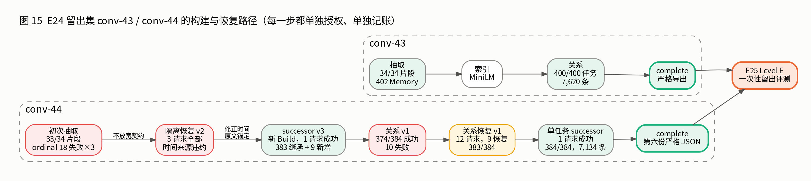{width=100%}

**conv-43**：抽取 34/34 片段，402 条 Memory；真实 MiniLM 索引；关系阶段 400/400 任务成功，7,620 条关系标签，共 408 次物理请求，其中 7 次 transport unknown，按预约计入。之后完成 complete 并严格导出。

**conv-44**：一共走了五步，每一步都单独准备计划、经非作者复核，并由我明确批准独立的调用与金额上限，额度不跨阶段转移：

1. **初次抽取**：33/34 片段，383 条 Memory。第 18 个片段三次都报 `extraction_time_expression_required`：模型给出的时间表达没有出现在所引锚点的原文里。
2. **隔离恢复 v2**：3 次请求，全部仍然违反时间来源契约，没有新增 Memory。我没有放宽校验，也没有清空时间字段。
3. **successor v3**：修正的是时间表达的原文锚定方式，契约本身不变。新建 Build，首次请求即通过；383 条继承加 9 条新增，共 392 条。
4. **关系 v1**：384 个任务中 374 成功、10 失败，共 6,973 条关系。失败任务各用尽 3 次尝试：8 个是 `known_source_required`（引用了不在已知来源中的 ID），2 个是 `same_state_dimension_required`。关系标签分布为：未确定 6,769、RETAIN 106、UPDATE 91、SUPERSEDE 5、CONFLICT 2。
5. **关系恢复 v1，再加一个单任务 successor**：恢复阶段 12 次请求，10 个失败任务中 9 个恢复，达到 383/384；剩下的 1 个任务在单独批准后 1 次请求成功，达到 384/384，共 7,134 条合法关系。392 条 Memory 的 CurrentState 投影重新计算后完全一致，之后在新的本地副本中完成 complete 并严格导出第六份 JSON。

每一步都保留原有的成功任务、关系和调用记录，逐行不变，只在新副本中追加。conv-43/44 的共同 Build 覆盖七个构建和恢复阶段，共 920 次请求，预约 USD 45.04，已报峰价上界 USD 6.61。

**决定**：两份留出 Build 都达到 complete，进入 E25。

### E25 Level E 独立留出评测（11-05）

**动机**：在全部策略、实现、模型、Prompt、参数、评分脚本和预算都锁定之后，进行唯一一次留出评测。

**设置**：conv-43/44 的 400 题 × H/D，共 800 项。实现 commit、系统锁和计划 SHA 在读取留出题正文之前就已固定。输入上限为 640,000 字节，完整解析 192,000，输出 32,768；每个操作最多 3 次模型尝试，HTTP 层不重试，thinking 关闭。生成冻结后，根代理和非作者终态审计都通过，之后才读取 gold 评分。这一阶段的独立硬上限为 6,000 次请求 / USD 1,387.93。

**结果**：

| 范围 | 每组题数 | H 成功 | D 成功 | H 完整分母 | D 完整分母 |
| --- | --- | --- | --- | --- | --- |
| 类别 1–4 token F1 | 301 | 299 | 295 | 0.402606 | 0.409151 |
| 类别 5 字面拒答 | 99 | 95 | 94 | 0.858586 | 0.808081 |
| 混合规则均值（不是事实正确率） | 400 | 394 | 389 | 0.515461 | 0.507886 |

- **类别 1–4**：D−H = +0.0065，区间 [−0.020, +0.034]；60 题提高、56 题退化、185 题不变。
- **类别 5**：D−H = −0.051，区间 [−0.101, 0]；1 题提高、6 题退化。
- **按对话**：两段对话的混合差值分别为 −0.021 和 +0.013，区间都跨零。
- **类别 2（时间）**：差值 +0.049。这是探索性结果，没有做多重比较校正，不能据此宣称提升。

**来源盲审**：三名没有参与本次生成实现的 AI 分区审阅了全部 800 项。每人先通读对应的完整原文，再核对答案、解释、全部引用和拒答，共保存 1,796 条逐字引文。审阅包隐藏组别、gold、分数和解析 Trace。17 个运行失败标为 N/A。

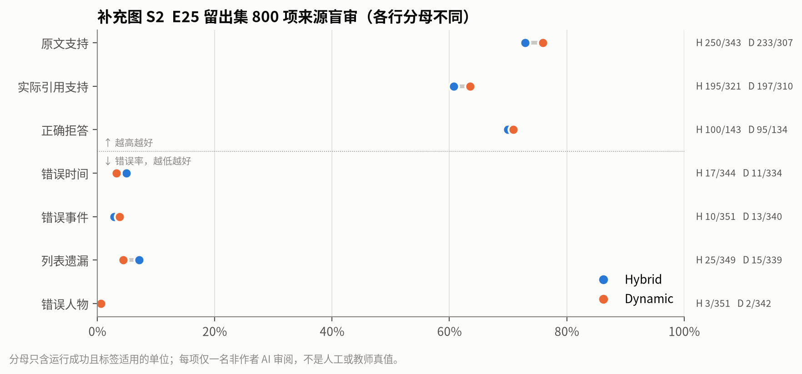{width=92%}

条件配对（两组都成功、且标签明确适用的题）：原文支持在 297 对中 28 对改善、18 对退化、251 对不变，差值 +0.034，区间 [−0.010, +0.078]；引用支持 31 对改善、23 对退化；正确拒答 0 对改善、2 对退化。错误时间、列表遗漏的差值为负（即 Dynamic 的错误更少），但区间分别跨零或触零。

**来源 Recall**：见图 9。Dynamic 的初始与扩展覆盖和 Hybrid 几乎相同；经过有效证据解析后，Recall@20 从 0.725 降到 0.537，交付覆盖低于 Hybrid 的 0.719。

**失败与费用**：Hybrid 394/400 成功，Dynamic 389/400；17 个失败项中 8 个为 `invalid_output`，9 个是末段遇到 HTTP 402（账户余额不足）。安全元数据显示共有 18 次 402 请求，都缺少 usage，预约不释放、也不按零成本处理。一次执行结束后，即使额度恢复，也不自动重启，没有重跑。

| 查询范围 | Hybrid | Dynamic | 合计 |
| --- | --- | --- | --- |
| 物理请求 | 851 | 1,261 | 2,112 |
| usage 未知的请求 | 8 | 10 | 18 |
| 保守预约，USD | 36.2805 | 69.1711 | 105.4516575 |
| 已报 usage 峰价上界，USD | 0.8706 | 6.8800 | 7.7506 |
| 单题 p50 / p95，s | 2.37 / 3.94 | 8.31 / 12.40 | — |
| 每个成功项的已报输入 tokens | 6,604 | 51,849 | — |

Dynamic 与 Hybrid 的已报峰价比约为 7.90，预约比为 1.91。两者口径不同，都不是实际账单的比值。

**结论**：在锁定配置下的一次留出评测中，答案指标和来源审阅都没有显示 Dynamic 有稳定改善，而 Dynamic 的查询费用约为 Hybrid 的 7.9 倍。留出结果已经曝光，此后的任何修复或重跑都只能标为回归测试，不能再称为同一次独立测试。

# 5 跨实验综合

本章把前面分散在各个实验里的结果按研究问题重新组织。图中的每一行都来自单个实验内部的比较；跨实验只看方向，不比较绝对数值。

## 5.1 实验谱系

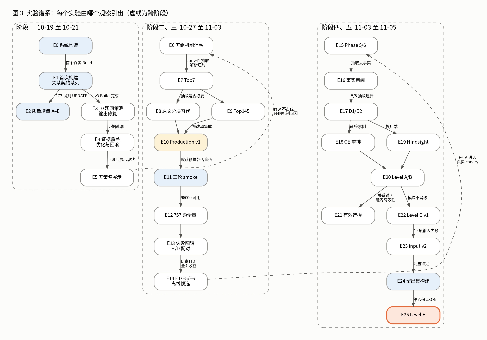{width=100%}

图 3 把 26 个实验单元按"上一步暴露了什么"连起来。整个过程有三次明显的转向：

1. **E5 → E6**：原文兜底不占优之后，问题从"选哪种策略"转向"Dynamic 的哪个机制在起作用"。
2. **E13 → E14**：完整分母配对显示 Dynamic 贵且没有全面收益，研究重心转向降本和减少输入失败。
3. **E15 → E16 → E17**：两道 canary 题都把错误追溯到抽取阶段，后续实验转向定位证据损失，并从检索侧（E18）和外部后端（E19）寻找替代方案。

## 5.2 RQ1：答案质量

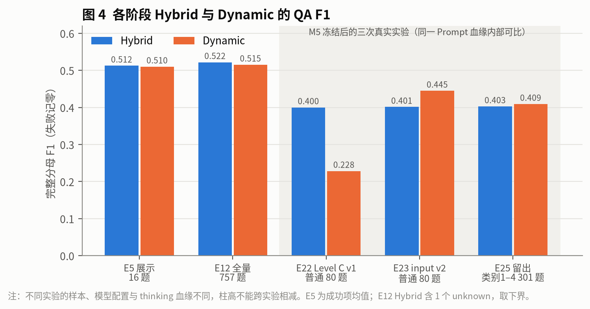{width=100%}

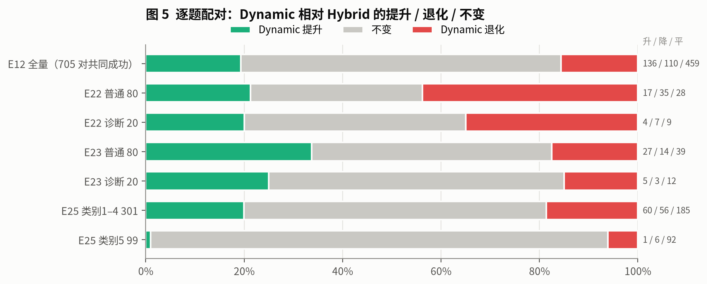{width=100%}

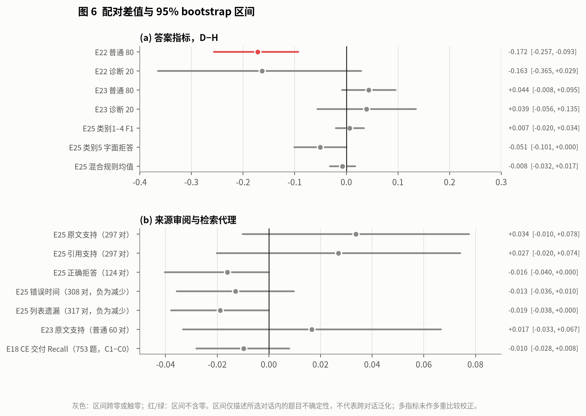{width=100%}

| 实验 | 样本 | H 完整分母 | D 完整分母 | D−H | 95% 区间 | 是否跨零 |
| --- | --- | --- | --- | --- | --- | --- |
| E5 | 16 题，已曝光 | 0.512 | 0.510 | −0.002 | 未计算 | — |
| E12 | 757 题，已曝光 | [0.522, 0.523] | 0.515 | 约 −0.007 | 未计算 | — |
| E22 | 普通 80 题，已曝光 | 0.400 | 0.228 | −0.172 | [−0.257, −0.093] | 否（负） |
| E23 | 普通 80 题，已曝光 | 0.401 | 0.445 | +0.044 | [−0.008, +0.095] | 是 |
| E25 | 类别 1–4 共 301 题，留出 | 0.403 | 0.409 | +0.007 | [−0.020, +0.034] | 是 |

E22、E23、E25 三次实验的答案生成配置相同（thinking 全部关闭，附加模块全部关闭），区别在于输入上限和样本。从 E22 到 E23 只放宽了输入上限，差值从 −0.17 翻转为 +0.04，说明 E22 的负差几乎全部来自运行失败。E23 到 E25 换成了留出集，差值从 +0.044 缩小到 +0.007。开发集上看到的正向趋势，在没有被反复诊断过的数据上大部分消失了。

来源盲审给出的结论相同：E23 的同题来源支持 2 对改善、1 对退化；E25 为 28 对改善、18 对退化，区间都跨零。

**回答**：现有证据不支持"Dynamic 稳定优于 Hybrid"。

## 5.3 RQ2：可靠性与成本

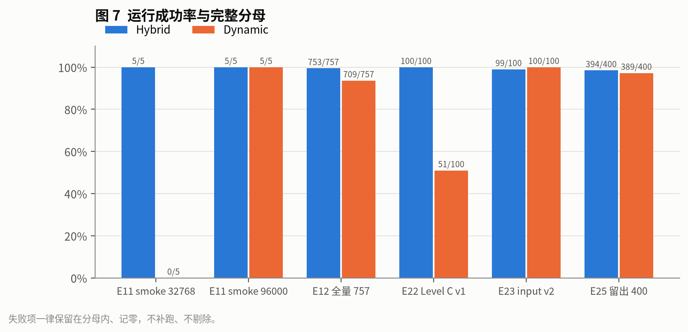{width=100%}

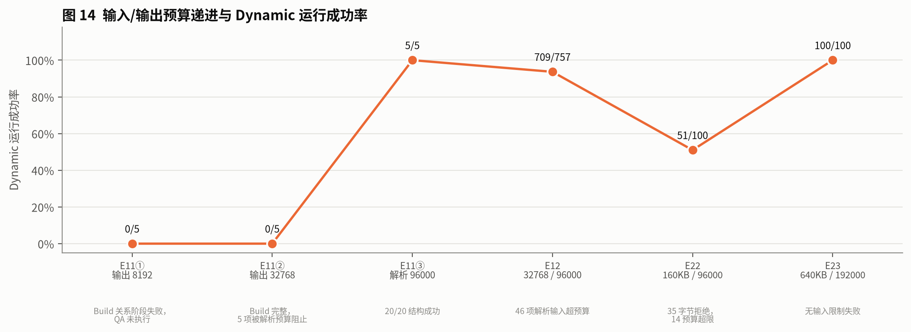{width=100%}

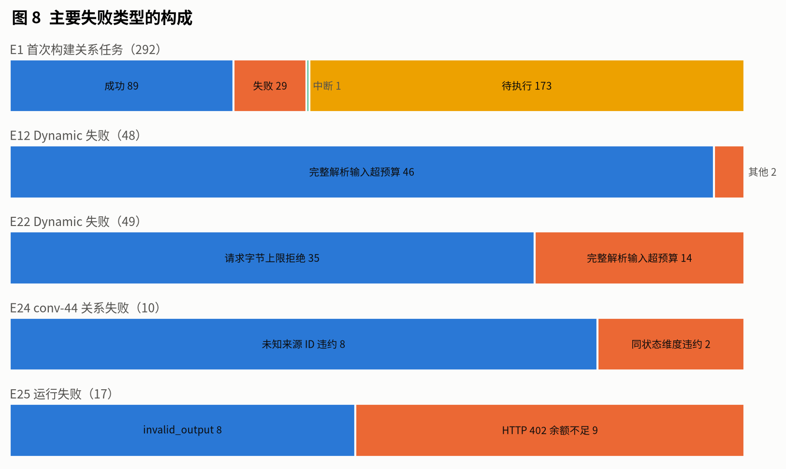{width=100%}

Dynamic 的失败主要不是因为模型答错，而是完整解析输入被预算或字节上限挡住。这类失败在本地被拦截，请求没有发出（E11②、E12、E22）。每一次放宽上限（E11③、E17、E23）都能消除这类失败，代价是更长的输入和更高的费用。

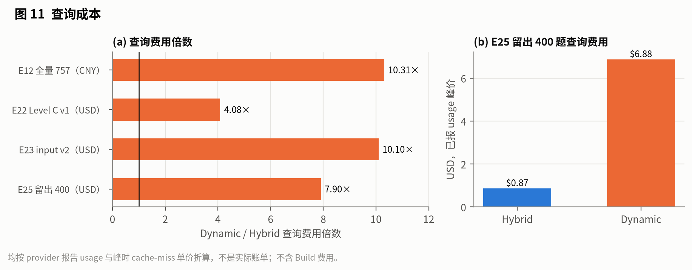{width=100%}

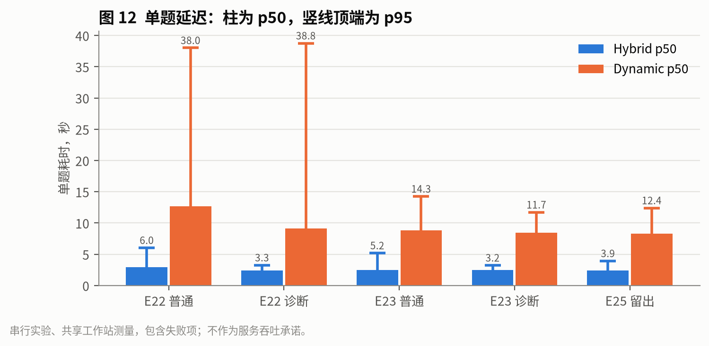{width=100%}

| 实验 | D/H 查询费用比 | D/H 单题 p50 比 | 口径 |
| --- | --- | --- | --- |
| E12 | 10.31 | — | 峰时估算，CNY |
| E22 | 4.08 | 4.36（普通题） | 已报 usage 峰价，USD；49 项失败在本地被拦截，没有产生费用 |
| E23 | 10.10 | 3.53（普通题） | 已报 usage 峰价，USD |
| E25 | 7.90 | 3.51 | 已报 usage 峰价，USD |

E22 的费用比偏低，是因为将近一半的 Dynamic 请求没有发出。去掉这个因素后，Dynamic 稳定地比 Hybrid 贵 8–10 倍，慢约 3.5 倍。E25 中每个成功项的已报输入 tokens，Dynamic 为 51,849，Hybrid 为 6,604，相差 7.9 倍。

**回答**：Dynamic 多出的解析步骤带来约 8–10 倍的查询费用和约 3.5 倍的延迟。输入上限足够时，它的运行可靠性与 Hybrid 相当（E25：389 对 394）。

## 5.4 RQ3：证据损失的位置

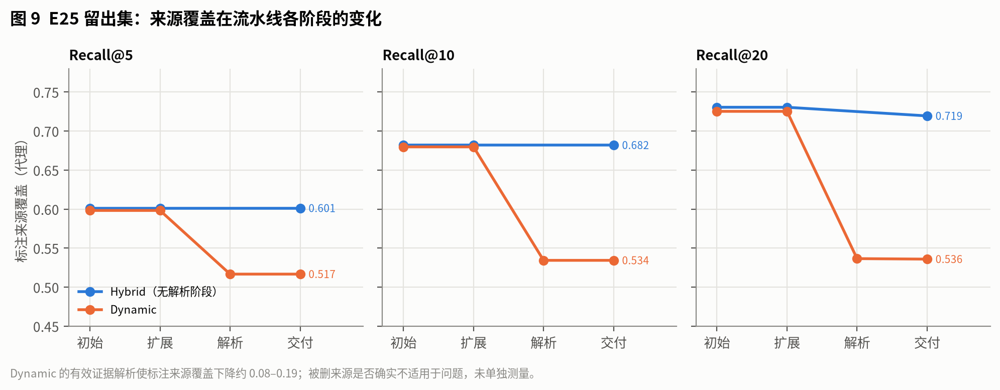{width=100%}

各个实验的证据从不同侧面指向同一组结论：

- **抽取**：E1 的案例 172，E6 的 conv-41 时间锚点，E15 的 D17:25/26，E16 中 8 例错误拒答里的 5 例，E19 中 Qwen3 的多处遗漏，E24 中 conv-44 第 18 片段反复失败。可以确认的事实丢失大多发生在抽取阶段。
- **检索与扩展**：E16 的共同遗漏来源链中，21/35 是初始召回疑似缺口。但 E17（D1 原文锚点）和 E18（Cross-Encoder）都没能把它们稳定补回来，E20 的 Graph 扩展也没有提高交付覆盖。
- **有效证据解析**：E25 中，Dynamic 的解析使标注来源覆盖下降 0.08–0.19（图 9），但答案 F1 没有下降。这有两种可能的解释：被删掉的来源确实不适用于本题；或者回答模型在缺少它们时仍能作答。两者无法区分，因为题内有效性的准确率只在 E21 的 25 道可评分题上测过（72% 严格一致）。
- **关系标签的分布**：E20 的 60 个参考关系中，SUPERSEDE 和 CONFLICT 都是 0；E24 中 conv-44 的 6,973 条关系里，6,769 条为"未确定"，SUPERSEDE 只有 5 条，CONFLICT 2 条。Dynamic 设计时针对的"旧状态被新状态替代"，在这批对话里很少出现。这可能是它难以产生增益的一个结构性原因，但我没有专门检验这个假设。

**回答**：损失分布在多个阶段，能确认的部分以抽取为主。Dynamic 只作用于检索之后的环节，抽取阶段丢掉的事实它补不回来。

## 5.5 候选的最终去向

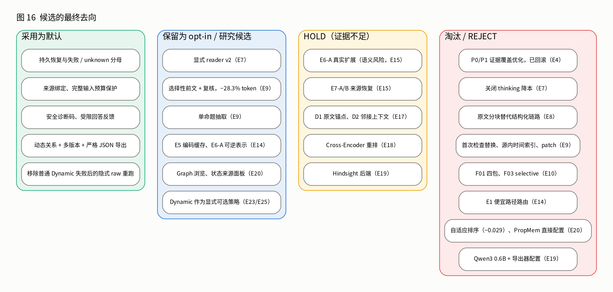{width=100%}

这次探索最终留下的，主要是工程约束，而不是质量改进：持久恢复、完整失败分母、来源绑定、输入预算保护、安全诊断码和多版本严格导出。在 E7–E21 中提出的二十余个质量候选里，只有 reader v2 和选择性前文（降本 28.3%）在已知题上稳定成立，两者都只保留为可选项。其余候选要么在同题对照或新边界上不成立，要么证据不足、暂时搁置。

# 6 实验工程方法

这一章整理在 18 天里逐步形成、后来每个实验都遵守的做法。很多做法是被具体失败逼出来的，所以每条都注明起点。

## 6.1 完整失败分母

**规则**：运行失败、预算拒绝、超时都留在分母里记零；unknown 给出上下界；"仅成功项"的分数单独标注，不作为主结论。

**起点**：E3 初轮里，Dynamic 9/10 的成功数和后来的 F1 是两回事；E12 中 Dynamic 在成功子集上均值较高（0.550 对 0.525），计入 48 项失败后反而略低。E22 是最极端的例子：仅成功项 Dynamic 领先 0.077，完整分母落后 0.172。如果只报成功子集，结论方向会完全相反。

## 6.2 先冻结，后评分

**规则**：题单、策略、Prompt、配置和预算在生成之前冻结并记录 SHA；所有生成结束、终态审计通过之后，才读取 gold。语义审阅同样先封存审阅结果，再揭盲。

**起点**：E6 的协议规定，正式运行后改动题单或 Prompt 会改变比较身份。E7 的语义复核首次采用"冻结后揭盲"。E25 把这一点做到最严：系统锁先于留出题正文读取，评分是生成结束后的单独操作，看过结果后不再调参。

## 6.3 每个付费阶段单独授权、单独记账

**规则**：每个付费阶段都有独立的次数、金额和时间上限，由我明确批准。每次请求发送前持久化一个预约槽位；结果未知的请求按全额预约保留，不释放、不自动重发；阶段之间的余额不转移；一次执行结束后，即使还有余额，也不自动追加。

**起点**：E1 的独立回放先批 6 次，再批 16 次，每轮各用独立的 SQLite 账本。E11 的三轮共用一个 ¥40 / 500 次的累计上限，截止时间不因重启而重置。E24 中 conv-44 的五步恢复各自批准，每一步都先免费准备、经非作者复核，再申请额度。E25 末段遇到 HTTP 402 后，按规则不重启。

## 6.4 新配置就是新身份

**规则**：配置是 Build 身份的一部分；修改配置必须新建 Build 或 Run，不能在原地修改，也不能把不同身份的结果拼接成一个分数。补充运行和修复运行不回填原分母。

**起点**：E11 的三轮各自新建身份；E12 的补充 Run 和修复 Run 与原 3,028 项分开保存；E24 的 successor Build 只在新副本中追加，原有成功任务和关系逐行保留。

## 6.5 不靠放宽校验来"修复"

**规则**：模型输出违反契约时，可以修改模型可见的指令，或把校验规则与 Prompt 共用同一份定义；不能放宽 schema、在后处理中替模型改标签、截断证据或硬编码案例 ID。

**起点**：E1 中，同状态维度、重复证据 ID、标签前提三类问题，都是通过让模型看到校验器实际执行的规则解决的；案例 172 的语义错误则没有被"修"掉。E24 中 conv-44 第 18 片段的时间契约始终没有放宽，最终靠修正锚定方式通过。

## 6.6 区分"已证明"与"仍未证明"

**规则**：每个实验的记录都分开列出已经证明的结论和仍未证明的内容。来源 ID 合法不等于来源支持结论；结构通过不等于语义正确；离线 Mock 通过不等于真实可用；局部改善不等于总体收益。

**起点**：Top7 的记录表从一开始就有"本轮改动 / 仍未证明"两列。E20 的初版审阅把没有执行的有效选择错写成 0%，后来更正，旧文件保留供审计。

## 6.7 复核身份分开标注

**规则**：作者代理的自查、非作者 AI 审阅、格式与哈希核验、人工复核，各自单独标注，不合并为"已验证"。每项只有一名审阅者时，不报告一致性指标。

**起点**：E5 的来源审阅属于开发助手自查；E15 第一次复核重试没有形成有效产物，因此有效的非作者审阅数被如实记为 0；E16、E22、E25 的审阅者都明确不参与对应的生成实现。

## 6.8 用 AI 编码代理推进实验

实验的实现、运行和整理由 AI 编码代理在上述规则下完成。实践中，规则需要写进执行代码和工具，不能只写在文档里：预约账本、身份哈希检查、"终态审计通过才能读 gold"的门槛，都在执行器里强制执行。代理也会犯错，例如初版审阅里的 0% 写错、测试读取任务列表时只取了默认的前 20 项、一次命令引用了不存在的测试文件。这些错误都被保留在记录里，之后另行更正。

# 7 局限与有效性威胁

- **样本量**：留出集只有两段对话、400 题；bootstrap 区间只描述这两段对话内部的题目不确定性，不支持对话级泛化，也不代表教师的隐藏评分集。
- **开发集曝光**：E5–E23 都在已经被反复诊断过的四段开发对话上进行，其中的正向结果可能包含过拟合。
- **语义真值**：所有语义判断都来自 AI 审阅者，每项通常只有一名，没有人工双审一致性；文字风格可能泄露组别，因此不能保证严格盲法。
- **模型版本**：`deepseek-flash` 是可变别名，无法证明整个实验期间的服务端权重相同。
- **thinking 血缘**：E22–E25 的新生成关闭 thinking，但开发集 Build 的关系判断是在 high thinking 下构建的，最终结果不是"全链路关闭 thinking"的成绩。
- **指标**：token F1 对改写和措辞很敏感；来源 Recall 是代理指标，不等于事实召回；题内有效选择的准确率只在 25 道题上测过。
- **费用**：全部是预约或已报 usage 的峰价折算，没有读取实际账单；E25 有 18 次请求的 usage 未知。
- **记录完整性**：仓库之外的个人探索和缺失的临时文件无法证明已经穷尽；没有找到记录的内容，本文标注为证据缺失，不补写。
- **数据披露**：本文只报告聚合数字和改写过的案例，不引用 LoCoMo 原文、留出集答案或 provider 原始响应。

# 附录 A 实验总表

| 编号 | 日期 | 内容 | 真实调用 | 样本 / 分母 | 核心结果 | 去向 |
| --- | --- | --- | --- | --- | --- | --- |
| E0 | 10-19 | 系统构造与工程验证 | 0 | 各模块离线测试 | 112 项浏览器/CI 通过 | 工程基线 |
| E1 | 10-20 | 首次构建与关系契约系列 | 220 + 6 + 4 + 9 + v5 Build + 25 | 292 关系任务；回放 3 / 2 / 3 任务 | 89/29/1/173；三类契约问题修复；172 语义关卡失败 | 契约修复保留，完整重建阻止 |
| E2 | 10-20 | 质量增量 A–E | 26 | 合成探针 | 局部改善；172 仍误判 UPDATE | 工程实现保留，默认 expanded |
| E3 | 10-20–21 | 10 题四策略 + 输出修复 | 初轮 + 98 | 40 项 | 24/40 → 40/40；D 0.154→0.334 | 回答契约保留 |
| E4 | 10-21 | 证据覆盖优化与回滚 | 30 项 A/B | 30 项 | 无稳定提升 | P0/P1 回滚 |
| E5 | 10-21 | 五策略现状展示 | 307 | 100 项 QA + 40 Recall + 10 关系 + 20 审阅 | H 0.512 / D 0.510 / 兜底 0.400 | 否定原文兜底更优 |
| E6 | 10-27–29 | 五组动态机制消融 | 107+ / 14 / 14 等 | 计划 1,080 | 未完成；conv-41 抽取反复失败 | 停止 |
| E7 | 10-29 | 诊断码细化与 Top7 | 9 + 48 + 104 + 48 | 960 合成；6 / 8 / 8 项 | reader v2 完成语义 2/8→6/8；关闭 thinking 3/8 | reader v2 可选；七父项未验收 |
| E8 | 10-29–30 | 原文分块替代 | 78 | 计划 80 | 必需事实 64 / 48 / 70（/78） | 拒绝替换 |
| E9 | 10-29–30 | Top145 | 96 + 249 + 86 + 56 | 已知题 + 12 边界 | 选择性前文 −28.3% token，质量 8/8 | 窄候选可选 |
| E10 | 10-31–11-01 | RC1/RC2 与 Production v1 | 334 | 168 pipeline | selective 节省 15.8% < 20% | 31 项工程采用；F01/F03 不采用 |
| E11 | 11-01 | 三轮预算 smoke | 84 + 322 + 40 | 每轮 20 项 | 0 → 15 → 20 项成功 | 研究参数可用 |
| E12 | 11-01–03 | 757 题全量基线 + 补充与修复 | 全量 + 59 + 8 | 3,028 项 | H [0.522, 0.523]；D 0.515；D 失败 48 | 原基线保持 |
| E13 | 11-03 | 失败图谱与配对 | 0（AI 审阅） | 705 对 | 136/110/459；费用 10.3 倍 | 不默认采用 D |
| E14 | 11-03 | E1 路由 / E5 缓存 / E6-A | 0 | 757 题 | 路由覆盖 0；E6-A 输入 −34.3% | E6-A 进入 canary |
| E15 | 11-03 | Phase 5 canary 与 Phase 6 | 8 | 2 对 | prompt −26.1%；语义不确定 | E6-A HOLD；E7 关闭 |
| E16 | 11-03 | Phase 7 事实审阅 | 0（AI 审阅） | 80 题 × 2 | 错误拒答 D 8 / H 11；5/8 抽取遗漏 | 归因到抽取 |
| E17 | 11-03 | D1 / D2 离线消融 | 0 | 757 / 711 | 遗漏来源恢复 3/35 | HOLD |
| E18 | 11-04 | Cross-Encoder 重排 | 0 | 753 题 | 交付 Recall −0.010 | HOLD |
| E19 | 11-04 | Hindsight 与 Qwen3 0.6B | 0（本地） | 合成 11 事实 | 来源链通过；逐事实轮次不支持 | Hindsight HOLD；小模型配置 REJECT |
| E20 | 11-04 | Level A/B、PropMem、关系审阅 | 0 | 757 × 6；60 关系对 | 模块无交付增益；关系 50/60 | 模块默认关闭；PropMem REJECT |
| E21 | 11-04 | 题内有效选择诊断 | 0 | 40 题，25 可评分 | 严格集合 18/25 | 诊断 |
| E22 | 11-04 | Level C v1 | 421 | 200 项 | 普通 D−H −0.172；D 失败 49 | 不晋级 |
| E23 | 11-04 | Level C input v2 | 522 | 200 项 | 普通 D−H +0.044，跨零；费用 10.1 倍 | 锁定 H/D 两组 |
| E24 | 11-04–05 | 留出集构建与恢复 | 920 | 2 段对话 | conv-44 经五步达到 384/384 | 两份 complete |
| E25 | 11-05 | Level E 留出评测 | 2,112 | 800 项 | 类别 1–4 D−H +0.007，跨零；费用 7.9 倍 | 零结果 |

# 附录 B 失败类型目录

| 失败类型 | 所在阶段 | 含义 | 出现的实验 | 处理方式 |
| --- | --- | --- | --- | --- |
| `same_state_dimension_required` | 关系 | RETAIN / SUPERSEDE / CONFLICT 的两端不在同一状态维度 | E1、E24 | 规则写进 Prompt（relations-v2） |
| `reason_and_unique_evidence_required` | 关系 | 旧的联合错误码，无法区分两种原因 | E1 | 拆成下面两个错误码 |
| `nonblank_reason_required` / `unique_evidence_required` | 关系 | 理由为空 / 证据 ID 重复 | E1 | 增加去重指令（relations-v3） |
| `factual_resolution_required` | 关系 | 旧事实与新非事实之间的标签前提不满足 | E1 | 校验器与 Prompt 共用标签函数（relations-v5） |
| `known_source_required` | 抽取、关系 | 引用了不在已知来源中的 ID | E11、E24 | 有限重试；不放宽 |
| `extraction_time_expression_required` | 抽取 | 时间表达不在所引锚点原文中 | E6、E24 | 修正锚定方式；契约不变 |
| 输出长度截断 | 关系 | 输出达到上限 | E1、E11 | 输出上限 8,192 → 32,768，新身份 |
| `complete_resolution_input_budget_exceeded` | 解析 | 完整候选超过解析输入预算 | E11、E12、E22 | 预算 24K → 96K → 192K，新身份 |
| `physical_request_policy_rejected` | 解析 | 消息超过本阶段字节上限 | E22 | 上限 160,000 → 640,000 字节，新阶段 |
| `answer_evidence_status_required` | 回答 | 回答缺少证据状态字段 | E23 | 记为 `invalid_output`，不补跑 |
| `invalid_output`（结构） | 各阶段 | 模型输出没有通过 schema 或领域校验 | E3、E6、E25 | 计入分母；保存诊断码 |
| `model_http_error`（HTTP 402） | 传输 | 账户余额不足 | E1、E12、E25 | 停止；预约保留；不自动重启 |
| `transport_unknown` | 传输 | 请求发出后结果未知 | E6、E7、E24 | 按全额预约保留，不重发 |
| OOM / 超时 | 构建 | 本地内存不足或请求超时 | E12 | 分段显式恢复，不拼接 |
| 过度拒答 | 回答 | 证据已交付，回答仍然拒答 | E16、E25 | 记录；没有自动修复 |
| 人物错绑 | 解析、回答 | 把事件归给了错误的人 | E15 | 记录为语义风险，阻止 E6-A 扩大 |
| Citation Failure | 回答 | 引用 ID 合法，但不支持结论 | E12、E13 | 单独标注；scorer 满分不代表引用正确 |

# 附录 C 成本表

所有金额都不是实际账单。"预约"是发送前按最坏情况扣减的额度；"峰价"按已报 usage 和官方峰时 cache-miss 单价折算。表中各行口径不同，不能简单相加。

| 实验 | 物理请求 | 已报 tokens | 预约 | 峰价 | unknown |
| --- | --- | --- | --- | --- | --- |
| E1 同状态维度回放 | 6 | 54,475 | — | 未计算 | 0 |
| E1 重复 ID 回放 | 4 | 50,068 | — | 未计算 | 0 |
| E2 A–E | 26 | — | — | 未计算 | 0 |
| E5 展示 | 307 | — | — | — | — |
| E6 A/D 四题 | 14 | 392,178 | — | — | — |
| E6 解析契约修复 + 效果 | 4 + 10 | 214,263 + 129,252 | — | — | — |
| E7 Top7 r2 | 103 已结算 | 448,646 | — | — | 1 |
| E7 reader v2 | 48 | 99,193 | — | — | 0 |
| E9 四批 | 96 + 249 + 86 + 56 | 276,723 + 593,616 + 212,852 + 242,531 | — | — | 0 |
| E11 三轮 smoke | 446 | — | ¥40 上限 | ¥21.46 | 0 |
| E12 查询（757 × H / D） | — | — | — | H ¥9.60 / D ¥98.93 | — |
| E15 canary | 8 | 142,696 + 110,912 | ¥25 上限 | ¥0.627 | 0 |
| E22 Level C v1 | 421 | 3,120,543 | USD 19.31 | USD 1.17 | 0 |
| E23 Level C input v2 | 522 | 8,015,848 | USD 27.81 | USD 2.59 | 0 |
| E24 留出集构建（7 阶段） | 920 | — | USD 45.04 | USD 6.61 | 7 |
| E25 Level E 查询 | 2,112 | 23,537,281 | USD 105.45 | USD 7.75 | 18 |
| M5 十个付费阶段合计 | 3,975 | — | USD 197.61 | USD 18.12 | 25 |

{width=95%}

E25 若各自独立部署一组（每组承担完整的共同 Build 成本，再除以 400 题），已报 usage 的单题成本为 Hybrid USD 0.0187、Dynamic USD 0.0337。这不包括未知 usage 和本地 embedding 的硬件成本。

# 附录 D 实验身份表

下表列出能够定位各实验原始记录的标识。Build 和 Run ID 取前 8 位；完整值、实现 SHA 和逐文件 SHA256 保存在原始实验记录中。

| 实验 | 标识类型 | 值 |
| --- | --- | --- |
| E1 首次构建 | Build | `91f1f509` |
| E1 同状态维度回放 | 实验 ID | `ec886d1d` |
| E1 重复 ID 回放 | 实验 ID | `62c3c900` |
| E1 v5 冻结实现 | 实现 SHA256 | `897f17a3` |
| E3 v3 Build | Build | `5c7699dd` |
| E3 初轮 / 复验 | Run | `1e6e9dac` / `70f6545c` |
| E6 conv-30 / conv-41 | Build | `5abd7718` / `e45e688e` |
| E11 ① | Build | `4c741582` |
| E11 ② / ③ | Build | `5c939051` |
| E11 ② / ③ | Run | `6aa4f580` / `1f5ad025` |
| E11 冻结身份 ① / ② / ③ | SHA256 | `c25a6ef2` / `64f69c9a` / `f7d53c5e` |
| E12 全量基线 | Run | `a2abe1fb` |
| E12 补充 / 修复 | Run | `df096a57` / `a9c2024b` |
| E24 conv-43 初次抽取 | Build | `b19ae777` |
| E24 conv-44 初次抽取 | Build | `bef9f685` |
| E24 conv-44 successor v3 | Build | `d9fb6141` |
| E24 conv-44 第六份导出 | 文件 SHA256 | `1006ce3d` |
| E25 实现 | Git commit | `0dbd98e7` |
| E25 系统锁 / 计划 | SHA256 | `3b6e3fbc` / `5d993788` |
| E25 生成冻结 | SHA256 | `3cab5d1b` |

各阶段记录所在分支的最终提交：

| 分支 | 覆盖范围 | 提交 |
| --- | --- | --- |
| `main` | E0–E5 与 M4 之前的历史 | `f5a5dfd` |
| `codex/research-process-archive-20261103` | 42 项历史探索的逐条档案，覆盖 E0–E14 | `3e64811` |
| `codex/production-integration-20261101` | E10 | `915fac0` |
| `codex/research-next-20261101` | E11–E19 | `97bfaaa` |
| `codex/m5-final-input-v2-20261104` | E23 | `aba95ca` |
| `codex/m5-final-completion-20261104` | E21 | `bb9f678` |
| `codex/m5-final-conv44-relations-20261104` | E20、E22、E24、E25 | `28ce63d` |

本文图表用到的全部数字集中在 `data/metrics.json`，每条记录都标注了来源位置；图表由 `scripts/` 下的三个脚本从这份文件生成，不调用任何模型。

# 附录 E 实验门槛与规则清单

| 门槛 | 设定值 | 出现位置 | 实际结果 |
| --- | --- | --- | --- |
| 关系回放调用上限 | 6 次；之后另批 16 次 | E1 | 6/6、13/16 用完后停止 |
| 质量增量单项上限 | 每项 ≤ 16 次 | E2 | 合计 26 次 |
| 五策略展示上限 | 420 次 | E5 | 用 307 次 |
| 选择性方案节省门槛 | ≥ 20% | E10 | 15.76%，未达标 |
| smoke 累计上限 | ¥40 / 500 次 / 4 小时 / 并发 1 | E11 | ¥21.46 / 446 次 |
| E5 缓存应用 CPU 门槛 | ≥ 15% | E14 | 冷启动 7.93%，未达标 |
| E1 路由门槛 | 只在可证明充分时走便宜路径；规则不读取 gold | E14 | 覆盖 0，不放宽 |
| canary 上限 | ¥25 / 8 次 / 45 分钟 / 并发 1 / 不重试 | E15 | 8 次全部结算 |
| Level C v1 上限 | 1,500 次 / USD 130.98 | E22 | 421 次 |
| Level C input v2 上限 | 1,500 次 / USD 346.98 | E23 | 522 次 |
| conv-44 各步恢复上限 | 例如 3 次 / USD 0.262，30 次 / USD 2.620 | E24 | 每步单独批准 |
| Level E 上限 | 6,000 次 / USD 1,387.93 | E25 | 2,112 次 |
| 读取 gold 的前提 | 生成全部冻结，且根代理与非作者终态审计都通过 | E22–E25 | 全部满足 |
| 晋级 Level D 的前提 | 单模块有独立事实增益、没有严重人物/事件/时间错误、预算获批 | E20 | 没有模块满足 |
| 留出集曝光后 | 不再调参；任何重跑只能称为回归 | E25 | 没有重跑 |

# 附录 F 未测量项

以下指标在本文范围内没有测量，或只在很小的样本上测量过。正文中没有出现以这些指标为依据的结论。

| 项目 | 状态 |
| --- | --- |
| 实际账户账单 | 未读取；全部费用为预约或峰价折算 |
| 人工或教师语义真值 | 无；所有语义判断都来自 AI 审阅 |
| 审阅者之间的一致性（kappa 等） | 未计算；每项通常只有一名审阅者，E16 双审的事实粒度不同 |
| 757 题原子事实召回与保留 | 未测量 |
| 题内有效证据选择准确率 | 只有 E21 的 25 道可评分题（历史预测） |
| SUPERSEDE、CONFLICT 关系的判断质量 | 参考样本中出现 0 次，无法评估 |
| Dynamic 删去的来源是否确实不适用 | 未测量 |
| E6-A、E7、D1、CE 重排的真实答案质量 | 都只有离线结果或 2 道 canary 题 |
| Hindsight 在真实模型下的抽取质量与 Build 总成本 | 未测量 |
| 教师隐藏评分集上的成绩 | 不适用；本文只有本地留出集结果 |
| "全链路关闭 thinking"的成绩 | 不存在；开发集 Build 的关系判断使用 high thinking |
| GPU、分组 CPU/RSS、本地硬件的货币成本 | 未测量 |

## 图表目录

| 编号 | 内容 | 位置 |
| --- | --- | --- |
| 图 1 | 实验总时间线 | 1.3 |
| 图 2 | 系统流水线与失败点 | 2.1 |
| 图 3 | 实验谱系 | 5.1 |
| 图 4 | 各阶段 H/D 的 QA F1 | 5.2 |
| 图 5 | 逐题配对：提升 / 退化 / 不变 | 5.2 |
| 图 6 | 配对差值森林图 | 5.2 |
| 图 7 | 运行成功率与完整分母 | 5.3 |
| 图 8 | 失败类型构成 | 5.3 |
| 图 9 | E25 来源覆盖漏斗 | 5.4 |
| 图 10 | E16 证据损失归因 | E16 |
| 图 11 | 查询成本 | 5.3、附录 C |
| 图 12 | 单题延迟 | 5.3 |
| 图 13 | E7–E9 迭代比较 | E9 |
| 图 14 | 预算递进与 Dynamic 成功率 | 5.3 |
| 图 15 | 留出集构建与恢复路径 | E24 |
| 图 16 | 候选的最终去向 | 5.5 |
| 补充图 S1 | E5 五策略展示 | E5 |
| 补充图 S2 | E25 来源盲审 | E25 |
| 补充图 S3 | E15 E7 来源命中 | E15 |
| 补充图 S4 | E18 CE 重排的类别差异 | E18 |
